# System Design for Beginners

**Piyush Garg** · System Design playlist, video 1 of 14 · [Watch on YouTube](https://www.youtube.com/watch?v=lFeYU31TnQ8)

## Overview

The video designs the backend of an Amazon-scale e-commerce site step by step on a whiteboard. It begins with one client talking to one server. Each time a new problem appears, a new component is added to solve it. The problems are servers crashing under load, downtime while scaling, spreading traffic, slow synchronous calls, database load, and global latency.

The components covered are:

- DNS
- vertical vs horizontal scaling and load balancers
- microservices behind an API gateway
- background workers, queues (SQS), pub/sub (SNS) and the SNS→SQS fan-out pattern
- rate limiting
- database read replicas and a Redis cache
- a CDN (CloudFront) with Anycast

AWS names are used throughout (ELB, EC2, SQS, SNS, CloudFront). Each one is a generic building block, and every cloud has an equivalent.

---

## 1. Client and Server

At the highest level, every system has just two parts.

- **Client:** whoever uses your application, such as a mobile phone, a laptop or an IoT device. Basically anything that sends requests to your server.
- **Server:** "nothing but a machine" that
  - runs **24/7**, and
  - has a **public IP address** (e.g. `10.2.3.4`). Public means anyone in the world can reach it using that IP.

The client sends a request to the server's IP, and the server sends back a response. Without the IP, the client has no way to reach the server.

**Does a server have to be in the cloud?** No. "the cloud is just someone else's machine." Your laptop could act as a server if you kept it on 24/7 and gave it a public IP. But you don't want your personal machine running nonstop or exposed on a public IP. That's why providers like **AWS** and **DigitalOcean** exist: they rent you virtual machines that run 24/7 with a public IP.

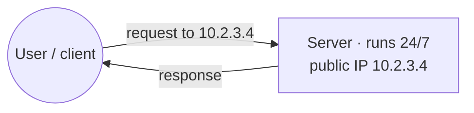

This is the smallest possible system. Every later component is added to fix a problem with it.

> **Note:** The `10.x.x.x` addresses in the video are just example numbers. In reality, `10.0.0.0/8` is a _private_ range that isn't reachable from the public internet.

---

## 2. IP Addresses and DNS

- **An IP address is like a home address** (street, house number, city, PIN code, state, country). The internet is massive, so you need a precise address to find a server.
- **Problem:** IPs are hard to remember, just like your friends' phone numbers. `amazon.com` is far easier than `10.2.3.4`. Can we give the IP a human-friendly name?
- **Solution: DNS (Domain Name System).** It's a **global directory** of key-value pairs, like a telephone directory:
  - `amazon.com → 10.2.3.4`
  - `google.com → <its IP>`
- **DNS resolution:**
  1. You type `amazon.com`.
  2. Your browser's first request goes to DNS: "what is amazon.com's IP?"
  3. DNS returns the IP.
  4. Only then does the browser send the real request to that server and get a response.
- When you buy a domain and point it at an IP, you pay a fee. DNS works in a decentralised way. Its purpose is to be a public directory of which domain maps to which IP.

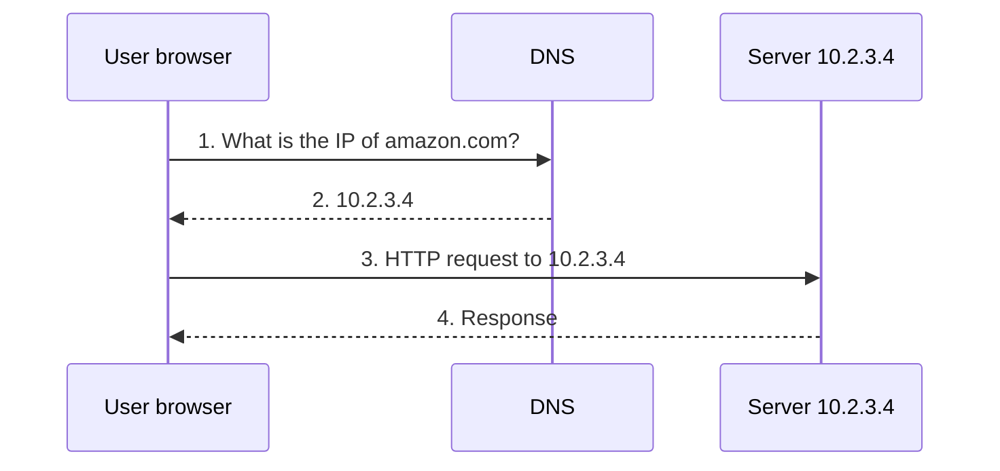

---

## 3. Why Servers Crash Under Load

- A server is ultimately a physical machine with limited **CPU and RAM**, say **2 CPU / 4 GB RAM**.
- As your users grow, the request load grows too. Eventually 2 CPU / 4 GB becomes a **bottleneck**.
- The server gets **overwhelmed**. If it runs **out of memory** (all 4 GB used), it crashes and stops serving.
- That's what "the website crashed" or "the server is down" means during a traffic rush: demand exceeded what the machine's physical resources could handle.
- **Example:** On exam-result day, every student hits NCERT or the board's website at once, and it goes down.
- A server going down is bad, so the system needs to be **fault tolerant**.

---

## 4. Vertical Scaling (Scaling Up)

**First idea:** A rush is coming, so make this one machine bigger.

- **Upgrade it:** Go from 2 CPU / 4 GB to **64 CPU / 128 GB RAM**. Now it's a powerful machine that handles a lot more traffic. There's still a ceiling, though. If the whole world arrived, it would eventually crash.
- **Extreme version:** Money is no object, so you make "a very dumb decision": **6,000 CPUs and 128,000 GB of RAM**. It's an ultra supercomputer, and any amount of traffic is fine.
- **But traffic isn't at peak all the time.** Amazon's traffic rises around festival seasons and falls during a recession. If you size the machine for the peak, then 90% of the time you're using maybe 10% of it. You're **wasting resources and money** on over-optimisation.

**Definition:** Vertical scaling ("scaling up") increases the capacity of a single server by adding resources such as CPU, RAM or disk to the existing server or VM.

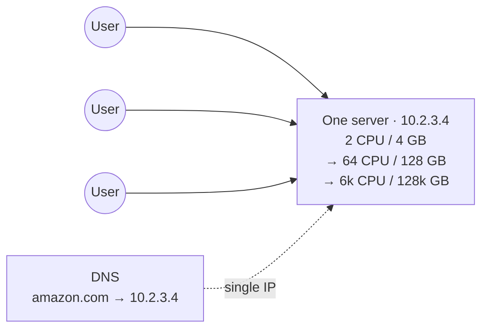

Every user resolves `amazon.com` to the same IP, and all requests land on the same box, which just keeps getting bigger.

### Pay-as-you-go scaling in the cloud: the restaurant analogy

Cloud providers like AWS say you don't need maximum resources all the time. You declare your normal need (e.g. 2 CPU / 4 GB), and resources are increased when traffic rises. You pay more only for the hours when usage was high, and less when traffic is low.

**Restaurant analogy:**

- You normally employ **2 cooks** and pay 2 salaries. This is your fixed baseline, like 2 CPU / 4 GB.
- When a rush comes, you could hire 10 permanent cooks. But then you'd pay 10 full monthly salaries, even though the rush isn't always at peak.
- Instead, you hire extra cooks **by the hour**: "come in during the rush, I'll pay you for those hours, then you leave." Extra resources are added only when the rush comes.

> **Note:** On AWS, this pay-per-hour elasticity is usually done by adding and removing instances (horizontal auto-scaling). Resizing a single instance's CPU and RAM normally requires a stop and start, which is exactly the downtime problem below.

### The big downside: downtime

- **You can't add CPU or RAM to a running machine.** It has to be restarted, which means **downtime**.
- **Spike scenario:** There was nobody five minutes ago, and suddenly a crowd arrives. To scale up, the server has to shut down, get new resources and restart, right when users need it most.
- **Sale example:** A big sale opens at 12 midnight.
  - Until 11 there's no rush. At 12:00 the peak hits all at once.
  - If the server is down for scaling at that moment, even **1 minute** of downtime is unacceptable for Amazon.
- You need **zero downtime**, and vertical scaling can't give you that.

**Vertical scaling, summed up:**

- **Pros:** It's simple. There's still one server and one IP, so no load balancer is needed.
- **Cons:**
  - It has a hard ceiling on how big a machine can get.
  - It's wasteful if sized for peak traffic.
  - It needs a restart, which means downtime.

---

## 5. Horizontal Scaling (Scaling Out)

**The alternative:** Don't make the machine bigger. When load increases, **start another machine in parallel**.

- The new machine takes time to boot (say 1 minute), but the existing machine keeps serving traffic in the meantime.
- If load grows again, start a third. While it boots, the other two handle traffic.
- The site might get a little slow at times, but there's **zero downtime**.

**Definition:** Horizontal scaling adds more servers (replicas of the same server) instead of increasing one server's resources.

**The new problem is distributing traffic.**

- Each machine has its own IP: `10.2.3.4`, `10.2.3.5`, `10.2.3.6`.
- DNS returns one IP for `amazon.com`, so every user worldwide still hits the first machine. The new ones sit idle.
- How do you send some users to one server and other users to another?

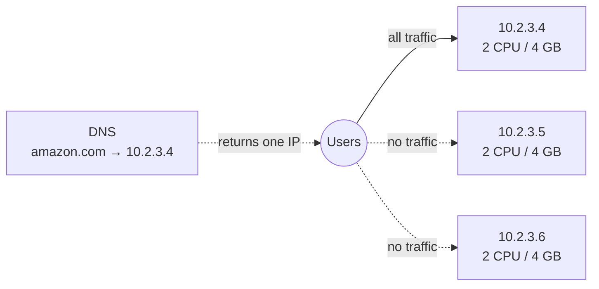

**Horizontal scaling, summed up:**

- **Pros:**
  - Zero downtime.
  - You add capacity in small steps.
  - You pay only for what's running.
- **Cons:** You now need something to spread the traffic. That's the next component.

---

## 6. Load Balancer

**Rule: whenever you scale horizontally, put a load balancer in front.**

- A load balancer is one more server placed in between, with its own IP (e.g. `10.2.3.7`).
- You register the **load balancer's IP in DNS**, so anyone opening `amazon.com` anywhere reaches the load balancer.
- Its job is to **balance the incoming load across the servers**: it decides which request goes to which server.

**Algorithms:** There are several. The simplest is **round robin**: request 1 → server 1, request 2 → server 2, request 3 → server 3, request 4 → server 1 again, and so on. Load is spread equally.

**Scaling out and in:**

- When traffic rises, start another server and tell the load balancer "I have one more." It now balances across four.
- When traffic falls (the sale ends), shut down the extra servers. This is **scaling in**. The load balancer now knows there are only two.

**Registration and health checks**, which are "the load balancer's intelligence":

1. A new server boots, which takes a little while.
2. It's registered with the load balancer.
3. The load balancer checks whether it's **healthy**, e.g. up and running for at least a minute and ready to take traffic.
4. Only then does the load balancer start sending it traffic.

**AWS name: ELB (Elastic Load Balancer).** It's just Amazon's name for a load balancer.

**Can the load balancer crash too?** Yes, it's a server too. But a managed ELB internally runs many small machines, threads and workers, so it's well resourced and handles load efficiently.

**Vertical vs horizontal:** Vertical scaling doesn't need a load balancer, because there's still one server with one IP. Horizontal scaling always does.

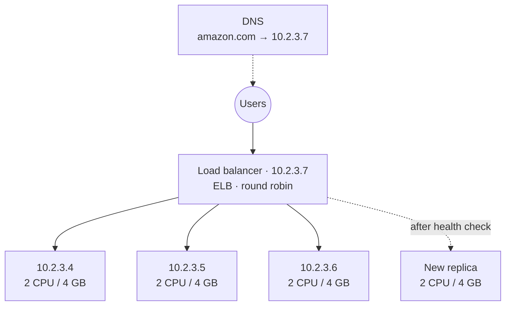

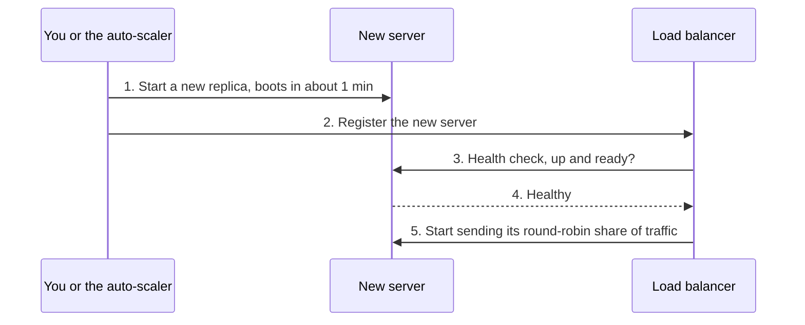

**Request flow:**

1. The user resolves `amazon.com` to the load balancer's IP.
2. The request hits the load balancer.
3. The load balancer picks the next healthy server (round robin).
4. The server's response goes back to the user.

**Trade-offs:**

- You get one stable IP, an even spread of load, easy scaling out and in, and no traffic to servers that aren't ready.
- The cost is a new component that could itself fail. A managed ELB handles that with internal redundancy.

> **Note:** Real health checks usually call an HTTP endpoint (e.g. `/health`) at a fixed interval, with healthy and unhealthy thresholds. "Up for a minute" is a simplification.

---

## 7. Microservices and Path-Based Routing

In a **microservice architecture**, the application is split into separate services. Each service has its own servers and **scales horizontally on its own**, based on its own load.

| Service      | Responsibility      | Servers (example) | Why that many                                                      |
| ------------ | ------------------- | ----------------- | ------------------------------------------------------------------ |
| Auth Service | Authenticates users | 4                 |                                                                    |
| API          | General API         | 6                 | Most heavily used                                                  |
| Orders       | Order management    | 3                 |                                                                    |
| Payments     | Handles payments    | 2                 | Many people browse, but comparatively few are buying at any moment |

**Goal: route each request by its path.**

- `amazon.com/auth` → auth servers
- `amazon.com/orders/...` (anything after it) → order servers
- `amazon.com/payments/...` (e.g. "get payment by ID") → payment servers
- plain `amazon.com` → API service

**Step 1: a router.** You need a server that routes based on the host or the route. Its rules look like: if `/auth`, go to the Auth service; if `/orders`, go to the Order service; and so on.

**Step 2: a load balancer per service.**

- The router can say "go to the auth service," but **which auth server?** It's the same problem again.
- So each service gets **its own load balancer**.
- The router's rules now point at load balancers ("/auth → Auth LB", "/orders → Orders LB").
- Each load balancer picks one replica inside its service.

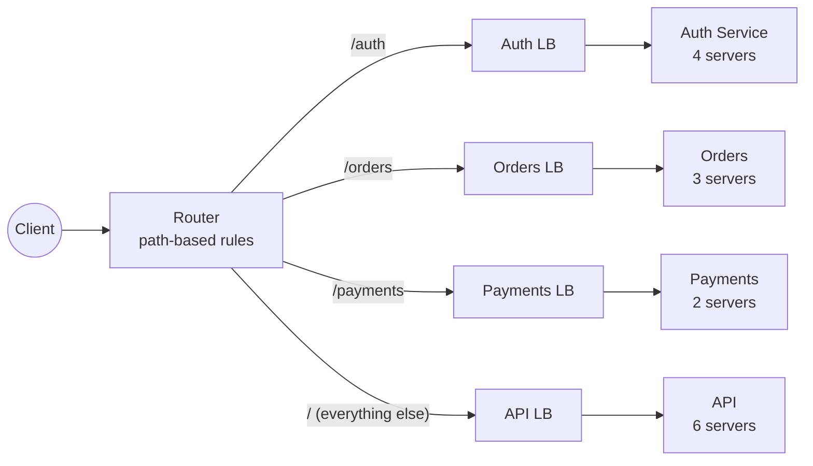

**Request flow:**

1. The client calls `amazon.com/auth`.
2. The router matches `/auth` and forwards the request to the Auth load balancer.
3. The Auth load balancer picks one of the four auth servers.
4. The response returns the same way.

**Why do it this way?**

- Each service scales by its own load: more API servers, fewer payment servers.
- Clients still see only one entry point.

---

## 8. API Gateway

The router in front of the microservices is called an **API gateway**.

- **What it does:** It checks which service a request belongs to and sends it to that service's load balancer. For example, `/auth` goes to the auth service's load balancer, which assigns the request to one server.
- **The servers behind it:** These are usually **EC2 instances**, Amazon's virtual machines (Elastic Compute Cloud).
- **Its IP:** The API gateway has its own public IP (e.g. `10.5.8.2`). **That's the IP you register in DNS** for `amazon.com`.

**How the pieces chain together:** A request to `amazon.com` goes to the **API gateway**. The gateway sends it to the correct **load balancer**, based on the rules you've written. The load balancer spreads it across the **identical replicas**.

**Definition:** An API gateway is a centralised entry point for API calls. It acts as a reverse proxy that routes client requests to backend services and returns their responses.

**Authentication at the gateway:** You can attach an authenticator such as **Auth0**. The user is authenticated first, and only then routed to the right service. All your rules live at the gateway.

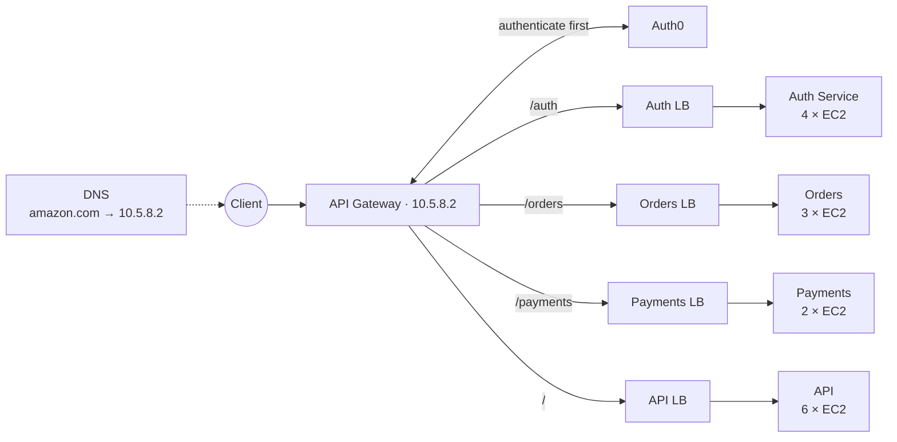

**Request flow:**

1. DNS resolves `amazon.com` to the gateway's IP.
2. The request reaches the gateway.
3. The gateway authenticates the user via Auth0.
4. The gateway matches the path rule (e.g. `/orders`).
5. It forwards the request to that service's load balancer.
6. The load balancer picks a replica.
7. The response travels back through the gateway.

**AWS example shown in the video.** Amazon API Gateway can route different paths to completely different kinds of backend:

- `/service1` → Elastic Load Balancer → ECS cluster / EC2 auto-scaling group
- `/service2` → AWS Lambda functions
- `/docs` → an S3 bucket
- `/service3` → an external server

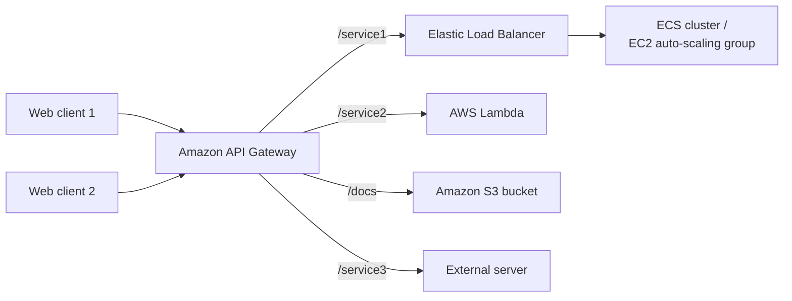

**Why use a gateway?**

- The gateway centralises routing and authentication, and clients only need one IP.
- The load balancers handle spreading load within each service.

> **Note:** Gateways usually also handle TLS termination, throttling and token validation. Auth0 is a third-party identity provider (now part of Okta).

---

## 9. Background Workers and the Problem with Synchronous Calls

Every big system has batch or background work. For example:

- An Amazon vendor uploads a **bulk Excel/CSV file** of products that has to be inserted.
- You need to **email 1 million users** that a sale is live.

You can't run a million-iteration loop on one server. So systems have **background services called workers**:

- **Email Worker:** reads users from the database and emails them. Sending to 1 million users takes time.
- **Bulk Worker:** processes bulk uploads and inserts the data.

**The synchronous way, using payment → email as the example:**

- A user pays, and you want to email them.
- The payment service calls the email worker directly ("a user paid, please email them"), e.g. with an HTTP POST containing the order ID, the email ID and what to send.
- The email worker calls an external API such as **Gmail**, waits for the result, and replies to the payment service.

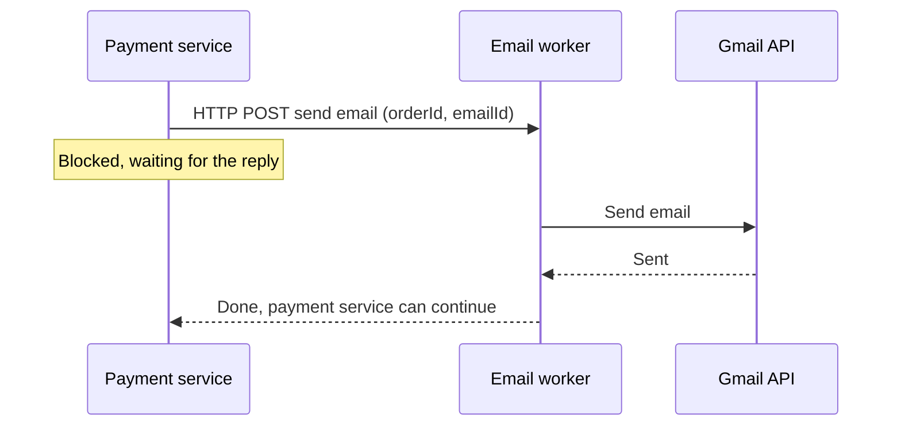

**Why that's a problem:**

- The **payment service is blocked** until the email is sent.
- If a payment happens every second, that isn't scalable. You're always waiting.
- The email worker also depends on Gmail's API, which can be slow, so payment speed gets tied to Gmail's speed.
- What's needed is **asynchronous** communication between the services.

---

## 10. Queues for Asynchronous Communication (SQS)

The most common solution is a **queue**, which works **first in, first out (FIFO)**.

**How it works:**

- **The producer pushes.** Whenever an order is placed, the payment service pushes a message (e.g. the order ID) into the queue and immediately moves on. With many orders per second, it pushes many messages.
- **The consumer pulls.** The email worker pulls one message, sends the email, deletes the message, then pulls the next one, and so on.

**Everyday clue:** This is why an order-confirmation email usually arrives **2–3 seconds** after you order. The email worker is working through the queue.

**Scaling the workers:** As load grows, scale email workers horizontally. This increases **parallelism**: one email at a time becomes two at a time, and more as you add workers.

**Bonus: protecting an external rate limit.**

- Suppose Gmail only lets you send **10 emails per second**.
- You can create a **deliberate bottleneck**: configure the worker never to pick more than 10 messages per second.
- Your system can accept millions of orders. Emails simply drain at a safe pace, and Gmail never complains about you hitting its limit.

**In short:** Queues let two microservices communicate **fully asynchronously**.

**AWS name: SQS (Simple Queue Service)**, a very robust managed queue.

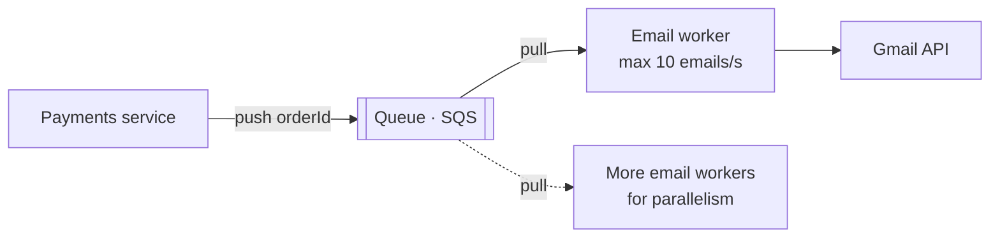

**Flow:**

1. An order is placed. The payments service pushes the order ID into the queue and continues without waiting.
2. An email worker pulls the next message.
3. The worker calls Gmail.
4. On success, the worker deletes the message.
5. The worker repeats. More workers means more parallelism.

**Trade-offs:**

- **Pros:**
  - The producer and consumer are decoupled.
  - Traffic spikes get absorbed by the queue.
  - You can throttle to respect a dependency's limits.
- **Cons:** The email arrives a few seconds later instead of instantly.

> **Note:** SQS **standard** queues don't guarantee strict FIFO order; **FIFO queues** exist for that. When a worker receives a message, it becomes invisible to other workers for a _visibility timeout_. The worker deletes it after processing succeeds, and that's the "discard" step.

---

## 11. How Workers Get Messages: Push vs Pull and Polling

Once you add a queue, a new question appears: how does the worker get each event? There are two mechanisms.

- **Pull:** The worker fetches messages itself by **polling**. Every couple of seconds it asks the queue, "do you have a message?" If there is one, it takes it.
- **Push:** The queue **invokes the worker** directly.

**SQS uses pull, so you have to poll.** You can poll in two ways:

- **Short polling:** Ask every second ("anything? no. anything? no."). Most responses are empty, so you make many API calls and **cost goes up**.
- **Long polling:**
  1. The call waits (blocks) for up to, say, **10 seconds**.
  2. It returns everything that arrived in that window in one go.
  3. You process the batch, then poll again.

  This means fewer calls and lower cost.

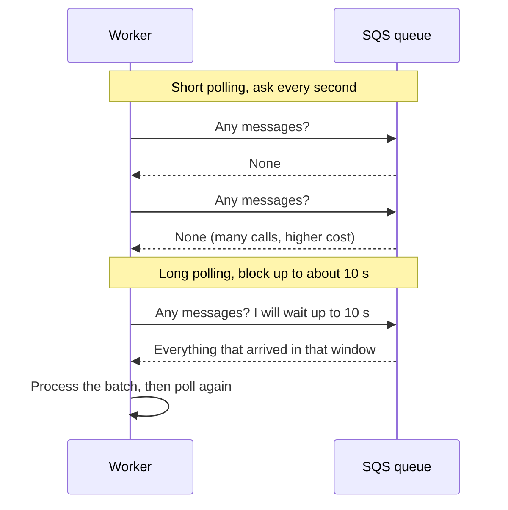

> **Note:** SQS long polling can wait up to 20 seconds per call and return up to 10 messages per receive. Lambda can consume SQS in a way that feels like push, but AWS polls the queue behind the scenes.

### A second worker type: the bulk-upload pipeline

1. A user bulk-uploads a file. The API puts the job into a **CSV queue**.
2. A **Bulk Worker** pulls the job from the queue.
3. It processes the items one by one and inserts them into the database (**MongoDB**).
4. Need it faster? Add another bulk worker for more parallelism.

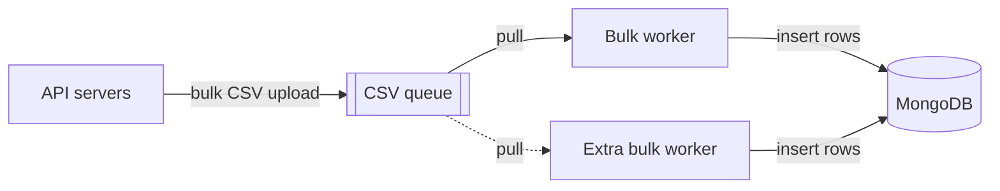

---

## 12. Pub/Sub with SNS and Event-Driven Architecture

**One event often needs several reactions.** After a payment, you may want to:

- send a WhatsApp message
- send an SMS
- email the vendor
- email the user

**The pub/sub model:**

- Instead of using a queue, you **publish a notification (an event)**. On AWS, that's **SNS (Simple Notification Service)**.
- The payment service publishes one event to SNS: "user paid."
- Several services are **subscribed and listening**: the email worker, a WhatsApp service, an SMS service, or any other microservice.
- All of them receive the same event, and each reacts in its own way. One sends an email, another sends a WhatsApp message, and so on.

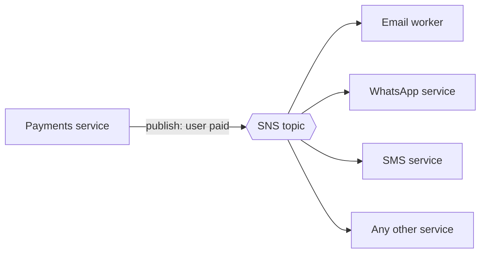

**Queue vs pub/sub:**

|                           | Queue (SQS)                                                                                                                                    | Pub/sub (SNS)                                                |
| ------------------------- | ---------------------------------------------------------------------------------------------------------------------------------------------- | ------------------------------------------------------------ |
| Delivery                  | **One-to-one.** Each message is picked up by only one consumer. If one worker gets a message, another worker will never get that same message. | **One-to-many.** Every subscriber gets a copy.               |
| Use it when               | A task should be processed once                                                                                                                | Several services must react to the same event                |
| Acknowledgement and retry | Yes: acknowledge, re-enqueue, or send to a DLQ                                                                                                 | No consumer-side acknowledgement; you build retries yourself |

**Event-driven architecture:**

- Something happened (the user paid). You emit that event, like making an announcement.
- Whoever is listening reacts in its own way.
- The same idea goes by several names: notification system, pub/sub, event-driven architecture, or event emitting.

### The catch: acknowledgements, retries and the dead-letter queue

Sending the email after a payment is critical. What happens if it fails?

**With a queue:**

- A worker picks a message, but Gmail is down and the email fails.
- **Option 1:** **Re-enqueue** the message so it's processed later.
- **Option 2:** Push it to a **dead-letter queue (DLQ)**, which marks it as failed, and **retry after 5–10 minutes**.
- Either way there's an **acknowledgement**. The message was either processed, or it's waiting in the DLQ. You get a delivery guarantee.

**With SNS (pure events):**

- You published the event, but maybe nobody was listening.
- Or a listener received it but failed, and the message is gone.
- There's **no built-in retry**. You'd have to build it yourself.

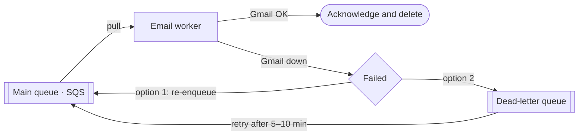

---

## 13. Fan-Out Architecture (SNS + SQS)

**Fan-out** is widely used in microservices: one event happens, and several things need to be done. SNS alone can trigger several things, but it has no acknowledgement. Fan-out fixes that by **combining SNS's one-to-many delivery with SQS's reliability.**

**How to build it:**

1. **Create one queue per job.**
   - **WhatsApp queue:** whatever goes in becomes a WhatsApp message to the user.
   - **Email queue:** whatever goes in becomes an email.
   - **SMS queue:** whatever goes in becomes an SMS.
2. **Give each queue its own consumers** (EC2 instances), sized to that channel's load. For example: 2 for WhatsApp, 1 for email, 2 for SMS.
3. **Subscribe (bind) the queues to the SNS topic.**

Now, when the payment service **publishes one "user paid" event**, it **automatically lands in all three queues**.

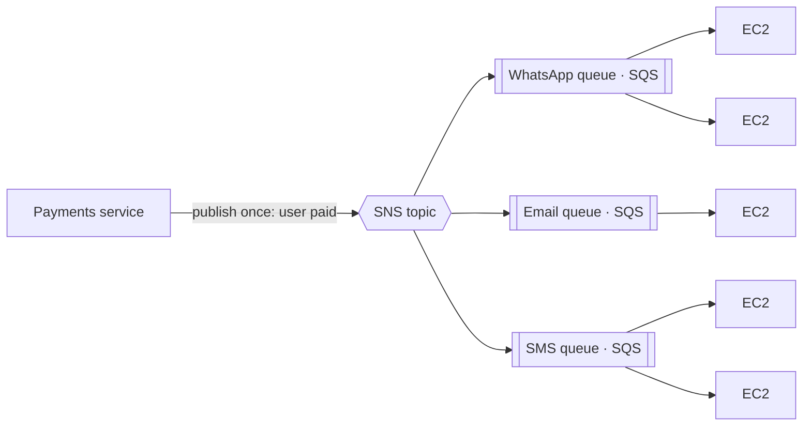

**Why this helps:**

- Suppose WhatsApp and email succeed but **SMS fails**. Only SMS is retried, from its own queue, and the other channels aren't affected.
- **Benefit 1:** Multiple services still get notified that the event happened.
- **Benefit 2:** Because the messages sit in SQS queues, you get **acknowledgements, retries and DLQs**.
- Each channel can scale and fail on its own.

### Real-world examples shown in the video

**Order processing** (Medium, _"Publish/Subscribe Fan-Out Pattern in Serverless Architectures Using SNS, SQS and Lambda"_):

- A client calls an API Gateway (REST), which invokes an "order acknowledgement" Lambda that writes to an order table.
- That Lambda publishes a message to SNS.
- SNS feeds three SQS queues, consumed by notification, inventory and shipment services.

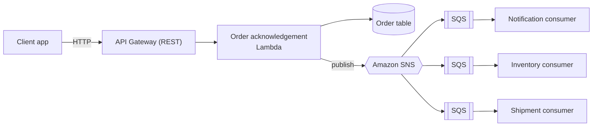

---

## 14. Rate Limiting

- Users hitting your load balancer can overwhelm the system by sending fake requests or launching **DoS/DDoS attacks**.
- **Rate limiting** caps how many requests someone may send in a given time window.
- **Example:** "I'll only accept **5 requests per second**. If you send more, I'll start blocking you." This is where the familiar **"Too Many Requests"** error comes from.
- Rate limiting isn't only per-user blocking. A limiter at the load balancer can also **let every request in but forward them to the servers at a controlled rate**.
- **Common strategies:** **token bucket** and **leaky bucket**. Both make sure nobody can exploit your system.
- At Amazon's scale, lots of people will try to exploit the system, so this is a very important concept.

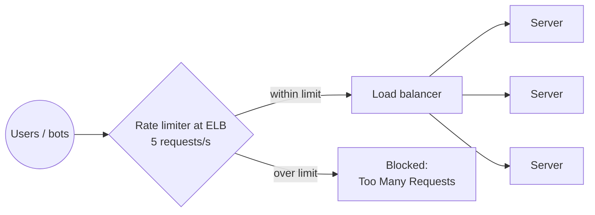

**Token bucket:**

- A bucket holds a fixed number of tokens (e.g. 5) and is refilled at a fixed rate.
- Each request takes one token. If a token is available, the request is allowed. If the bucket is empty, the request is rejected.
- Short bursts are allowed while tokens last.

**Leaky bucket:**

- Incoming requests go into a bucket, which is really a queue.
- They "leak" out to the server at a constant rate.
- If the bucket is full, new requests are dropped.

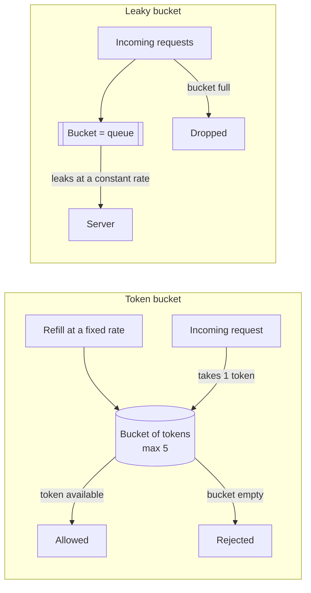

|          | Token bucket                            | Leaky bucket                                            |
| -------- | --------------------------------------- | ------------------------------------------------------- |
| Strength | Finer control; handles temporary bursts | Steady, predictable output; protects against big bursts |
| Weakness | Tokens have to be managed               | Adapts poorly to changing traffic                       |

**Request flow:**

1. A request arrives.
2. The limiter checks the client's budget.
3. If the request is within budget, it's forwarded to the load balancer and servers.
4. If not, it's rejected with "Too Many Requests."

---

## 15. Scaling the Database: Read Replicas and a Redis Cache

**The bottleneck:** Lots of requests mean lots of computation, and every microservice reads from and writes to the database. As the services scale out, a **single database gets overwhelmed**. There are many ways to scale a database; the simplest is **replicas**.

A database handles **writes**, **reads** and, in modern apps, **analytics** queries (e.g. "how much was spent").

### Primary node and read replicas

- **Primary (master) node:**
  - **All writes** (inserts) must go here.
  - **Real-time reads** must also come from here.
- **Read replicas:**
  - These are multiple copies of the database.
  - Their data is often **slightly delayed**, so they serve **delay-tolerant reads** such as analytics services and logs.
- This takes read load off the primary.

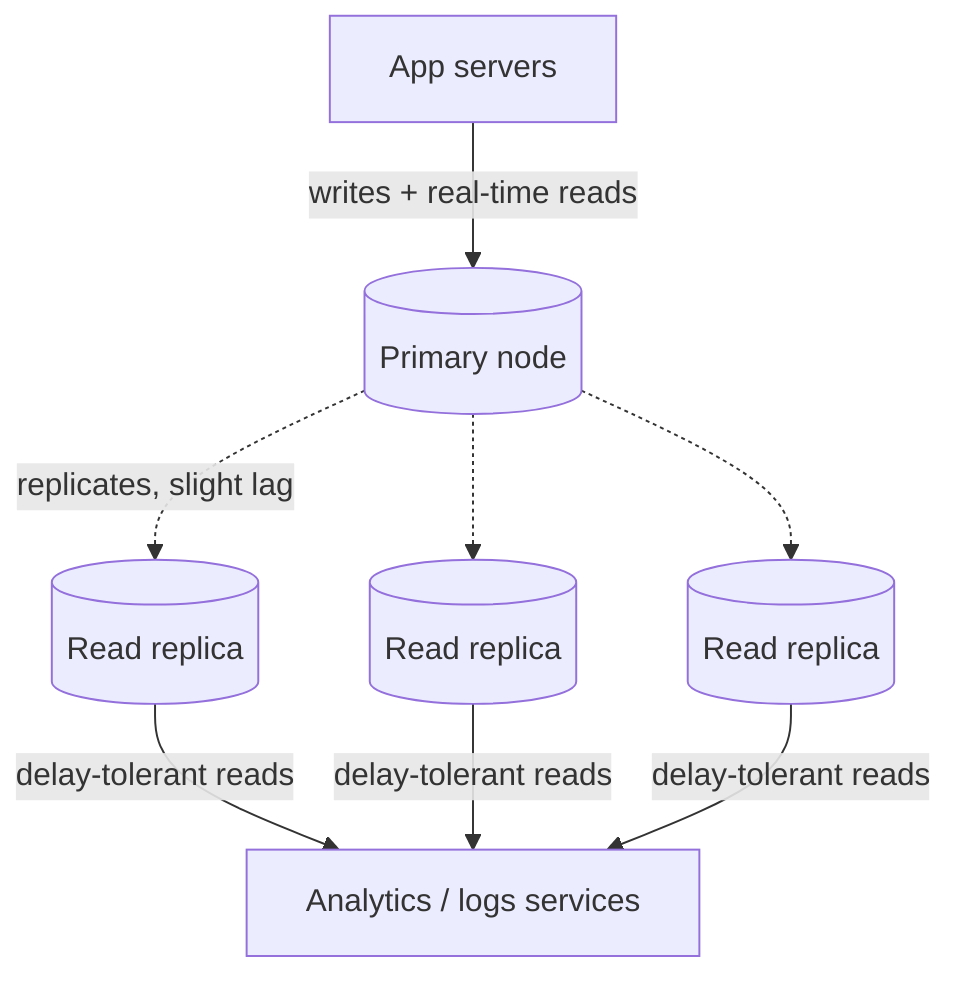

### Caching with Redis: "the biggest thing"

- If something involves a complex computation, there's a good chance you should **cache** the result.
- Usually that means **Redis**, an in-memory database.
- **The pattern:**
  - Check Redis first. **If the result is there**, return it straight from the cache.
  - **If not**, query the database, **store the result in Redis**, then return it.
- **The benefit:** fewer database calls, which makes the system more robust.

```mermaid
sequenceDiagram
    participant S as Service
    participant R as Redis cache
    participant D as Database
    S->>R: 1. Get result for this key
    alt Cache hit
        R-->>S: 2a. Cached value, return immediately
    else Cache miss
        R-->>S: 2b. Not found
        S->>D: 3. Run the query or computation
        D-->>S: 4. Result
        S->>R: 5. Store the result in cache
        Note over S: 6. Return the result to the caller
    end
```

### Where each kind of request goes

| Request                  | Goes to                                                                    |
| ------------------------ | -------------------------------------------------------------------------- |
| Write / insert           | Primary node; changes then replicate to the read replicas with a small lag |
| Read that must be fresh  | Primary node                                                               |
| Analytics or logs read   | A read replica                                                             |
| Expensive repeated query | Redis first, then the database on a miss, then fill the cache              |

**Trade-offs:**

- **Pros:** less load on the primary, and repeated work is avoided.
- **Cons:** Replicas can serve stale data, and so can the cache if it isn't invalidated.

> **Note:** The delay in replicas is called **replication lag**. Beyond replicas and caching, common next steps for scaling a database include sharding/partitioning and connection pooling.

---

## 16. CDN (CloudFront) and Anycast

**Don't expose the load balancer directly.** Put a **CDN (Content Delivery Network)** in front of it.

**Why a CDN:**

- Your users are everywhere: the US, Canada, North India, South India and so on.
- A CDN has **small machines (edge locations) all over the world**. You don't own them; the provider runs them. AWS's CDN is **CloudFront**.
- Creating a CloudFront distribution **takes a while**, because it deploys to edges in every region.
- All the edges route internally to your load balancer, which acts as the **origin**.
- Each user's request goes to their **nearest edge**.

**"But the edges must have different IPs, so how is each request routed?" The answer is Anycast.**

- All the edge machines share **one single IP**.
- The network always routes each user to the **nearest available** machine with that IP. North India users land on the North India edge.

```mermaid
flowchart BT
    NIU(("North India users")) --> NI["CloudFront edge<br/>North India"]
    USU(("US users")) --> USE["CloudFront edge<br/>US"]
    CAU(("Canada users")) --> CAE["CloudFront edge<br/>Canada"]
    NI -->|"cache miss only"| LB["Load balancer (origin)<br/>ELB · rate limited"]
    USE -->|"cache miss only"| LB
    CAE -->|"cache miss only"| LB
    LB --> SRV["App servers"]
```

**Example: downloading a photo**

1. A North India user requests a photo. Anycast routes the request to the North India edge.
2. The edge checks whether that photo is in **its cache**. The first time, it isn't.
3. The edge fetches the photo from the load balancer and server.
4. CloudFront **caches it** and returns it to the user.
5. Later, anyone in North India who wants that photo gets it **from the edge's cache**. The request never reaches your server, because someone in that region already loaded it.

```mermaid
sequenceDiagram
    participant U1 as North India user 1
    participant U2 as North India user 2
    participant E as CloudFront edge North India
    participant LB as Load balancer and server
    U1->>E: 1. GET photo (Anycast routes to nearest edge)
    E->>E: 2. Check edge cache, miss
    E->>LB: 3. Fetch photo from origin
    LB-->>E: 4. Photo
    E->>E: 5. Store in edge cache
    E-->>U1: 6. Photo
    U2->>E: 7. GET same photo later
    E-->>U2: 8. Served from edge cache, server never contacted
```

**Benefits:**

- **Lower latency:** The load balancer might be deployed in America, but an Indian user's request no longer has to travel there.
- **Speed:** Content comes from a nearby edge's cache, so it's very fast.
- **Less server load:** Requests answered from the cache never reach your server.
- **Bandwidth savings:** Less data travels between your origin and users.
- **The load balancer is hidden** behind the CDN.

**Real example:** Amazon product pages have photos and videos. Once someone in your region has opened a product, the edge has cached its media, and everyone else there gets it from the cache. Their experience is better, and your bandwidth is saved.

**Trade-offs:**

- A distribution takes time to set up.
- Caching only helps with content that many people in a region request.

> **Note:** With Anycast, many servers announce the same IP address through BGP, so ordinary internet routing delivers each user to the closest one. CloudFront mostly caches static content (images, video, JS/CSS). Dynamic API calls usually pass through to the origin, though they still travel over AWS's network. A CDN also absorbs a lot of DDoS traffic.

---

## 17. The Complete Architecture

Every component was added to fix a specific problem, and together they make the system scalable and highly available.

The final whiteboard combines two entry paths plus an asynchronous side:

- **Path A (content through the CDN):**
  1. Users reach the nearest CloudFront edge through Anycast.
  2. Cache misses go to the rate-limited ELB.
  3. The ELB sends them to horizontally scaled servers.
  4. The servers use Redis, the primary database and the read replicas.
- **Path B (API calls through the gateway):**
  1. DNS points `amazon.com` at the API gateway.
  2. The gateway authenticates the user with Auth0.
  3. It routes each path (`/auth`, `/orders`, …) to that service's load balancer and EC2 fleet.
- **Asynchronous side:**
  - Slow or bulk work (emails, CSV uploads, WhatsApp/SMS alerts) goes into queues and SNS topics.
  - Worker fleets process it in the background.

> The board is a composite of the teaching stages rather than one strict request path. The CDN feeds the ELB from the scaling section, while DNS points `amazon.com` at the API gateway from the microservices section. The video doesn't spell out how the two entry points relate. In practice, a CDN commonly sits in front of the API gateway as well, so both paths share one front door.

The diagram below is a cleaned-up version of the final board. On the board, the simple email queue, the plain SNS topic and the fan-out were drawn as separate stages. Here they're merged into the fan-out version.

```mermaid
flowchart LR
    subgraph EDGE["CDN edges · Anycast"]
        NIU(("North India users")) --> NIE["CloudFront<br/>North India"]
        USU(("US users")) --> USE["CloudFront<br/>US"]
        CAU(("Canada users")) --> CAE["CloudFront<br/>Canada"]
    end
    NIE & USE & CAE -->|"cache miss"| ELB["ELB · 10.2.3.7<br/>rate limit 5 req/s<br/>token or leaky bucket"]
    subgraph SCALE["Horizontally scaled servers"]
        S1["10.2.3.4<br/>2 CPU / 4 GB"]
        S2["10.2.3.5<br/>2 CPU / 4 GB"]
        S3["10.2.3.6<br/>2 CPU / 4 GB"]
    end
    ELB --> S1 & S2 & S3
    subgraph DATA["Data layer"]
        RED[("Redis cache")]
        PRI[("Primary node")]
        RR[("Read replicas × 3")]
    end
    S1 & S2 & S3 <-->|"cache first"| RED
    S1 & S2 & S3 -->|"writes, fresh reads"| PRI
    PRI -.->|"replication"| RR
    RR -->|"delayed reads"| S1 & S2 & S3

    C(("Client")) -.->|"resolve amazon.com"| DNS["DNS<br/>amazon.com → 10.5.8.2"]
    C --> GW["API Gateway · 10.5.8.2"]
    GW <--> A0["Auth0"]
    GW -->|"/auth"| ALB["Auth LB"] --> AUTH["Auth · 4 EC2"]
    GW -->|"/orders"| OLB["Orders LB"] --> ORD["Orders · 3 EC2"]
    GW -->|"/"| APILB["API LB"] --> API["API · 6 EC2"]
    GW -->|"/payments"| PLB["Payments LB"] --> PAY["Payments · 2 EC2"]

    API -->|"bulk upload"| CQ[["CSV queue"]]
    CQ -->|"pull"| BW["Bulk workers"]
    BW --> MDB[("MongoDB")]

    PAY -->|"publish: user paid"| SNS{{"SNS topic"}}
    SNS --> WQ[["WhatsApp queue"]]
    SNS --> EQ[["Email queue"]]
    SNS --> SQ[["SMS queue"]]
    WQ -->|"pull"| WC["WhatsApp workers × 2"]
    EQ -->|"pull"| EW["Email workers<br/>max 10 emails/s"]
    SQ -->|"pull"| SC["SMS workers × 2"]
    EW <--> GM["Gmail API"]
    EQ -.->|"failed messages"| DLQ[["DLQ"]]
```

**Flow A: page or static content**

1. The user's request goes to the nearest CloudFront edge (Anycast).
2. On a cache hit, the edge serves it directly.
3. On a cache miss, the request goes to the ELB, which checks the rate limit and forwards it to a replica.
4. The replica checks Redis, then the database (primary or a replica).
5. The response is returned and cached at the edge.

**Flow B: API call**

1. DNS resolves `amazon.com` to the API gateway's IP.
2. The gateway authenticates the user via Auth0.
3. The gateway matches the path.
4. It forwards the request to that service's load balancer.
5. The load balancer picks an EC2 replica.
6. The response comes back.

**Flow C: after a payment**

1. The Payments service responds to the user right away.
2. It publishes "user paid" to SNS.
3. SNS fans the event out to the WhatsApp, Email and SMS queues.
4. Workers pull from their queues at a safe rate (e.g. 10 emails per second for Gmail).
5. Failed messages are retried or moved to the DLQ.

---
