# System Design Crash Course – Part 2

**Piyush Garg** · System Design playlist, video 2 of 14. [Watch on YouTube](https://www.youtube.com/watch?v=YuB3OuF3MUE)

## Overview

Part 2 starts from the Part 1 architecture and asks a harder question: how do you survive sudden traffic spikes without crashing or overspending? It first shows that a good design depends on the **traffic pattern**. Three streaming companies make the point: Netflix has spikes it can predict, YouTube has spikes it can't, and Hotstar has live-cricket spikes plus a hidden spike on its movies service whenever viewers press Back.

Next it explains why adding whole servers during a spike is too slow and too much work. That leads to **serverless (AWS Lambda)**, with its pros (cheap, nothing to manage) and many cons (cold start, time limits, DDoS cost, vendor lock-in, statelessness, database-connection storms).

The last part follows how deployment evolved: servers that need dependencies installed → "it works on my machine" → virtual machines → containers ("lightweight VMs") → container orchestration → Google Borg → **Kubernetes**, which Google donated to the CNCF. In the final picture, containerised apps run on a cluster of servers, and Kubernetes is the "brain" that scales them, replaces failed ones and rolls out new versions with zero downtime.

Topics covered:

- traffic patterns, burst traffic and autoscaling policies
- pre-warming servers and pre-caching on the CDN
- serverless / AWS Lambda: how it works, cold start, pricing, and its limitations
- dependency problems and "it works on my machine"
- virtualization vs containerization
- container orchestration, rolling updates and blue-green deployments
- Google Borg, Kubernetes and the CNCF

---

## 1. Recap of Part 1

The video opens by panning over the finished Part 1 diagram, with one line on each area:

- A **server** is just a machine running in the cloud.
- **Vertical scaling** adds resources (CPU/RAM) to one machine. **Horizontal scaling** adds more machines.
- **Microservices** sit behind an **API gateway**, with **load balancers** in front of each service.
- **Queues** process work asynchronously, and a **dead-letter queue** holds failed messages.
- **Fan-out architecture** combines SNS (Simple Notification Service) + SQS.
- Queues feed **bulk workers**.
- **CDNs** serve content from edges close to users.

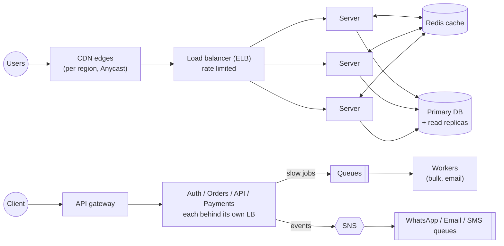

**Why this matters for Part 2:** Every "server" box in this design is a full machine. The rest of the video uses exactly these boxes to show how hard it is to add one more during a spike.

---

## 2. System Design Isn't a Fixed Recipe

- System design isn't one blueprint you copy and implement. Every company has its own **use case, way of working and traffic pattern**, and its design **evolves over time**.
- The end goal has two sides:
  1. Make the system **fully scalable and fault tolerant**, so it doesn't crash when traffic jumps.
  2. Keep it **cost optimised**. Anything can be scaled by throwing resources at it, but then the bill goes up.
- So system design is a **balance**: don't crash, and run at the lowest sensible cost.
- You can't strike that balance without understanding **your own traffic pattern**.

---

## 3. Same Product, Three Different Designs: YouTube, Netflix, Hotstar

YouTube, Netflix and Hotstar (JioHotstar) are all video-streaming platforms, yet their designs aren't interchangeable.

None of this means Netflix's design is bad or that YouTube over-provisions. Each design fits its own **traffic pattern**, as the next sections explain.

---

## 4. Traffic Patterns and Why Autoscaling Struggles with Bursts

### A steady baseline

Say Netflix has about **3 million active users** on a normal day; the graph he draws is simulated, not real data. Keeping enough capacity for 3M users around the world is no problem.

### Burst traffic and scaling policies

The problem is a **burst**: traffic suddenly shoots up almost vertically, and the system starts crashing. Why?

- Horizontal and vertical scaling don't happen "magically". You have to set a **scaling policy**, a rule for **when** to scale. For example:
  - more than 1,000 requests in the last 15 minutes → add a server
  - average CPU ≥ 70% → add another server
  - average memory > 70% → add another server
- So scaling always reacts to some **parameter or policy**. The system can't know on its own when to add a server.

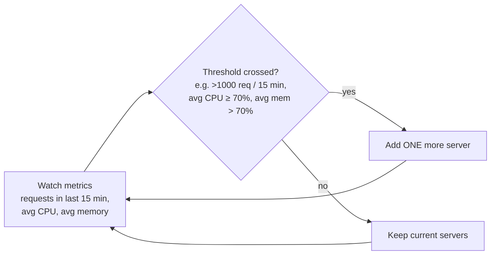

### Gradual growth vs a sudden spike

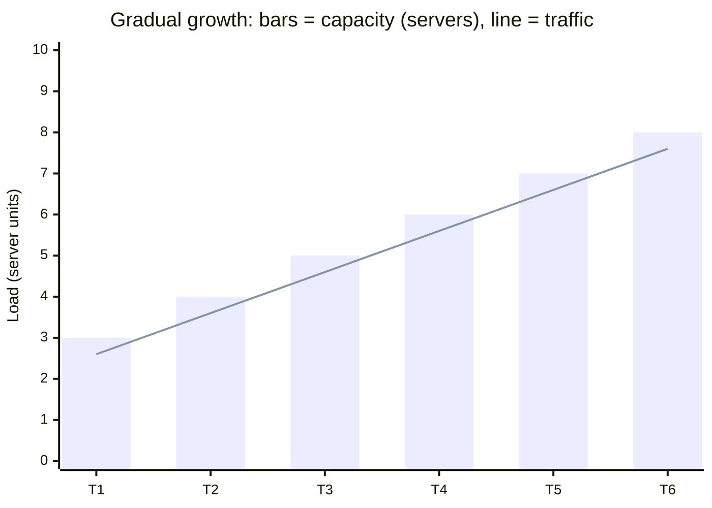

**Gradual growth is easy:**

1. Start with 3 servers.
2. Traffic rises slowly. Average CPU crosses the threshold, and a 4th server is added.
3. The same thing repeats: 5, 6, 7, 8 servers.
4. Because the slope is gentle, each new server arrives in time.

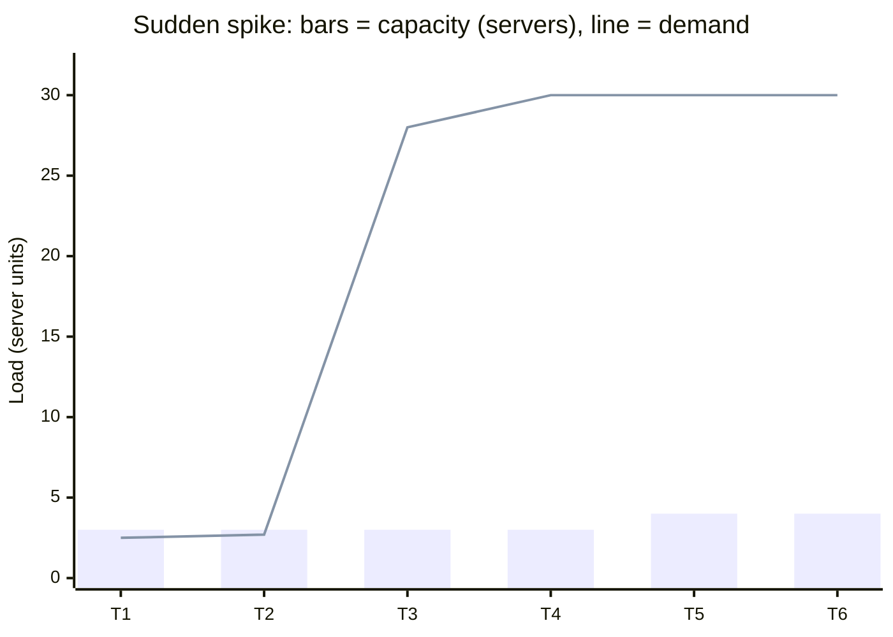

**A sudden spike leads to a crash:**

1. Traffic jumps almost vertically.
2. The policy works on **averages**, which update slowly. By the time it reacts, it has added only **one** server (3 → 4).
3. Real traffic is far beyond that, so the servers crash.
4. The traffic graph shows a sudden **dip**. That dip is the crash, not users leaving.

**Why it's hard:** The real question is **when** to scale, and a reactive, average-based policy is always too late for a burst.

> **Note:** AWS also offers _step scaling_ (add several instances depending on how far a metric is breached) and _scheduled / predictive scaling_. But new machines still take minutes to boot, so a true burst still outruns them. That's the problem the rest of the video tackles.

---

## 5. Netflix: Predictable Spikes → Pre-Warm Servers and Pre-Cache on the CDN

- When would Netflix get a spike? Its historical data (say ten years of it) gives the answer: **when a new movie launches**.
- Releases are never random. The trailer comes out first, and the date is fixed in advance. In the best case everyone shows up on launch day; in the worst case nobody does. Either way, **the spike is predictable**.
- **So Netflix can pre-scale:**
  - Normally 10 servers run. About **24 hours before** the launch, warm up **30 servers**. Their stats say launches always spike, so they're already scaled 3×.
  - If the spike comes, it's absorbed.
  - If it doesn't (people didn't like the movie, or some other event pulled attention away), just **scale back down to 10**.
- **Netflix also controls the content, so it can prepare that too:**
  - A few hours before launch (he says 3–4 hours), cache roughly the **first 10 minutes** of the movie on **every CDN server around the world**.
  - The opening minutes are then served from the edge, and load on the origin servers drops sharply.
- In short, Netflix can easily predict its traffic and get ready ahead of time.

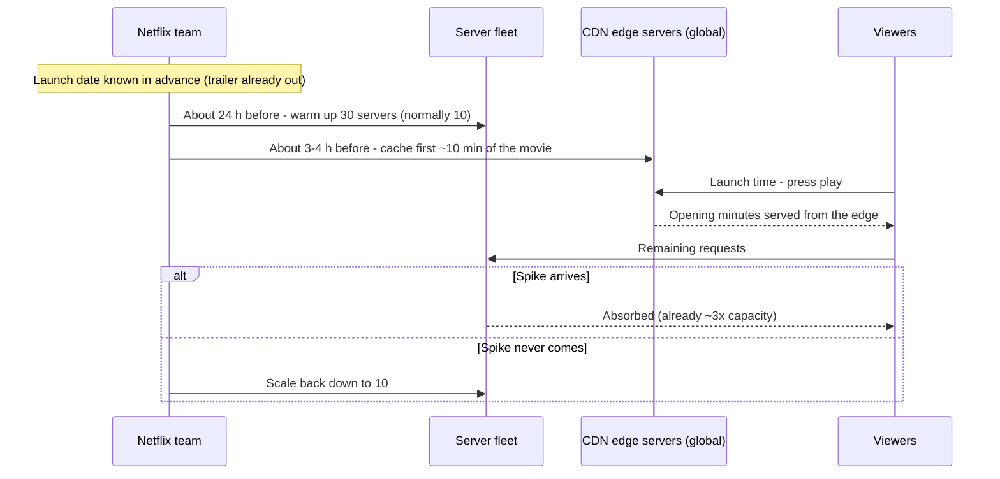

**Trade-off:** You pay for 20 extra servers for a day "just in case". That's cheap compared to crashing at launch.

---

## 6. YouTube: Spikes You Can't Predict

- Netflix's approach fails on YouTube, because **YouTube doesn't control what gets published or when**.
- Suppose average traffic is **10M** (any number works). Then, without warning:
  - A huge creator like **MrBeast** goes live without telling YouTube, and traffic jumps at once.
  - A political or world incident happens. News channels all go live, and _everyone_ opens those streams.

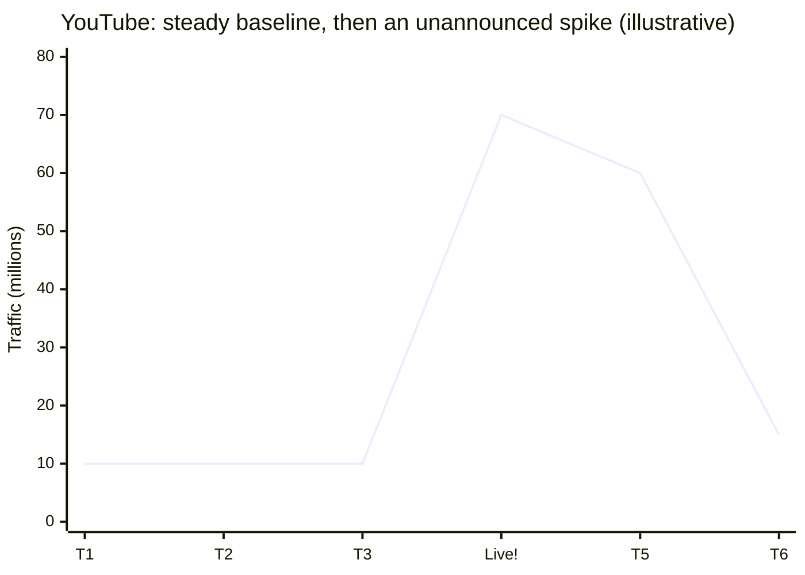

- **Machine learning can predict broad trends, but not sudden spikes:**
  - Feb–March is exam season in India, so students (including college students) watch more content, and traffic is higher.
  - During festivals like **Diwali** people watch less, so traffic dips.
  - You can forecast "next month will be high or low", but not a spike that happens in the next five minutes.
- YouTube's design therefore has to absorb sudden spikes. He says many articles explain how YouTube does this. The one option he gives in this video is to keep servers **pre-warmed** and accept the cost, because predicting traffic here is "very hard".

---

## 7. Hotstar: Live Cricket and the "Back Button" Spike

### Two services

Hotstar looks like Netflix (movies and web series, with predictable traffic), but it also **live-streams cricket**. It has two services:

- **Movies service:** the catalog you see after logging in.
- **Live Streaming service:** the match stream.

With no match on, the live-streaming service barely does any work, so it can be **scaled way down**. Most people are watching movies or series.

### Match-day plan

A match is scheduled for tomorrow, so traffic is predictable again. With India playing an interesting opponent, you can estimate the crowd. So, an hour or two before the match:

- scale **Movies down**, since few people watch movies during a big match, and
- scale **Live Streaming up**, e.g. from **10 to 200** instances.

### How traffic moves during a match

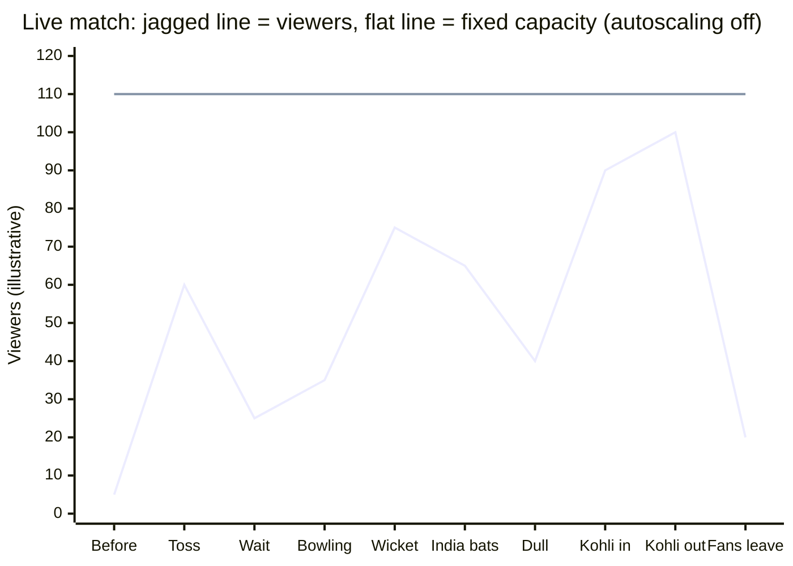

Here's his story, step by step:

1. Traffic is quiet before the match.
2. **Toss:** a spike, since everyone opens the stream. That's fine, because 200 instances are ready.
3. After the toss there's a wait before play starts, so people close the app and traffic falls.
   - **You must not scale down here.**
   - There's also a scary question: did traffic really drop, or did the servers crash?
4. India chooses to bowl. The first bowler isn't exciting, so there's a small bump, then a dip.
5. India's bowler suddenly gets a big opposition batsman out, and traffic **spikes**. WhatsApp is buzzing alongside, with everyone forwarding updates.
6. India comes in to bat, so traffic goes up. A dull passage brings it back down.
7. Someone like **Dhoni or Virat Kohli** walks in: a spike.
8. He's out first ball: an **even bigger** spike.
9. Then fans get annoyed and leave, and traffic crashes down.

### Decision: turn autoscaling OFF during the match

- Traffic is too unpredictable. With autoscaling on, every dip would trigger a scale-down, and the next spike would hit a shrunken fleet.
- Better to accept the cost: for a **4-hour match**, keep ~**200 servers up for about 6 hours**.
- Here, fault tolerance matters more than the bill.

### The hidden problem: the Back button and the Movies service

What could still go wrong? His hint is the **Movies** service.

- On a TV, the first screen is the **home screen** listing available movies, with the live match as one tile. Clicking that tile connects you to the live service.
- Say **24 crore** (240 million) people are watching live and maybe **1 lakh** (100,000) are watching movies. Naturally, you scale for the 24 crore.
- But when the match gets dull or a favourite player gets out, what do people press? **Back.**
- Back takes them to the **home screen**, which calls the **Movies API** to list the catalog.
- So every **dip** in live viewership can become a **spike on the Movies service**. The two are correlated.
- People have two options:
  - press **Home** and close the app (good: no Movies load), or
  - press **Back**, which is what most people do.
- If all 24 crore press Back, up to 24 crore catalog calls hit the Movies servers at least once.

**Request flow:**

1. The viewer opens the app, and the home screen calls Movies.
2. The viewer clicks the live tile and moves to the Live service.
3. A dull moment comes, and the viewer presses Back.
4. The home screen loads again, and the Movies API gets hit.

**Failure case and fix:** If you scale Movies down for the match, the Back-button wave can crash it. So keep the Movies service **up and running** during matches too. He says Hotstar probably didn't expect this at first ("just scale live, movies aren't needed"). They learned that Back leads to Movies, and now keep it up for every match.

> **Note:** 24 crore is an illustrative number. The real concurrency record is lower: Disney+ Hotstar reported about 5.9 crore concurrent viewers for the 2023 World Cup final.

### The lesson

- Netflix's design can't be copied onto Hotstar or YouTube, or the other way round.
- Each company learned its own traffic patterns over time and built the design that fits.
- Real system design works like this: you start somewhere, **monitor**, learn your traffic patterns, crash sometimes, and **optimise** so it doesn't happen again.
- Understanding traffic patterns is the basic skill.

---

## 8. Why Scaling Whole Machines Is So Hard

- Even a simple service like **Amazon** can predict its big moments. A big sale starts on a known date, so Amazon can pre-scale before it opens. (He calls it Big Billion Days, which is actually Flipkart's sale.)
- The hard case is still **YouTube-style sudden spikes**, where forecasting is impossible because anyone can publish anything. There you **can't rely on autoscaling**:
  1. It works on **averages**: "if average CPU > 70%, add one server".
  2. But traffic just went up **10×**. You needed **10 servers right now**, not one.
- **Two deeper problems with real machines:**
  1. **They're slow to add.** In the end it's a machine: it has to boot, install things and start your server.
  2. **They take work to manage.** For every machine, you decide the CPU and RAM, allocate an IP, register it with the load balancer, and so on.
- As a SaaS owner building software, do you want to think about RAM, GB and IP addresses, or about your application code?
- To solve this, AWS launched **Lambda**, and that led to **serverless**.

---

## 9. Serverless with AWS Lambda: How It Works

- He prefers to call the idea **serverless** rather than "Lambda".
- Serverless doesn't mean there's no server. It means **you don't manage the server**.
- No more spinning up a machine, choosing its OS (Ubuntu or Debian), or choosing CPU and RAM. You're an application developer, so you just write code.

**How it works:**

1. You write a code file (e.g. JavaScript) with the logic for handling a request.
2. You hand that file to Lambda. That's all.
3. Lambda gives you a **public URL** (his example: `https://abc.com/abc`), which you can share.
4. You never see the infrastructure underneath: not the CPU, the RAM or the machines.
5. Whenever someone hits the URL, Lambda **loads your code for that request** and handles it.

**How it scales:**

- More traffic → Lambda keeps starting more instances, roughly **one Lambda per request**.
- Less traffic → instances get destroyed.
- They're simple, lightweight functions: a request comes in → the function is invoked → the request is handled → the function is destroyed.
- Ten requests → ten functions; all of them respond, then all of them are gone.

**Why it's "serverless":** You didn't manage CPU, RAM or any autoscaling policy. Which Lambda serves which request, the infrastructure underneath, the auto-scaling — AWS handles all of it.

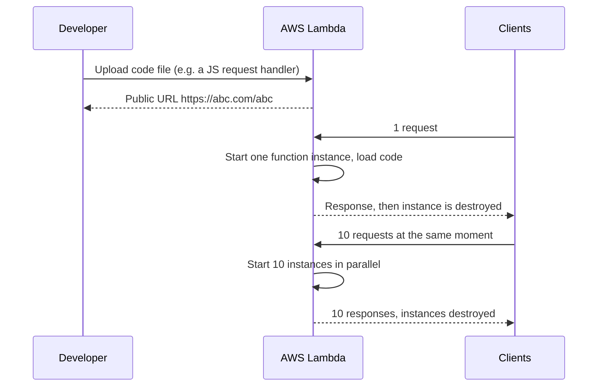

> **Note:** "One Lambda per request" is a simplification. Each Lambda instance handles one request at a time, but it isn't destroyed right away: it stays **warm** for a while and gets reused for later requests. The next section depends on this. A direct HTTPS endpoint is available through **Lambda Function URLs**, or you can put **API Gateway** in front.

---

## 10. The Big Trade-Off: Cold Start

1. Overnight there are **zero** active users, so **zero** Lambdas are running.
2. In the morning the **first request** arrives. A Lambda has to start, and it pulls your code from wherever it's stored.
3. That first user waits, maybe **~2 seconds**. This is the **cold start**.
4. Once one Lambda is running and the code has been pulled, it's **warm**. New instances start quickly, and other users' requests are answered in maybe **~0.5 s**.

- Cold start hits the first request after a long gap with no users.
- If your site always has some traffic (say 20–30 users at any moment), the Lambda never goes fully cold, and you don't need to worry about it.

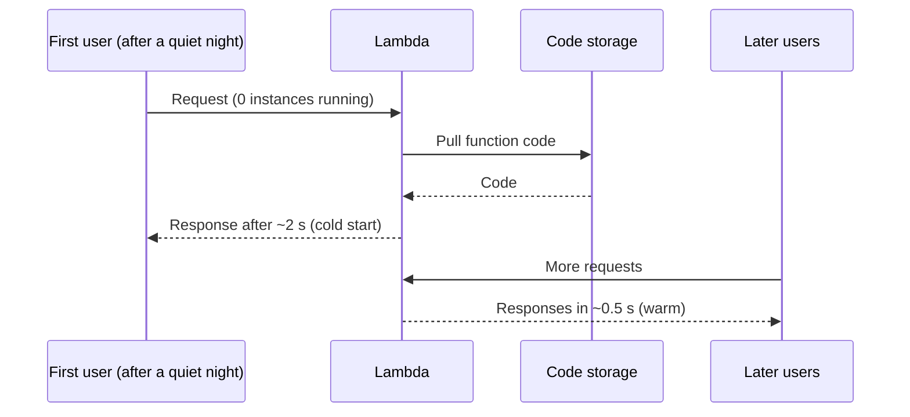

> **Note:** The length of a cold start depends on the runtime and the size of your package. AWS sells **provisioned concurrency** to keep a number of instances always initialised, which removes cold starts for a fee.

---

## 11. Lambda Pros and Pricing

**Pro #1: it's very cheap.** He shows AWS's Lambda pricing page:

| Item                                  | Price                                                                                |
| ------------------------------------- | ------------------------------------------------------------------------------------ |
| Free tier (always free)               | **1 million requests per month** + **3.2 million seconds of compute time per month** |
| Beyond the free tier                  | **$0.20 per 1 million requests** (x86, US East (Ohio))                               |
| Duration (on the page, not discussed) | $0.0000166667 per GB-second for the first 6 billion GB-seconds per month             |

- With the free tier, 1 million people can call your function for free.
- If you're handling 10–20 million requests, you're likely already a profitable company, and Lambda is a tiny part of your bill.

**Other pros:**

- No scalability worries.
- No configuration.
- No autoscaling group to set up.

**Pay per use vs pay per hour:**

- Traditional machines bill **per hour**, even with zero users, because the machine is running.
- With Lambda, no users means no bill. You pay only when users come.

> **Note:** Lambda bills for **compute duration (GB-seconds)** on top of the per-request fee. The free tier is defined as 400,000 GB-seconds per month. The "3.2 million seconds" shown is that allowance at the smallest memory size (128 MB). Prices change, so check the current pricing page.

---

## 12. Lambda Cons

### 1. Cold start

Covered above: the first request after a quiet period is slow.

### 2. Fixed duration

API Gateway sits in front of the function, and he says you **can't take more than 15 seconds** to return a response. So there's a hard ceiling on how long a request can run.

> **Note:** The actual limits are different. AWS caps one Lambda invocation at **15 minutes**, and API Gateway's default integration timeout is about **29 seconds**. There's a hard limit.

### 3. DDoS

Scaling never stops, so a DDoS attack can make **any number of Lambdas** run, and you pay for all of them.

> **Note:** You can limit the damage with _reserved concurrency_ (a cap on how many instances one function may run), throttling at API Gateway, and AWS WAF rules.

### 4. Vendor lock-in

- Once your code is structured around Lambda, you can't easily move from AWS to DigitalOcean or another cloud.
- Pricing is generous today. If AWS raises it, your only option is rewriting your code and changing the whole architecture.

**From his experience, here's how the lock-in builds up:**

1. You use Lambda.
2. "For some reason" SQS starts getting used too.
3. To call Lambda over HTTP you need **API Gateway**.
4. To make domains easy you add **Route 53**.
5. Since you're doing all this anyway, storage goes to **S3**.
6. To watch Lambda logs you start using **CloudWatch**.
7. For long-running tasks you reach for **Step Functions**.

**Why it hurts:** Lambda is cheap, but these other services are expensive. Chasing one cheap thing, you've started ten expensive ones, and now you're tied to the ecosystem. He says from experience that you _will_ get locked in.

### 5. No configuration

This is both a pro (nothing to manage) and a con. If your code needs something at the **OS level**, you can't set it up.

### 6. Always stateless

Instances are destroyed after each request, so you **can't keep state** on the server. If a user sends data and you want to keep it on the server, you can't: it's gone when the request ends.

### 7. Database-connection storms

- Each new Lambda opens its **own connection** to the database (MongoDB in his example).
- With lots of requests you get lots of connections. The database starts struggling, and **connections start dropping**.
- **The fix:** put a **reverse proxy** in between. The Lambdas always connect to it, and it manages the connections to MongoDB.
- **But** that proxy has to run on a **stateful machine**, an **EC2** instance. That brings back cost and the problem of scaling it.
- And it's now a **single point of failure**: a million Lambdas can be running, but if that one proxy fills up, everything fails.

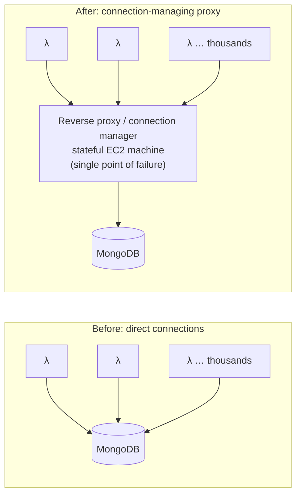

> **Note:** A common way to reduce this is to create the database client **outside the handler**, so warm instances reuse the same connection. Relational databases also have managed poolers such as **RDS Proxy**. He doesn't mention either.

### Serverful vs serverless

- **Serverful architecture:** you manage everything about the server.
- **Serverless:** the cloud manages it for you. You don't own the server, hence the name.

---

## 13. Back to Serverful: Dependencies Slow Down Scaling

**Setup:** one server (`10.2.3.5`, 2 CPU / 4 GB RAM) in an **autoscaling group**, with a load balancer in front.

**Problem:** Adding another **replica** of this machine isn't as easy as it sounds. Take **FFmpeg**, a command-line tool for video transcoding and editing, as an example dependency:

1. You installed FFmpeg on your laptop (Windows or Mac), and your code uses it.
2. When you deploy, the server needs FFmpeg installed too, or your code won't run.
3. So every scale-out means running a setup script on the new machine:
   - `sudo apt-get update`
   - `sudo apt-get install ffmpeg`
   - install its drivers
   - start your code

**Picture it during a spike:** Users are flooding your servers while the new one is still running `apt-get update`. By the time it's ready, the existing two servers have crashed and the users have left.

**Conclusion #1:** Starting a whole new machine is a **heavy process**.

---

## 14. "It Works on My Machine"

The second classic problem:

1. Locally you have FFmpeg version 0.4.2 on Windows/Mac, and the code works.
2. When you deploy, the OS is **Ubuntu**, and the FFmpeg that gets installed is a **different version** (0.4.5). These are example version numbers.
3. Code that worked locally fails on the server, and you're stuck working out what changed.

**In real projects:**

- A real project doesn't have one dependency. A decent-sized codebase uses **30–40 packages/libraries**, and all of them must match on the server.
- Does each one run on Linux? Is its binary even available for Linux?
- You end up tracking packages and versions instead of writing code.

**Conclusion #2:** Machines are **heavy**, and the **environment is hard to reproduce**.

---

## 15. Virtualization

**The idea that came to solve this is virtualization:**

1. Create a **virtual machine (VM)** on your own computer, and put a full OS in it, e.g. **Ubuntu**, even if your computer runs Windows or Mac.
2. Do all your work inside the VM: install FFmpeg, write and run the code, check that everything works.
3. Deploy **that whole VM image** to the server.

**What it fixes:**

- A **physical machine now runs a VM inside it**. When the outer server scales, the same VM keeps running.
- You no longer track dependencies one by one.
- "It works on my machine" becomes **"it works on any machine"**.

**But virtualization is very heavy:**

- The host already has an OS, and inside it you run **another full OS** plus 30–40 libraries.
- 2 CPU / 4 GB won't be enough any more, because one machine is now running two OSes' worth of software.
- Scaling is still slow. An OS image is around **4–5 GB**, and it has to be downloaded and booted.

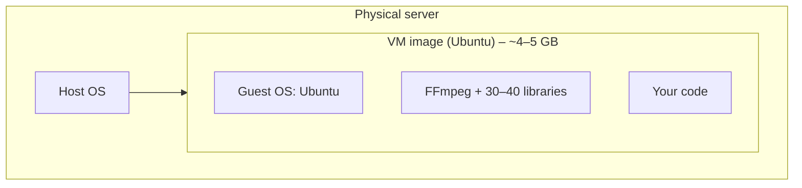

**Net result:**

- One problem is solved: code won't break while scaling, because it runs the same everywhere.
- But scaling is still slow, the cost went up, and the system got more complex.

> **Note:** VMs run on a **hypervisor** (e.g. VMware, KVM, Hyper-V). Each guest OS brings its own full kernel, which is why VMs are so heavy.

---

## 16. Containerization: the "Lightweight VM"

- Google must have hit this problem years ago while it was scaling massively: VMs eat resources and don't scale well. The answer was **containerization**.
- At a very high level, a container is a **lightweight VM**.
- How do you make a VM lightweight? **Remove the OS layer.** The container uses the **host machine's kernel** and keeps only its own dependencies.

**Size comparison:**

|           | Guest OS                  | Packages | Code   | Total        |
| --------- | ------------------------- | -------- | ------ | ------------ |
| VM        | ~4 GB                     | ~200 MB  | ~50 MB | **~4.25 GB** |
| Container | none (shares host kernel) | ~200 MB  | ~50 MB | **~250 MB**  |

Without the OS, the packages and code still work correctly.

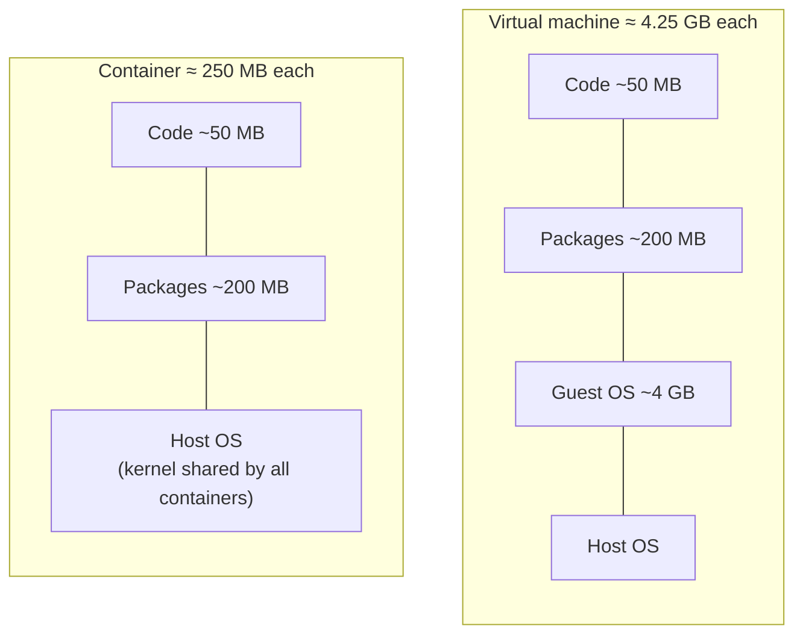

**What that buys you:**

1. Containers are small, so **one machine can run many of them**. When a machine is nearly full, quickly start another and keep going.
2. Around 16 containers can each scale, be destroyed and be recreated on their own, while you **pay the cloud for only 2 machines**.
3. Each container runs its code **in isolation**. If one crashes, just start another.
4. Because you tested the same container locally, "it works on my machine" now means **it works on yours too**.

> **Note:** Containers rely on Linux kernel features (**namespaces** for isolation and **cgroups** for resource limits; Google engineers contributed cgroups). **Docker** (2013) made containers mainstream. So "Google invented containerisation" is a simplification. Containers still include a small base image of OS libraries, just not a kernel. On Mac and Windows, Docker Desktop runs a small Linux VM in the background, because containers need a Linux kernel.

---

## 17. Container Orchestration

**Every solution brings its own overhead.** In computer science, everything that solves a problem brings an overhead of its own. With containers, the overhead is **managing** them all (imagine ~50 of them). Something has to keep track — a **brain**:

- Traffic rising? Create more containers.
- No traffic? Delete containers.
- A container **failed** (turned "red" with an error)? Delete it and start a fresh one in its place.

**Why you can't do it by hand:** You can't SSH into every machine and start or stop containers yourself when each machine runs ~30 of them. Who notices which container is being destroyed or created, or restarts the one that failed? That's a very big problem.

**Container orchestration** is this job: automatically deploying, managing and scaling containerised applications **across a cluster of servers** (his cluster has **3 servers**).

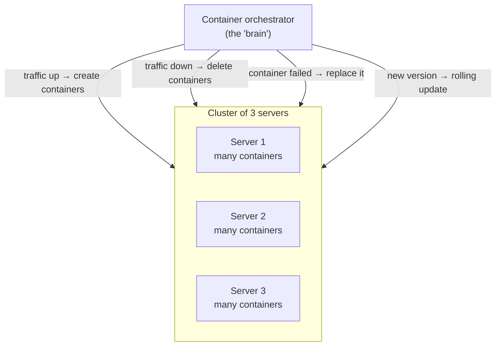

### Deploying new code: rolling updates and blue-green

A developer pushes a new version with a new feature, so every running container now has old code. With a **rolling update**:

1. Start one new container.
2. Once it's up, delete one old container.
3. Start another new one, delete another old one, and so on.
4. Eventually every container runs the new code.

He also names **blue-green deployments**. Both are **deployment strategies**.

| Strategy                         | How it works                                                                                                           | Rollback                                                                          |
| -------------------------------- | ---------------------------------------------------------------------------------------------------------------------- | --------------------------------------------------------------------------------- |
| **Rolling update**               | Replace old containers with new ones a few at a time                                                                   | Roll forward or back gradually; old and new versions run side by side for a while |
| **Blue-green** _(added context)_ | Run a complete second copy ("green") of the new version next to the live one ("blue"), then switch all traffic at once | Instant: switch traffic back to blue                                              |

**The catch:** Someone has to **build** this brain, the container orchestrator. That's real work.

---

## 18. Google Borg and the Birth of Kubernetes

### Google Borg

- Google built such a system in-house: **Borg**, a cluster-management system that Google developed and uses internally to run its huge data centres.
- Borg was Google's **brain**, its internal, large-scale container-management system.

### How Kubernetes was born

1. This problem wasn't unique to Google. **Any** organisation using containers at real scale hits it.
2. Google **did not open-source Borg**.
3. Instead, the team that built Borg was told, roughly: "You now understand the problem and how to solve it, so write a **new project from scratch**." It would use Borg's lessons but not its code. He calls it **"Project X"** as a placeholder.
4. Project X would be the brain: a **container orchestrator for every kind of use case**, including auto-scaling, automatic load balancing, and creating and destroying containers.
5. Google then **open-sourced** it and **donated** it, so Google doesn't own it. It went to the **CNCF (Cloud Native Computing Foundation)**, which supports cloud-native projects such as Kubernetes, Envoy and Prometheus.
6. Project X's real name is **Kubernetes** (**K8s**).

**In one line:** Kubernetes is **built on Borg's lessons**, **made by Google**, **donated to the CNCF**, and **open source**.

---

## 19. What Kubernetes Does

- Kubernetes manages containers **inside a cluster of servers**: it rolls out updates and replaces containers so that you get **zero downtime**.
- He has a separate, dedicated Kubernetes video (linked in the description). It covers the control plane, API server, etcd, scheduler, controller manager, cloud controller manager, worker nodes, kubelet, kube-proxy, and how pods are created and scheduled.

---

## 20. Why Modern Systems Use Containers + Kubernetes

Modern development runs on **containers** because they strike a very good balance:

- **burst scaling** is easy
- **replacing** a container is easy
- **rolling updates** and **blue-green** deployments are easy
- **zero-downtime deployments** become possible

Since **Kubernetes is open source**, you get the orchestrator for free; you don't need to build the brain yourself.

Kubernetes also has:

- its own **reverse proxy / load balancer**
- the option to run on a cloud provider or **self-host** it
- strong support for **ingress controllers** (traffic coming in) and **egress controllers** (traffic going out)

---

## 21. Behind Smooth Streaming: Load and Stress Testing

- When you watch a cricket match with crores of people watching live, a lot of engineering, trial and error, and plenty of crashes went into making it work.
- Big companies like Hotstar **simulate the traffic a day before** an important match. They send fake traffic themselves to check whether the system is fault tolerant enough.
- This is **load testing and stress testing**: running servers at full stress to find their limits.
- Even streaming this YouTube video to you in smooth 4K takes a lot of system design, especially **CDN servers**.

---
