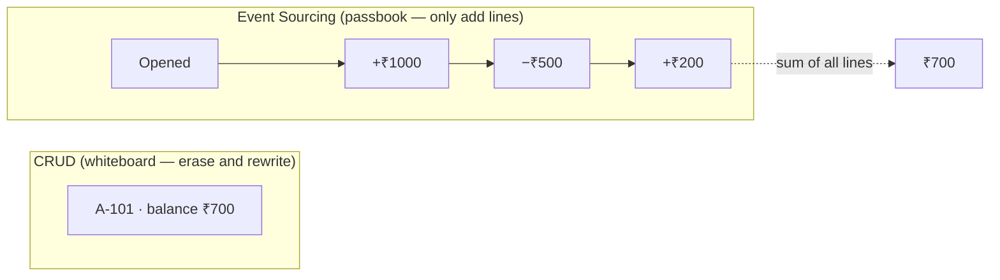
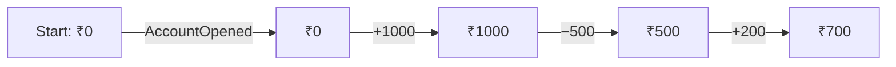
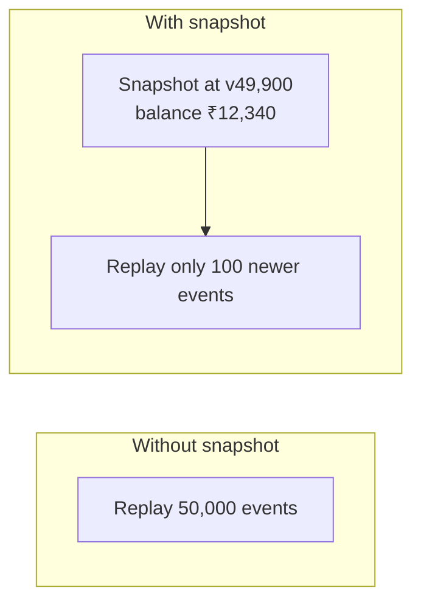
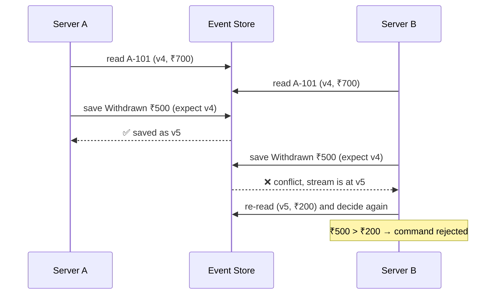
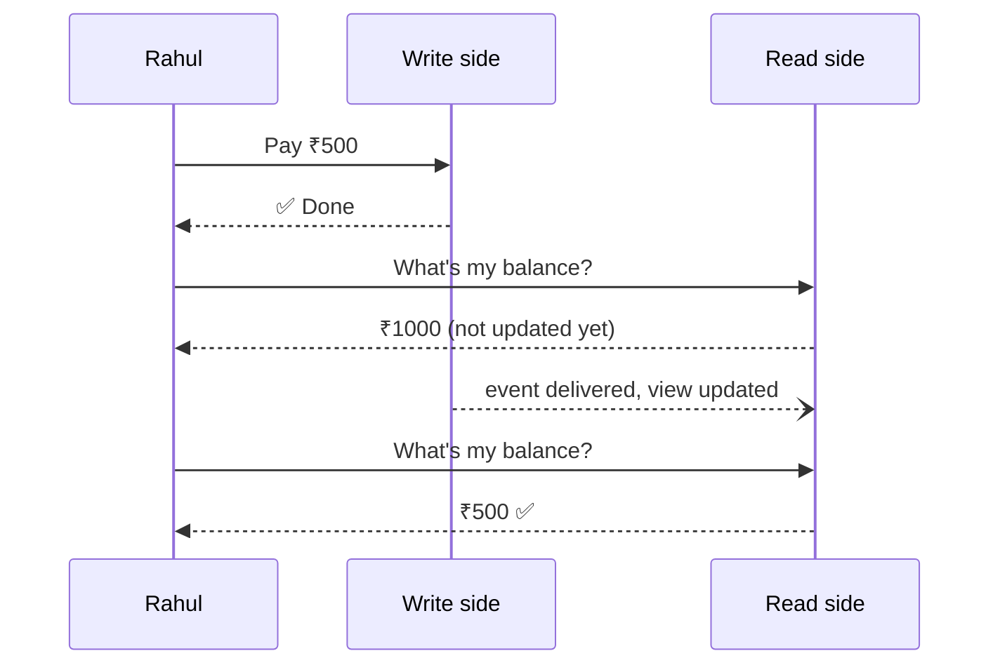
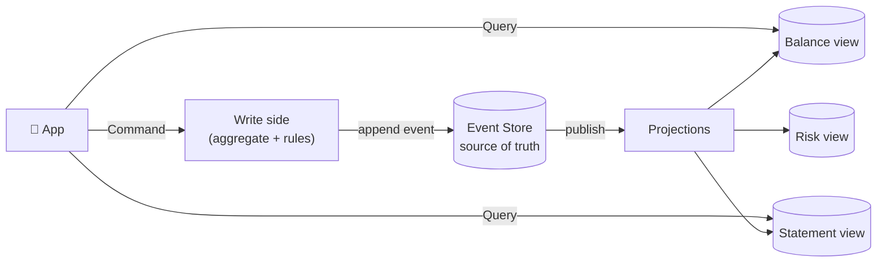

# Event Sourcing and CQRS — Theory Notes

## The Running Example

We'll use **one story** throughout: a digital wallet (like Paytm or PhonePe).

- Rahul opens wallet account `A-101`
- Adds ₹1000
- Pays ₹500 at a shop
- Adds ₹200
- Final balance: **₹700**

## 1. The Story: Why These Patterns Exist

### 1.1 How most systems store data

Most applications follow **CRUD** (Create, Read, Update, Delete). They keep **one row per thing** and **overwrite** it whenever something changes.

```
| account | owner | balance |
| A-101   | Rahul | 700     |
```

Every time Rahul pays or adds money, the `balance` column is overwritten. The previous value disappears.

### 1.2 The hidden cost of overwriting

CRUD answers **"what is the state now?"** very well. But it **throws away the answer** to many other important questions:

| Question                                                           | Can CRUD answer it?                          |
| ------------------------------------------------------------------ | -------------------------------------------- |
| What is Rahul's balance now?                                       | ✅ Yes                                       |
| How did it become ₹700?                                            | ❌ No                                        |
| What was his balance last Tuesday at 3 PM?                         | ❌ No                                        |
| Was ₹200 credited by a user action or by a bug?                    | ❌ No                                        |
| How many people added money and then withdrew it within 5 minutes? | ❌ No (unless you planned for it in advance) |

When Rahul calls support saying _"my balance should be ₹900"_, the system only knows `700`. Nobody can prove what happened.

Teams usually patch this by adding a separate **audit log table**. But that log is a **side copy**. If someone forgets to write to it, or a bug writes something different, the log and the real data disagree, and you no longer know which one to trust.

### 1.3 The second problem: one model doing two jobs

In CRUD, the **same tables and the same model** are used for two very different jobs:

1. **Changing data safely**: validating rules, preventing overspending, keeping things consistent
2. **Showing data quickly**: home screen balance, passbook, admin reports, search, analytics

These jobs want **opposite designs**:

| Writing wants…                                          | Reading wants…                                   |
| ------------------------------------------------------- | ------------------------------------------------ |
| Normalised tables (no duplication, so no inconsistency) | Denormalised data (pre-joined, ready to display) |
| Strong rules and validation                             | No rules, just speed                             |
| Low traffic, high correctness                           | Very high traffic, low latency                   |
| One shape                                               | Many different shapes (one per screen)           |

Forcing one model to do both leads to slow screens full of complex joins, or business rules leaking all over the codebase.

### 1.4 The two ideas that solve this

| Problem                               | Pattern that solves it                                                         |
| ------------------------------------- | ------------------------------------------------------------------------------ |
| History is lost on every update       | **Event Sourcing**: store what _happened_, not just what _is_                  |
| One model is pulled in two directions | **CQRS**: separate the model for changing data from the model for reading data |

They are **two different patterns** that happen to work beautifully together.

## 2. Event Sourcing — The Theory

### 2.1 The core idea

> **Instead of storing the current state, store the full sequence of changes (events). The current state is calculated from those events.**

The best real-world analogy is a **bank passbook**:

- The bank never erases a line in your passbook.
- Every deposit and withdrawal is **a new line at the bottom**.
- Your balance is just **the sum of all lines**.
- If the bank makes a mistake, it doesn't erase the line. It adds a **correction line**.



Other everyday examples of event sourcing you already know:

| Thing                    | Events               | State derived from them          |
| ------------------------ | -------------------- | -------------------------------- |
| Bank passbook            | Transactions         | Balance                          |
| Git                      | Commits              | The files in your working folder |
| Chess game notation      | Moves (e4, e5, Nf3…) | Board position                   |
| Accounting ledger        | Journal entries      | Account balances                 |
| Database write-ahead log | Log records          | Table contents                   |

In all of these, **the history is the truth**, and the "current state" is just a convenient summary of it.

### 2.2 Shift in thinking: state is derived, events are the truth

This is the single most important mental shift:

| CRUD thinking              | Event Sourcing thinking                             |
| -------------------------- | --------------------------------------------------- |
| The **state** is the truth | The **events** are the truth                        |
| History is optional extra  | State is an optional summary                        |
| "Balance is ₹700"          | "These 4 things happened, and that adds up to ₹700" |

Once you accept this, everything else in event sourcing follows naturally. You can always **recompute** state from events, but you can never recompute events from state.

### 2.3 What is an event?

An **event** is a record of **something meaningful that already happened** in the business.

#### Properties of a good event

**1. It is in the past tense.**
`MoneyDeposited`, `OrderShipped`, `SeatBooked`. Not `DepositMoney`. An event describes a fact, not a request.

**2. It is immutable.**
Once written, it never changes. You can't "un-happen" something. If it was wrong, you record another event that corrects it.

**3. It has business meaning.**
A business person should understand the event name.

| ✅ Good (tells a story)    | ❌ Bad (tells nothing) |
| -------------------------- | ---------------------- |
| `MoneyWithdrawn`           | `AccountUpdated`       |
| `AddressCorrected`         | `RowChanged`           |
| `OrderCancelledByCustomer` | `StatusSetTo4`         |

`AccountUpdated` loses the **intent**: _why_ did it change? Was it a payment, a refund, a fee, a correction? Good events capture intent, and intent is exactly what CRUD throws away.

**4. It records the change, not the result.**
Store `MoneyWithdrawn { amount: 500 }`, not `BalanceIs { balance: 500 }`. The change is the fact; the result can always be calculated.

**5. It carries just enough data.**
Who, what, when, and the relevant details. Not the whole world.

```js
{ type: "MoneyWithdrawn", accountId: "A-101", amount: 500, at: "2026-10-26T10:42:00Z" }
```

### 2.4 Event store and streams

The **event store** is simply the place where events are saved. It has **one golden rule**:

> **Append only. Never update. Never delete.**

Events are grouped into **streams**. A stream is the full history of **one thing**: one account, one order, one booking.

```
Stream "A-101"
  v1  AccountOpened
  v2  MoneyDeposited   ₹1000
  v3  MoneyWithdrawn   ₹500
  v4  MoneyDeposited   ₹200

Stream "B-202"
  v1  AccountOpened
  v2  MoneyDeposited   ₹25000
```

Each event has a **version number** inside its stream (1, 2, 3…). That number becomes very important later for handling concurrent requests.

**What can be an event store?** A normal SQL table works fine (one row per event). There are also dedicated databases like EventStoreDB. The technology matters much less than the rule: **only append**.

### 2.5 Replay: getting the current state

To know Rahul's balance, you **start from an empty state and apply every event in order**:



This process is called **replaying** or **rehydrating**. In code, it's just a loop (or `reduce`):

```js
const balance = events.reduce((total, e) => {
  if (e.type === "MoneyDeposited") return total + e.amount;
  if (e.type === "MoneyWithdrawn") return total - e.amount;
  return total;
}, 0);
```

> If you've used **Redux** in React, you already know this pattern: actions are events, the reducer is replay, and the store state is the derived state.

### 2.6 Commands vs events

Students often mix these up, so it's worth being very clear.

|                 | **Command**                   | **Event**                          |
| --------------- | ----------------------------- | ---------------------------------- |
| Meaning         | A **request** to do something | A **fact** that something happened |
| Grammar         | Imperative: `WithdrawMoney`   | Past tense: `MoneyWithdrawn`       |
| Can it fail?    | ✅ Yes, it can be rejected    | ❌ No, it already happened         |
| Who creates it? | User / API / another system   | The system, after checking rules   |
| Stored forever? | Usually not                   | Yes                                |

The flow is always:

```
Command (request)  →  check business rules  →  Event (fact)  →  saved forever
                              ↓
                       or rejected (nothing saved)
```

Rahul asks to withdraw ₹5000 (`WithdrawMoney`). The system checks his balance (₹700) and **rejects** the command. **No event is created**, because nothing happened.

### 2.7 Aggregate: the rule keeper

An **aggregate** is the object responsible for **one stream** and its **business rules**. In our example, the `Account` is the aggregate.

Its job is to answer one question: **"Given everything that has happened so far, is this new request allowed?"**

When a command arrives:

1. Load all past events of that account
2. Replay them to rebuild the current state (balance ₹700)
3. Check the rules (is ₹500 ≤ ₹700?)
4. If allowed, produce a new event (`MoneyWithdrawn ₹500`)
5. If not, reject the command

**Why is it called a "consistency boundary"?** Everything inside one aggregate is kept consistent together. For a single account, the balance can never go negative, because every withdrawal goes through that account's aggregate. Rules that span **multiple** aggregates (for example, transferring between two accounts) need a different approach, usually a **saga** (see section 6).

#### Decide vs Apply: a subtle but important idea

The aggregate has two kinds of logic, and they must stay separate:

|                | **Decide**                      | **Apply**                                       |
| -------------- | ------------------------------- | ----------------------------------------------- |
| Purpose        | Check rules, produce new events | Update state from an event                      |
| Can it reject? | Yes                             | **Never**                                       |
| Runs for       | New commands only               | New events **and** all old events during replay |

**Why must "apply" never reject?** Because it also runs on **old events** during replay. Imagine the bank changes the daily withdrawal limit from ₹10,000 to ₹5,000 today. A ₹7,000 withdrawal that was valid last month is still a **historical fact**. If replay re-checked today's rules, old history would fail to load. **Rules judge new requests; they never re-judge the past.**

### 2.8 Correcting mistakes: compensating events

Since events can't be edited or deleted, how do you fix a mistake?

> **You add a new event that cancels the effect of the wrong one.**

Say ₹200 was credited twice because of a bug. You don't delete the duplicate. You append:

```
v5  DepositReversed  ₹200   reason: "Duplicate credit"
```

**Why is this better than deleting?**

- The history is **honest**: it shows the mistake _and_ the fix.
- Auditors and regulators can see exactly what happened and when.
- Anyone who had already reacted to the wrong event (for example, sent an SMS) can see the correction and react again.

This is exactly how accountants have worked for centuries. You never erase an entry in a ledger; you post a reversing entry.

### 2.9 Snapshots: making replay fast

**The problem:** an active account may collect 50,000 events over a few years. Replaying all of them on every request is slow.

**The solution:** every so often (say every 100 events), save a **snapshot**, which is the computed state at that point together with its version number.

Next time, load the latest snapshot and replay **only the events after it**.



**Analogy:** a bookmark in a long novel. You don't re-read from page 1 every time.

**Important:** a snapshot is only a **cache**. It is not the truth. You can delete every snapshot and the system still works correctly, just slower. The events remain the source of truth.

Another common technique is to **keep streams short** by design. For example, a bank might start a fresh stream each month with an opening balance, or an order stream naturally ends when the order is delivered.

### 2.10 Concurrency: preventing double spending

**The problem:** Rahul has ₹700. He taps "Pay ₹500" on his phone and laptop at the same moment. Two servers handle the requests:

1. Server A loads A-101 (version 4, ₹700). Is ₹500 OK? ✅
2. Server B loads A-101 (version 4, ₹700). Is ₹500 OK? ✅
3. Both save a withdrawal, so the balance becomes **−₹300**. ❌

**The solution: optimistic concurrency.** When saving, each server says _"I made my decision based on version 4, so only save if the stream is still at version 4."_



**Why "optimistic"?** We _assume_ conflicts are rare, so we don't lock anything while working. We only check at the very end, and retry in the rare case of a clash. This is fast and scales well.

In a SQL event store, this is usually just a **unique constraint on (stream id, version)**. Two servers cannot both insert "version 5".

### 2.11 Time travel

Because nothing is ever thrown away, you can rebuild the state **as it was at any moment**: just replay events up to that point.

Uses:

- **Disputes:** "What was Rahul's balance at 10:50 AM yesterday?"
- **Statements:** month-end balance for every account
- **Debugging:** "What did the system believe at 3:12 AM when the bug happened?"
- **Compliance:** regulators asking for historic positions

In CRUD, answering these requires extra tables you had to plan in advance. In event sourcing, they come for free.

### 2.12 Changing events over time (versioning)

Events are kept **forever**, but software changes. Six months from now you might add a `currency` field to `MoneyDeposited`. The old events don't have it, and you can't edit them.

Common approaches:

| Change                         | How to handle it                                                                              |
| ------------------------------ | --------------------------------------------------------------------------------------------- |
| Add a new optional field       | Use a default when it's missing (e.g. currency = INR)                                         |
| Rename or restructure fields   | An **upcaster**: a small function that converts old events into the new shape _while reading_ |
| The meaning changes completely | Create a **new event type** (`MoneyDepositedV2`) and support both                             |

**Key principle:** stored events are never rewritten. You adapt **how you read them**.

### 2.13 Personal data and "right to be forgotten"

Laws like GDPR can require deleting a person's data, but events can't be deleted. Two common answers:

1. **Keep personal data out of events.** Store only an ID; keep the name, phone and so on in a normal, deletable table.
2. **Crypto-shredding.** Encrypt personal data inside events with a per-user key. To "forget" the user, delete the key. The events remain, but that data becomes permanently unreadable.

### 2.14 What you gain and what you pay

**Benefits**

| Benefit                                  | Why it matters                                                            |
| ---------------------------------------- | ------------------------------------------------------------------------- |
| **Complete audit trail**                 | Every change, with who, when and why, is recorded automatically           |
| **Time travel**                          | State at any past moment                                                  |
| **Debugging by replay**                  | Reproduce production bugs exactly with real events                        |
| **New insights from old data**           | Ask new questions about history you already have                          |
| **Captures intent**                      | "Refund" and "correction" are different events, not just a changed number |
| **Natural fit for event-driven systems** | Other services can react to the same events                               |

**Costs**

| Cost                     | Why it hurts                                                             |
| ------------------------ | ------------------------------------------------------------------------ |
| **More complex**         | New way of thinking; harder for new team members                         |
| **Querying is hard**     | "All accounts with balance > ₹10,000" would mean replaying every account |
| **Event design matters** | Bad events live forever                                                  |
| **Schema evolution**     | Old event formats must be supported indefinitely                         |
| **Storage grows**        | Usually cheap, but never shrinks                                         |

The biggest cost, **querying is hard**, is exactly what CQRS fixes.

## 3. CQRS — The Theory

### 3.1 Where the idea comes from

CQRS grew from an older principle called **CQS (Command–Query Separation)** by Bertrand Meyer:

> A method should either **change** something (a command) or **return** something (a query), but **not both**.

```js
account.withdraw(500); // command: changes state, returns nothing meaningful
account.getBalance(); // query: returns data, changes nothing
```

**CQRS** (Command **Query Responsibility Segregation**), named by Greg Young, takes this from the level of a single method to the level of the **whole system architecture**:

> Use **one model to handle changes** (commands) and a **separate model to handle reads** (queries).

### 3.2 The restaurant analogy

| Restaurant                                                                                 | CQRS                                                         |
| ------------------------------------------------------------------------------------------ | ------------------------------------------------------------ |
| The **kitchen** follows strict recipes, hygiene rules and quality checks                   | **Write side**: business rules and validation                |
| The **menu board** and order display are quick to read and already formatted for customers | **Read side**: data pre-shaped for screens                   |
| Customers never walk into the kitchen to check what's available                            | Queries never touch the write model                          |
| You can add a new menu board without changing how the kitchen cooks                        | You can add a new read model without touching business logic |

### 3.3 Why separate reads and writes at all?

Reads and writes are **fundamentally different** in almost every way:

|                  | Writes (commands)                 | Reads (queries)                                          |
| ---------------- | --------------------------------- | -------------------------------------------------------- |
| **How often**    | Rahul pays maybe 5 times a day    | He opens the app 30 times a day                          |
| **What matters** | Correctness, rules, consistency   | Speed                                                    |
| **Shape needed** | One consistent model              | Many shapes: home screen, passbook, admin report, search |
| **Logic**        | Lots of business rules            | Almost none                                              |
| **Scaling**      | Hard to scale (needs consistency) | Easy to scale (copies of data)                           |

When one model serves both, you compromise on both. CQRS stops the compromise.

### 3.4 The write side

The write side (also called the **command side**) is responsible for **changing data correctly**.

- Receives **commands** (`WithdrawMoney`)
- Loads the relevant aggregate
- Checks business rules
- Saves the result (events, if using event sourcing)
- Returns success or rejection, and **usually not much data**

It is designed for **correctness**, not for convenient reading.

### 3.5 The read side

The read side (also called the **query side**) is responsible for **answering questions fast**.

- Receives **queries** (`GetBalance`, `GetStatement`)
- Reads from **read models**: data stored in exactly the shape each screen needs
- Contains **no business rules**
- **Never changes** anything

### 3.6 Read models (views)

A **read model** is a copy of data shaped for **one specific use**. You can have as many as you like.

For the wallet:

| Read model          | Shape                              | Used by             | A good store                 |
| ------------------- | ---------------------------------- | ------------------- | ---------------------------- |
| Balance view        | `A-101 → ₹700`                     | Home screen         | Redis (very fast key lookup) |
| Statement view      | List of lines with running balance | Passbook screen     | Postgres table               |
| High-value accounts | Accounts above ₹10,000             | Risk team dashboard | Postgres / Mongo             |
| Transaction search  | Searchable text                    | Support agents      | Elasticsearch                |

**Duplicate data is fine here.** In normal database design, duplication is avoided. In CQRS read models it's **intentional**: each copy is optimised for its reader, and the write side remains the single source of truth.

### 3.7 Projections: how read models get updated

A **projection** (or **projector**) is the piece that **watches what happens on the write side and updates read models accordingly**.

Think of a news reporter: when something happens (an event), the reporter updates the relevant noticeboards (read models).

```
MoneyWithdrawn ₹500 from A-101
   → Balance projection:   A-101 = 700 − 500
   → Statement projection: add a line "Withdrawal −500, balance 500"
   → Risk projection:      check if the account dropped below the threshold
```

Two properties projections should have:

1. **Idempotent:** processing the same event twice must not double-count. Messages are sometimes delivered twice in real systems.
2. **Resumable:** remember the last event processed (a **checkpoint**), so after a crash the projection continues from where it stopped.

### 3.8 Eventual consistency

In real systems, projections usually run **in the background** (for example, consuming from Kafka). So there's a short gap, usually milliseconds, between **the write being saved** and **the read model being updated**.

During that gap, a query may return **slightly old data**. This is called **eventual consistency**: the read side is not always instantly up to date, but it **will become consistent** shortly.



**Is that acceptable?** For most screens, yes. Humans don't notice a 50 ms delay. But the UI must be designed for it:

| Technique                                     | How it works                                                                           |
| --------------------------------------------- | -------------------------------------------------------------------------------------- |
| **Return the result in the command response** | The payment API returns `newBalance: 500`, and the app shows that immediately          |
| **Optimistic UI**                             | The app updates the screen locally, assuming success                                   |
| **Read-your-own-writes**                      | The query waits until the read model has caught up to the version the command produced |
| **Honest status**                             | Show "Processing…" for things that truly take time                                     |

**Where eventual consistency is NOT acceptable:** business rules. The rule "don't overspend" is checked on the **write side**, against the true event stream, never against a possibly stale read model.

### 3.9 Levels of CQRS

CQRS isn't all-or-nothing. It can be applied at different strengths:

| Level                       | What's separated                                                          | Consistency                 | Complexity |
| --------------------------- | ------------------------------------------------------------------------- | --------------------------- | ---------- |
| **1. Code only**            | Separate classes for commands and queries, same database and tables       | Immediate                   | Low        |
| **2. Separate read tables** | Same database, but read-optimised tables or materialised views            | Immediate or near-immediate | Medium     |
| **3. Separate databases**   | Write DB plus different read DBs (Redis, Elasticsearch…) synced by events | Eventual                    | High       |
| **4. With event sourcing**  | Write side is an event store; all read models are projections             | Eventual                    | Highest    |

Many teams start at level 1 or 2 and move up only when needed.

### 3.10 CQRS is not the same as Event Sourcing

They are **independent**:

| Combination                     | Is it common?          | Example                                            |
| ------------------------------- | ---------------------- | -------------------------------------------------- |
| CQRS **without** Event Sourcing | ✅ Very common         | Save to Postgres, sync to Elasticsearch for search |
| Event Sourcing **without** CQRS | ⚠️ Rare and painful    | Every query must replay events                     |
| **Both together**               | ✅ The natural pairing | Events from the event store feed all read models   |

### 3.11 What CQRS gives and what it costs

**Benefits:** reads and writes scale independently; each side stays simple; the best database can be used for each query; new screens don't touch business logic.

**Costs:** more moving parts; data is duplicated; eventual consistency must be designed for; overkill for simple apps.

## 4. Using Both Together

### 4.1 Why they fit so well

- **Event Sourcing** makes the write side excellent (full history, strong rules) but is **bad at queries**.
- **CQRS** adds a read side that is **excellent at queries**.
- **Events** are the perfect bridge: the write side produces them and the read side consumes them.

Each pattern covers the other's weakness.

### 4.2 The complete picture



### 4.3 Walkthrough: Rahul pays ₹500

**Before:** A-101 has `AccountOpened` and `MoneyDeposited ₹1000`. The balance is ₹1000.

| #   | What happens                                                                 | Side   |
| --- | ---------------------------------------------------------------------------- | ------ |
| 1   | The app sends the command `WithdrawMoney(A-101, ₹500)`                       | Write  |
| 2   | The system loads A-101's events (or a snapshot plus recent events)           | Write  |
| 3   | The aggregate replays them: balance = ₹1000                                  | Write  |
| 4   | Rule check: ₹500 ≤ ₹1000 ✅                                                  | Write  |
| 5   | A new event, `MoneyWithdrawn ₹500`, is appended (expecting version 2)        | Write  |
| 6   | The event is published                                                       | Bridge |
| 7   | Projections update the balance view (₹500) and the statement view (new line) | Read   |
| 8   | Rahul opens the app; the query reads the balance view: ₹500, instantly       | Read   |

Notice:

- Steps 1–5 are about **correctness**.
- Steps 7–8 are about **speed**.
- They never get in each other's way.

### 4.4 The superpower: read models are disposable

Since events are the truth and read models are just **derived copies**:

- **A bug corrupted the statement view?** Fix the projection, delete the view, replay all events. It's rebuilt perfectly.
- **The business wants a new report, "monthly spending by category"?** Write a new projection and replay history. The report is **immediately filled with years of past data**, as if it had always existed.
- **Want to move search from Mongo to Elasticsearch?** Build a new projection into Elasticsearch, replay, and switch over.

This is something a CRUD system **cannot** do, because it has already thrown away the history needed to rebuild anything.

## 5. Use Cases Explained

### 5.1 How to recognise a good fit

Ask these questions about your domain:

| Question                                                              | If "yes", it leans towards ES/CQRS |
| --------------------------------------------------------------------- | ---------------------------------- |
| Does the **history** of changes matter to the business or regulators? | ✅                                 |
| Are there **disputes** where you must prove what happened?            | ✅                                 |
| Do you need state **"as of" a past date**?                            | ✅                                 |
| Are there **many different views** of the same data?                  | ✅                                 |
| Is read traffic **much higher** than write traffic?                   | ✅ (CQRS)                          |
| Are there **real business rules** to protect?                         | ✅                                 |
| Do **other services need to react** to changes?                       | ✅                                 |

### 5.2 Banking, wallets and payments

**Why it fits:** money is the classic case. Regulators require full history. Disputes need proof. A balance has to be explainable line by line, and double-spending must be impossible.

- **Events:** `MoneyDeposited`, `MoneyWithdrawn`, `RefundIssued`, `ChargebackRaised`, `FeeCharged`
- **Read models:** balance (home screen), passbook, monthly statements, fraud signals, regulator reports
- **ES strength used:** audit trail, time travel, compensating events
- **CQRS strength used:** a fast balance screen while payments stay strictly validated

### 5.3 E-commerce orders

**Why it fits:** an order moves through many stages, and many teams care about different parts.

```
OrderPlaced → PaymentCaptured → OrderPacked → OrderShipped → OrderDelivered
                                                          ↘ OrderReturned → RefundIssued
```

| Read model                          | Who needs it           |
| ----------------------------------- | ---------------------- |
| "Where is my order?" status         | Customer app           |
| Full order timeline                 | Customer support       |
| "To pack" list                      | Warehouse staff        |
| Average time from packed to shipped | Operations / analytics |
| Order search                        | Admin panel            |

**One stream of events, five read models**, each perfectly shaped for its users. If analytics later asks "how often do customers cancel within 10 minutes of ordering?", the answer is already in the events.

### 5.4 Ride-hailing (Uber / Ola)

**Why it fits:** a trip is naturally a sequence of events, fare disputes are common, and live screens are read-heavy.

- **Events:** `RideRequested`, `DriverAssigned`, `DriverArrived`, `TripStarted`, `TripEnded`, `FareCharged`
- **Read models:** live trip screen for the rider, driver earnings, surge-pricing data, support timeline
- When a rider disputes a fare, support can see **exactly** when the trip started, ended and how the fare was computed.

### 5.5 Inventory and warehouses

**Why it fits:** stock level is naturally **the sum of all movements in and out**, which is the definition of event sourcing.

- **Events:** `StockReceived`, `StockReserved`, `StockReleased`, `StockShipped`, `StockAdjusted`
- When 20 units "go missing", the event history shows exactly which movement caused it.

### 5.6 Other good fits

| Domain                                        | Why                                                                        |
| --------------------------------------------- | -------------------------------------------------------------------------- |
| **Bookings** (flights, hotels, movie tickets) | Seats held, released, confirmed; huge read traffic on availability         |
| **Insurance claims**                          | Long-running cases with legal audit needs                                  |
| **Healthcare records**                        | Medical history _is_ a sequence of events                                  |
| **Food delivery**                             | Restaurant, rider and customer all update one order; live tracking screens |
| **Version control / collaborative editing**   | Git is literally event sourcing                                            |

### 5.7 When NOT to use them

| Situation                                             | Why it's a bad fit                       |
| ----------------------------------------------------- | ---------------------------------------- |
| Simple CRUD (blog posts, user settings, to-do lists)  | Lots of complexity for almost no benefit |
| Little or no business logic                           | Nothing for aggregates to protect        |
| Nobody cares about history                            | You pay for something nobody uses        |
| Team is new to the patterns and the deadline is tight | The learning curve is real               |
| Every screen must reflect every change instantly      | Eventual consistency becomes painful     |

> **Practical advice:** don't apply these patterns to your **whole** system. Use them for the **core, high-value parts** (payments, orders) and keep plain CRUD for the simple parts (profiles, settings). Different parts of a system can use different approaches.

## 6. Event Sourcing vs event-driven architecture

These sound similar but are different things.

|                                 | **Event-driven architecture**                              | **Event sourcing**                                        |
| ------------------------------- | ---------------------------------------------------------- | --------------------------------------------------------- |
| What it's about                 | **Communication**: services notify each other using events | **Storage**: events are how a service stores its own data |
| Are events the source of truth? | Not necessarily; the service may still use CRUD tables     | Yes, always                                               |
| Are events kept forever?        | Often not (a message queue may delete them)                | Yes                                                       |

A system can be event-driven without using event sourcing (very common), and an event-sourced service can be completely internal.

## 7. One Small Code Example

The entire idea in one short file. Run it with `node wallet.js`.

```js
// ---------- EVENT STORE: append-only list ----------
const eventStore = [];

// ---------- REPLAY: rebuild state from events ----------
function getAccount(accountId) {
  const events = eventStore.filter((e) => e.accountId === accountId);
  let balance = 0;
  for (const e of events) {
    if (e.type === "MoneyDeposited") balance += e.amount;
    if (e.type === "MoneyWithdrawn") balance -= e.amount;
  }
  return { balance };
}

// ---------- WRITE SIDE: commands check rules, then save events ----------
function depositMoney(accountId, amount) {
  if (amount <= 0) throw new Error("Amount must be positive");
  saveEvent({ type: "MoneyDeposited", accountId, amount });
}

function withdrawMoney(accountId, amount) {
  const { balance } = getAccount(accountId);
  if (amount > balance)
    throw new Error(`Insufficient funds (balance ₹${balance})`);
  saveEvent({ type: "MoneyWithdrawn", accountId, amount });
}

function saveEvent(event) {
  eventStore.push(event); // only ever push, never edit or delete
  updateReadModel(event); // projection (async via Kafka in real systems)
}

// ---------- READ SIDE: projection keeps a ready-made view ----------
const balanceView = {}; // accountId -> balance

function updateReadModel(event) {
  const current = balanceView[event.accountId] || 0;
  if (event.type === "MoneyDeposited")
    balanceView[event.accountId] = current + event.amount;
  if (event.type === "MoneyWithdrawn")
    balanceView[event.accountId] = current - event.amount;
}

function getBalance(accountId) {
  // query: just a lookup, no replay, no rules
  return balanceView[accountId] || 0;
}

// ---------- DEMO ----------
depositMoney("A-101", 1000);
withdrawMoney("A-101", 500);
depositMoney("A-101", 200);

console.log("Balance (read side):", getBalance("A-101")); // 700
console.log("History (event store):", eventStore);

try {
  withdrawMoney("A-101", 5000);
} catch (err) {
  console.log("Rejected:", err.message); // no event saved
}
```

**Where each concept lives:**

| Concept                     | In the code                                        |
| --------------------------- | -------------------------------------------------- |
| Event                       | `{ type: "MoneyWithdrawn", accountId, amount }`    |
| Event store (append-only)   | `eventStore.push(...)`, never edited               |
| Replay                      | `getAccount()` loops through events                |
| Command + business rule     | `withdrawMoney()` checks the balance before saving |
| Rejected command → no event | The ₹5000 withdrawal throws; nothing is saved      |
| Projection                  | `updateReadModel()`                                |
| Read model                  | `balanceView`                                      |
| Query                       | `getBalance()`, a simple lookup                    |

## 8. Summary

### The three ideas to remember

> **Event Sourcing:** keep the **passbook**, not just the balance. Events are the truth; state is calculated from them.
>
> **CQRS:** the **kitchen** (write) and the **menu board** (read) are separate. Writes care about correctness; reads care about speed.
>
> **Together:** every new passbook entry automatically updates every menu board.

### The flow in one line

```
Command → Aggregate (replay + rules) → Event → Event Store → Projections → Read Models ← Query
```

---
