# System Design – Event Sourcing

**Piyush Garg** · System Design playlist, video 3 of 14 · 28 Jun 2025 · [Watch on YouTube](https://www.youtube.com/watch?v=JTmgi0vO5Ug)

## Overview

This video explains **event sourcing**. In classic CRUD, you overwrite a database row every time something changes. In event sourcing, you record every change as an **event** in an **append-only log**, and that log becomes the **source of truth**.

The video starts with the traditional design (API Gateway → Nginx → EC2 → Postgres) and its two problems:

- the database becomes a lock-heavy bottleneck
- the stored state drifts out of sync with what really happened.

## 1. What Is an Event?

Event sourcing is partly inspired by **event-driven architecture**, so the starting point is the word _event_.

A large system has many users doing many things on the platform, and **every action is an event**. Amazon examples:

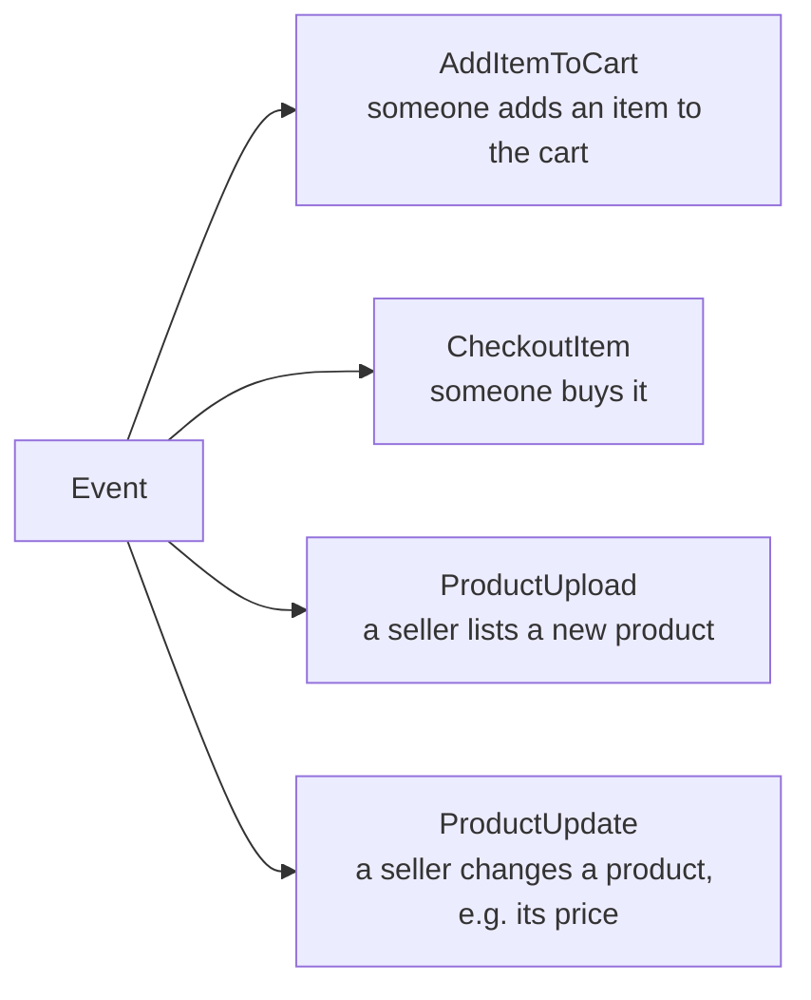

- Every click or action like this is an event, and a big system has many types of events to process.
- The _usual_ way to process an event is to perform a matching action in the database. That's what the next section shows.

## 2. The Traditional (CRUD) Way: Updating a Product's Price

**CRUD** means you create, read, update and delete rows in a database. Most full-stack apps work this way.

**Components:**

- **User:** a seller changing a price, or a buyer reading the product.
- **API Gateway:** the entry point that routes the request to the backend.
- **Nginx:** to be precise, there's a reverse proxy between the gateway and the server. The gateway points at Nginx, and Nginx hands the request to the server. (You can consider Nginx as another API Gateway, but it's not the same as the first one. For small apps, you can skip Nginx and have the gateway point directly at the server. But for large apps, Nginx behaves as API Gateway 2.0, with caching, rate limiting, and other features.)
- **EC2 server:** the application code that handles the request.
- **Postgres:** the primary database, with rows and columns. It's the **source of truth**.

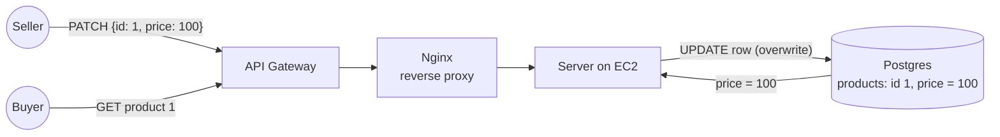

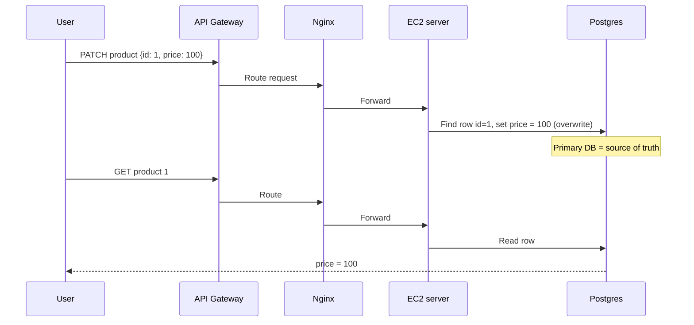

## 3. Problem 1: The Database Becomes a Bottleneck

- At scale, many updates arrive while many reads are happening, and the **database becomes the bottleneck**.
- Updating a row means **acquiring a lock** on it.
- **Race-condition example:**
  1. The old price is 90.
  2. Someone updates it to 100.
  3. A buyer read the row a few milliseconds earlier and saw 90.
  4. That buyer believes the price is 90, even though it was just changed to 100.
- With very frequent updates, rows are locked very often. While a row is locked, others have to wait (his claim), so requests pile up behind the locks.

> **Note:** In Postgres, plain reads aren't blocked by a row's write lock. Thanks to **MVCC** (multi-version concurrency control), a reader simply sees the last committed value, which is exactly the "stale 90" case. The heavy contention is mainly between **concurrent writers** to the same row.

## 4. Problem 2: State Management in a Video-Processing Pipeline

The second, bigger problem is **state management**.

### Example: a YouTube-like video-processing system

The video you upload isn't the video viewers watch. After upload, the servers:

- encode it into different formats (360p, 480p, 720p, 1080p, 4K)
- transcribe it
- optimise it so low-end devices can play it

This takes time. Even with good resources, a one-hour video might take 10–20 minutes. In a pipeline like this, tracking the **state** of each video is crucial.

### The traditional design

**Components:**

- **User + API server:** the user uploads a video, and it lands in S3 as a raw video.
- **S3 (raw video):** storage for unprocessed uploads.
- **Postgres:** one row per video. The state is **just a string column that gets overwritten**.
- **Worker pool:** four EC2 machines that do the actual processing.

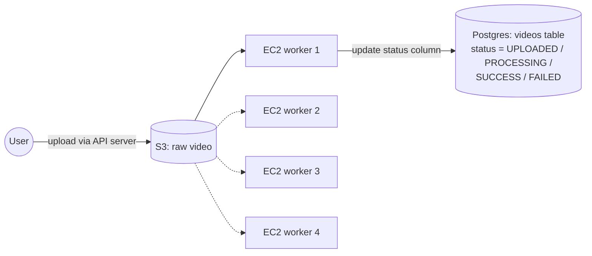

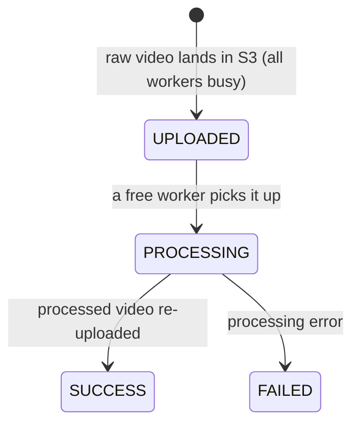

**Flow:**

1. The user uploads, and the raw video goes to S3.
2. A row is inserted for the video. All workers are busy right now, so the status is `UPLOADED`.
3. When a worker becomes free, it picks up the video, and the status changes to `PROCESSING`. This tells the user the video has been picked up.
4. Either it succeeds (the processed video is re-uploaded, and the status becomes `SUCCESS`) or it fails (the status becomes `FAILED`).

In short, whatever the servers do, you save its **state** into the database. So far it looks easy.

### How the state goes out of sync

The pipeline logic as pseudo-code:

```text
user uploads video
  db update status "UPLOADED"                 <-- (A) can fail

when worker picks video
  db update status "PROCESSING"               <-- (B) can fail

when worker is done
  re-upload processed video                   <-- (C)
  db update status "SUCCESS" (else FAILED)    <-- (D) can fail
```

## 5. Event Sourcing: Events Are the Source of Truth

Event sourcing says your **source of truth is the events**. That's where the name comes from.

### Stop overwriting the database

A database update is an atomic operation that **replaces** the old value. This causes two problems:

1. **You lose history.** Say the video was uploaded at 10:00, moved to processing at 10:05, and finished at 10:10. All of that is gone, because you only stored the latest state as a string.
2. **If the replace itself fails, you're out of sync**, as shown above.

### Always append to an event log

Instead, **always add an entry to an event log**, an **append-only log**.

- **Why append-only?** You never want events to get shuffled (_aage peeche ho jaana_). A video can't go to processing before it's uploaded. New events are always added at the end, never inserted in the middle, and old ones are never edited.
- In this architecture, application logic **never updates the database directly**. It only **emits events**.

|                               | Traditional (CRUD)                                 | Event sourcing                                 |
| ----------------------------- | -------------------------------------------------- | ---------------------------------------------- |
| What you store                | Only the **current state** (overwritten each time) | **Every change**, as an event                  |
| How you write                 | `UPDATE` / replace                                 | Append to the end of a log                     |
| History                       | Lost                                               | Kept forever                                   |
| Source of truth               | The current row                                    | The event log                                  |
| If a write is missed or wrong | The state silently goes out of sync                | Replay the events to rebuild the correct state |

## 6. Rebuilding the Video Pipeline with Events

**Components:**

- **Event:** an object with three parts:
  - an `event` name
  - a `data` payload (the video path, an ID, etc.)
  - a `timestamp` saying when it was emitted
- **Worker:** still does the processing, but now it **emits events** instead of updating a status column.
- **S3 (event storage):** where the event logs are kept. Any storage works; he uses S3. The events are stored permanently.

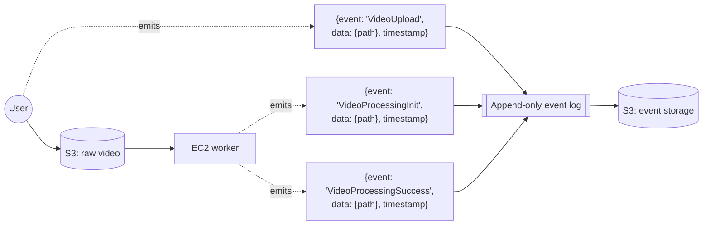

**Flow:**

1. The user uploads a video, and `VideoUpload` is appended, with the path and ID.
2. A worker picks it up and emits `VideoProcessingInit`. The exact event names are up to you.
3. Optionally, while processing, the worker emits progress events (10%, 20%, 30%…).
4. After the re-upload, the worker emits `VideoProcessingSuccess`. On failure, it emits a failure event instead.
5. Every event carries a timestamp and is appended to the log, which is stored in S3.

The event log for one video looks like this:

```text
{ event: "VideoUpload",            data: { videoId: "A", path: "raw/A.mp4" },  timestamp: 10:00 }
{ event: "VideoProcessingInit",    data: { videoId: "A" },                      timestamp: 10:05 }
{ event: "VideoProcessingSuccess", data: { videoId: "A", path: "out/A/" },      timestamp: 10:10 }
```

## 7. Hydration: Rebuilding State from Events

To show the user the current state, you **replay** the events. This is called **hydration**: using the events to reconstruct the state.

**Example: a user asks for the current status of video A.**

1. Read the events for that video, from the start.
2. `VideoUpload` → state is **uploaded**.
3. `VideoProcessingInit` → state is **processing**.
4. `VideoProcessingSuccess` → state is **success**.
5. Return "Success" to the user.

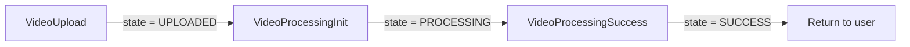

- **Bonus — you can show _how_ it got there:** "You uploaded at 10:00, our worker picked it up at 10:05, and it succeeded at 10:10." The same works for a failure event.
- **Rule:** to show state, you don't rely on a stored string. You replay the events to work out what the current state should be.

## 8. Banking Example: Balance Column vs Event Ledger

### Approach 1: track the state yourself (CRUD)

A `balance` column sits on the users table, and every transaction overwrites it:

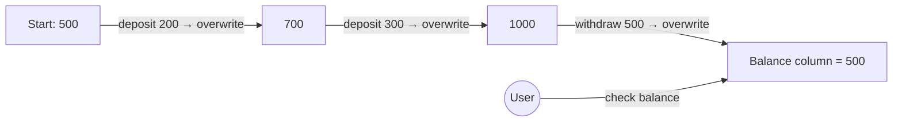

- The user checks their balance by reading this column.
- You're maintaining the state yourself, with atomic overwrites. Only the final number exists; how it got there is lost.

### Approach 2: an event-sourced ledger

Store each transaction as an event instead:

```text
{ event: "Deposit",  amount: 200 }
{ event: "Deposit",  amount: 300 }
{ event: "Withdraw", amount: 500 }
```

When the user fetches their balance, **hydration** runs from the initial balance:

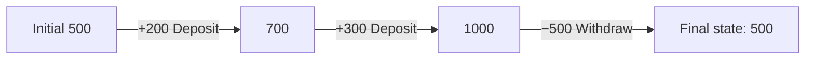

- The result is the same **500**, but now you can also show the user _how_ 500 was reached, by showing the full event log.
- This is how real bank statements and accounting ledgers work: you never edit a past entry; you add a new one (even a correction is a new entry).

## 9. Replay: Audit Trail, Reconciliation, Time Machine

Because every event is kept, **replaying** them gives you three powers:

| Power              | Example                                                                        | How replay helps                                                                                |
| ------------------ | ------------------------------------------------------------------------------ | ----------------------------------------------------------------------------------------------- |
| **Audit trail**    | "Who changed what, and when?"                                                  | Every change is already recorded, with a timestamp                                              |
| **Reconciliation** | A user says, "By my count my balance should be 300 — why are you showing 500?" | Replay all the events and check whether the user is right, or whether the system made a mistake |
| **Time machine**   | "What was my balance one month ago?"                                           | Replay events only **up to that date**. With overwrites, you'd have no record                   |

The **event stream is the source of truth**, and current state is always worked out from it.

## 10. The Cost of Hydration: Keep the Current State in Postgres

**The objection:** In production, an append-only log only ever grows. Re-running hydration over the whole log every time someone reads a value would be very slow.

**The fix:** **cache the result of hydration** in a normal database table.

**Components:**

- **Event stream:** the append-only log files.
- **Hydration process:** runs **continuously and in order** over the events, and keeps writing the latest state.
- **Postgres (state table):** holds the ready-made current state.
- **User:** reads directly from this table, which is fast.

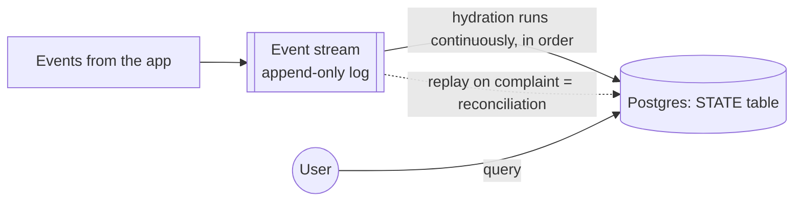

**Flow:**

1. A user action only produces an event. The state is **never updated synchronously** on the user's request.
2. The hydration process reads the events in order and keeps updating the state in Postgres.
3. User queries read the ready-made state from Postgres.
4. If a user complains ("I think the state is wrong — my video is stuck in processing"), you **reconcile**: replay that video's events and rewrite its state.

**Why this beats plain CRUD:** You still have a fast table to read from, but you also know what the state _should_ be, and _how_ it got there — what happened, and at what time.

> **Note:** This cached table is usually called a **projection**, **read model** or **materialized view**. Many systems also save periodic **snapshots** (e.g. "balance was 10,000 at the end of September"), so hydration only replays events after the last snapshot. Neither term is used in the video.

## 11. Scaling the Consumers: Out-of-Order Processing

One hydration server isn't enough at scale, so you start **three Node.js workers** to read the event stream. That creates a new problem.

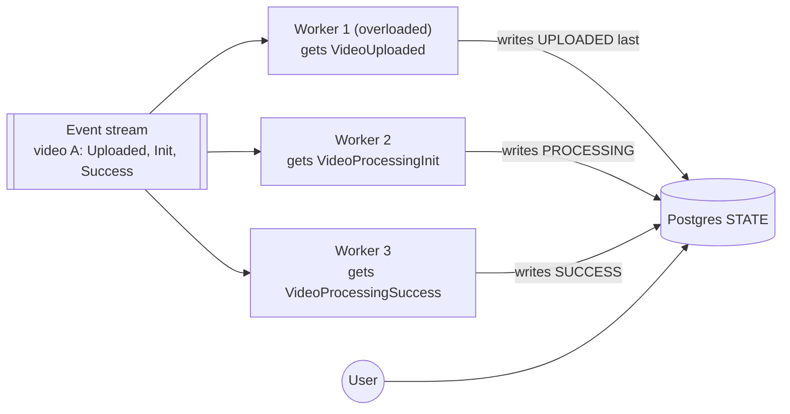

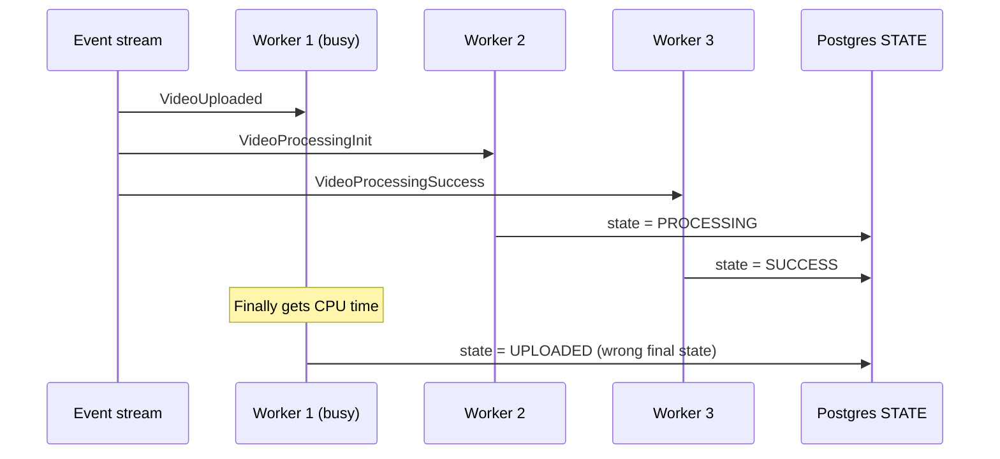

**What goes wrong:**

1. The stream has three events for video A: `VideoUploaded`, `VideoProcessingInit`, `VideoProcessingSuccess`.
2. Worker 1 takes the first event, but it's under heavy load, so it's slow.
3. Worker 2 takes the second event and sets the state to **processing**.
4. Worker 3 takes the third event and sets the state to **success**.
5. Worker 1 finally gets to run and writes **uploaded**. The stored state is now **wrong**.

From the user's view, the video went processing → success → uploaded. The **workers went out of order**.

**It's recoverable:** Because the event stream still exists, a **reconciler** process can replay video A's events in order, and the state goes back to **success**.

**But it's better to stop this from happening in the first place.** That's the next section.

## 12. The Fix: Kafka Consumer Groups and Topic Partitions

This is why the video's title card has the Kafka logo.

**Components:**

- **Kafka topic:** the event stream, split into **partitions**. A partition is an ordered log on its own.
- **Consumer group:** a set of workers (worker 1, 2, 3) that **share** the work. Each partition is read by **exactly one worker** in the group.
- **Partition key:** decides which partition an event goes to. Here, the key is the **video ID**.

**The rule:**

- Choose the partition by **video ID**. All of video A's events always go to the same partition (say partition 0), and all of video B's go to partition 1.
- One partition is always processed by one worker, so **all of video A's events reach the same worker, in order**: Upload → Init → Success.
- If that worker is busy, video A's Success is just **delayed**, but it can never be applied before Upload.
- Different videos can still be processed in parallel by different workers.

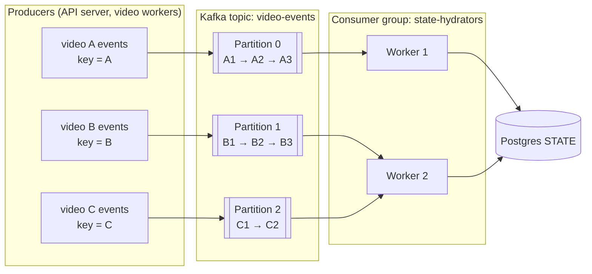

**Another example from the video:** With **5 partitions** and **3 workers**, Kafka might give worker 1 partitions 1 and 4, worker 2 partitions 2 and 5, and worker 3 partition 3. A worker can own several partitions, but a partition never has two workers in the same group.

**Flow:**

1. The producer writes each event with `key = videoId`.
2. Kafka sends every event with the same key to the same partition, in the order they were written.
3. Each partition is owned by one worker in the consumer group.
4. So all events for one video are processed by one worker, in order, and the state is always correct.

> **Note:** Kafka chooses the partition by **hashing the message key**, so you just send `key = videoId`. Ordering is guaranteed only **within** a partition, never across partitions — which is fine, since one video's events never need to be ordered against another video's. If a worker dies, the group **rebalances**, and another worker takes over its partitions, still reading them in order.

He recommends his separate video, _Apache Kafka Crash Course | What is Kafka?_.

**Recap of the concept:** Events stored in an append-only log are the source of truth. The state in the database isn't changed directly; it's computed from the events.

---

## 13. Use Cases of Event Sourcing

- **Banking, payments and wallets:** Think of how UPI apps or Paytm-style wallets might work: every credit, debit, refund and reversal is a new entry. Nobody edits an old transaction; a mistake is fixed by adding a correcting entry. This gives a complete audit trail for regulators, makes disputes easy to settle (“show me every transaction since 1st March”), and lets you answer “what was the balance on 31st March?” for tax or audit purposes.
- **Stock trading and exchanges:** Every order (placed, modified, cancelled, filled) is an event. If the system crashes, it can replay the day’s events to rebuild the exact state of every order. A well-known example is the LMAX exchange in London; Martin Fowler wrote about its event-sourced design.
- **E-commerce orders and delivery tracking:** An order goes through cart → paid → packed → shipped → out for delivery → delivered → returned. Each step is an event, often from a different team or service (payments, warehouse, courier). The tracking timeline you see on Amazon or Swiggy is basically that event list shown to you. When a customer says “it never arrived”, support replays the events to see where it went wrong.
- **Ride-hailing and workflows:** A ride is driver assigned → arrived → trip started → trip ended → paid. Uber built a workflow engine called Cadence, which later grew into Temporal. It stores each workflow’s history as events and replays them to recover after a crash. Many companies now use Temporal for long-running processes like payments, onboarding and order fulfilment.

### When it’s worth it, and when it isn’t

**Use it when:**

- You need a **full audit trail** of every change.
- You need to **replay events** to rebuild state, for reconciliation or debugging.
- You need to **show users how the state got there**, not just the current state.

**Don't use it when:**

- You don't care about history, and just want the current state.
- You don't need to replay events, and can just overwrite the state.
- For small apps, the complexity of event sourcing isn't worth it. A simple CRUD design is easier to implement and maintain.

---
