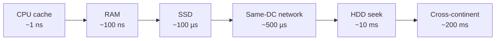
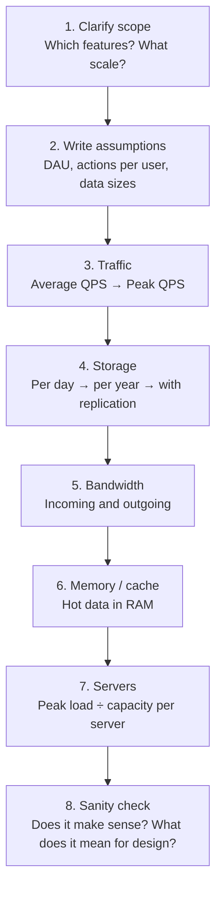
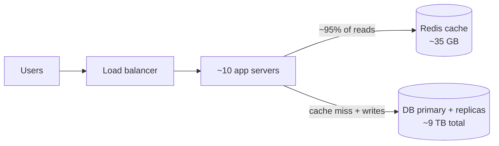
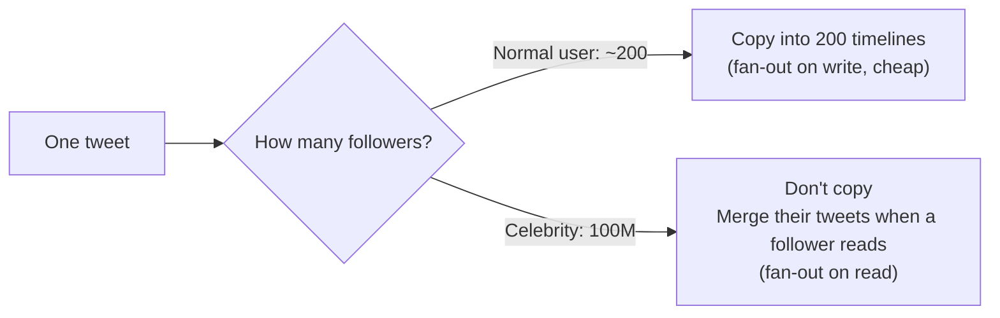
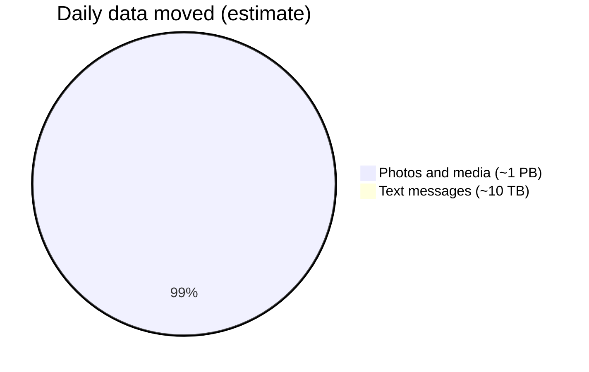
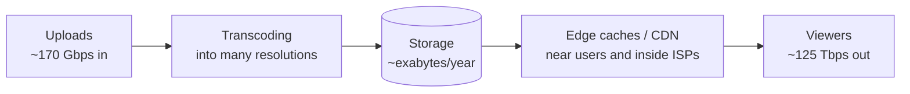
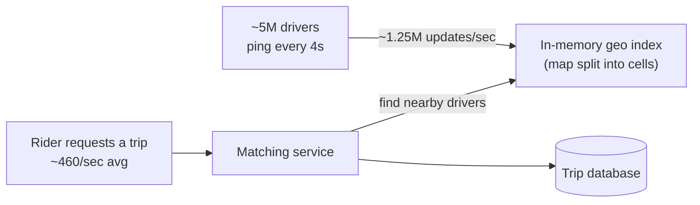
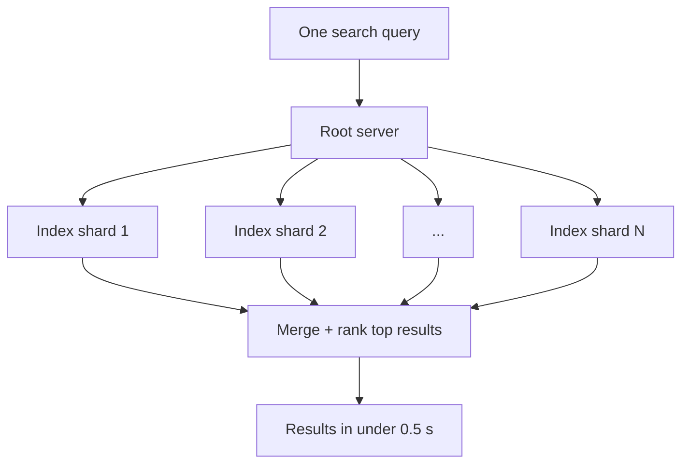
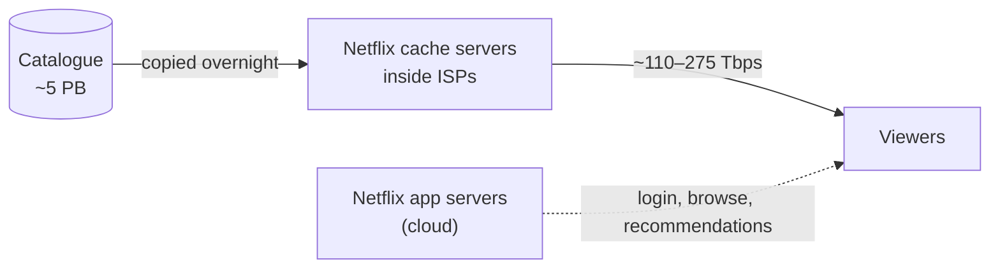

# Back-of-the-Envelope Estimation — System Design Notes

## 1. What Is Back-of-the-Envelope Estimation?

### 1.1 Definition in one line

> **Back-of-the-envelope estimation = a quick, rough calculation, using simple assumptions and rounded numbers, to find out roughly how big a system needs to be.**

The name comes from the idea that the maths is simple enough to do **on the back of an envelope** (or a napkin), without a calculator or spreadsheet.

### 1.2 What it is trying to answer

In system design, the estimate usually answers questions like:

| Question                                      | What we estimate                   |
| --------------------------------------------- | ---------------------------------- |
| How many requests hit us every second?        | **QPS** (queries per second)       |
| How much data do we store per day / per year? | **Storage**                        |
| How much data moves over the network?         | **Bandwidth**                      |
| How much can we keep in fast memory?          | **Cache size**                     |
| How many machines do we need?                 | **Server count**                   |
| How many people are online at the same time?  | **Concurrent users / connections** |

### 1.3 The goal is the right _order of magnitude_, not the exact number

This is the most important idea in these notes.

You are **not** trying to say "we need 4,327 servers". You're trying to say **"we need thousands of servers, not tens and not millions"**.

### 1.4 The analogy: planning a wedding dinner

You're organising a wedding for about **500 guests**. You don't need the exact count to plan:

- Each guest eats about 3 rotis → **~1,500 rotis**
- A cook makes ~100 rotis per hour → **15 cook-hours**
- The dinner lasts 3 hours → **~5 cooks**
- Add a buffer for the rush when everyone arrives at once → **6–7 cooks**

You didn't know if it would be 470 or 530 guests, but you still know you need **6–7 cooks, not 1 and not 50**. That's exactly what back-of-the-envelope estimation does for software.

## 2. Why It Matters

### 2.1 Numbers decide the design

The **same feature** needs a completely different design at different scales:

| Scale  | Users       | What the design looks like                                            |
| ------ | ----------- | --------------------------------------------------------------------- |
| Small  | 1,000       | One server, one database. Done.                                       |
| Medium | 1 million   | Load balancer, a few app servers, DB replicas, a cache                |
| Large  | 100 million | Sharded databases, many cache clusters, message queues, CDN           |
| Huge   | 1 billion+  | Multiple data centres, custom infrastructure, edge caches inside ISPs |

Without estimating, you can't know which row you're in. You'll either **over-engineer** (wasting time and money) or **under-engineer** (the system falls over on launch day).

### 2.2 It reveals the real bottleneck

Estimation often shows that the problem you _expected_ is **not** the hard part.

- In **Uber**, creating trips is easy. The hard part is the **flood of driver GPS updates** (section 7.5).
- In **WhatsApp**, storing text is easy. The hard part is **keeping a billion connections open** (section 7.2).
- In **Netflix**, storage is modest. The hard part is **bandwidth** (section 7.7).

### 2.3 In interviews

System design interviews almost always include an estimation step. The interviewer isn't checking your arithmetic. They're checking that you can:

1. Make **sensible assumptions** and say them out loud
2. Turn assumptions into **numbers** quickly
3. Use those numbers to **justify design choices** ("reads are 100× writes, so we need a cache")

## 3. The Building Blocks (Numbers to Know)

You can't estimate without a few reference numbers in your head. These are the ones that come up again and again.

### 3.1 Data size units

| Unit                    | Power of 10            | Power of 2 (approx.) | Think of it as…                      |
| ----------------------- | ---------------------- | -------------------- | ------------------------------------ |
| 1 **B** (byte) = 8 bits | 10⁰ = 1                | 2⁰ = 1               | A single character (e.g. "a")        |
| 1 **KB** (kilobyte)     | 10³ = 1 thousand bytes | 2¹⁰ = 1,024          | A short text message with metadata   |
| 1 **MB** (megabyte)     | 10⁶ = 1 million        | 2²⁰                  | A phone photo (compressed)           |
| 1 **GB** (gigabyte)     | 10⁹ = 1 billion        | 2³⁰                  | ~1 hour of SD video                  |
| 1 **TB** (terabyte)     | 10¹² = 1 trillion      | 2⁴⁰                  | A laptop's whole disk                |
| 1 **PB** (petabyte)     | 10¹⁵                   | 2⁵⁰                  | Thousands of servers' worth of disks |
| 1 **EB** (exabyte)      | 10¹⁸                   | 2⁶⁰                  | Planet-scale (YouTube, Netflix)      |

**Tip:** for estimation, treat **2¹⁰ ≈ 1,000**. The 2.4% difference doesn't matter.

**Bits vs bytes:** network speeds are in **bits**, storage in **bytes**. 1 byte = 8 bits.

```
1 Gbps (gigabit per second) = 1,000 Mb/s ÷ 8 = 125 MB/s
10 Gbps network card        ≈ 1.25 GB/s
```

### 3.2 Size of common things

These are rough, typical values for planning.

| Thing                                            | Approximate size      |
| ------------------------------------------------ | --------------------- |
| 1 ASCII character                                | 1 byte                |
| 1 character in UTF-8 (e.g. Hindi, emoji)         | 2–4 bytes             |
| Integer (`int`)                                  | 4 bytes               |
| Long / timestamp                                 | 8 bytes               |
| UUID                                             | 16 bytes (36 as text) |
| A tweet / short post (text + metadata)           | ~1 KB                 |
| A chat message (text + metadata)                 | ~100 bytes – 1 KB     |
| A row in a typical DB table                      | ~100 bytes – 1 KB     |
| A compressed phone photo                         | ~200 KB – 2 MB        |
| 1 minute of 1080p video (streaming quality)      | ~30–40 MB             |
| 1 hour of video, SD / HD / 4K (Netflix guidance) | ~1 GB / ~3 GB / ~7 GB |

### 3.3 Time conversions (the most useful shortcuts)

| Period    | Seconds       | Rounded for estimation |
| --------- | ------------- | ---------------------- |
| 1 minute  | 60            | —                      |
| 1 hour    | 3,600         | ~4 × 10³               |
| **1 day** | **86,400**    | **~10⁵ (100k)**        |
| 1 month   | ~2.6 million  | ~2.5 × 10⁶             |
| 1 year    | ~31.5 million | ~3 × 10⁷               |

**Rules of thumb from these:**

```
1 million requests per day   ≈ 12 requests per second
1 billion requests per day   ≈ 12,000 requests per second
1 request per second         ≈ 86,400 per day ≈ 2.6 million per month
```

### 3.4 Latency numbers every programmer should know

These show **how slow things are compared to each other**. Exact values change with hardware, but the **ratios** stay roughly the same.

To make them feel real, the last column scales everything up as if **1 nanosecond were 1 second**.

| Operation                             | Time        | If 1 ns = 1 second |
| ------------------------------------- | ----------- | ------------------ |
| Read from L1 CPU cache                | ~1 ns       | 1 second           |
| Read from L2 CPU cache                | ~4 ns       | 4 seconds          |
| Read from main memory (RAM)           | ~100 ns     | ~1.5 minutes       |
| Send 1 KB over a 1 Gbps network       | ~10 µs      | ~3 hours           |
| Random read from SSD (4 KB)           | ~100 µs     | ~1 day             |
| Read 1 MB sequentially from RAM       | ~250 µs     | ~3 days            |
| Round trip inside one data centre     | ~500 µs     | ~6 days            |
| Read 1 MB sequentially from SSD       | ~1 ms       | ~12 days           |
| Hard disk seek                        | ~10 ms      | ~4 months          |
| Read 1 MB sequentially from HDD       | ~20 ms      | ~8 months          |
| Network round trip India → US → India | ~200–250 ms | ~7 years           |



**What these numbers teach:**

1. **Memory is ~1,000× faster than SSD, and SSD is ~100× faster than spinning disk.** That's why caches (Redis, Memcached) exist.
2. **Reading sequentially is much faster than jumping around.** That's why logs, Kafka and LSM-tree databases append data.
3. **Crossing continents is very slow.** That's why CDNs and multi-region deployments put data close to users.
4. **Compressing data is cheap compared to sending it.** So compress before sending over the network.

### 3.5 Availability: what the "nines" mean

| Availability           | Downtime per year | Downtime per month | Downtime per day |
| ---------------------- | ----------------- | ------------------ | ---------------- |
| 99% ("two nines")      | ~3.65 days        | ~7.3 hours         | ~14.4 min        |
| 99.9% ("three nines")  | ~8.8 hours        | ~44 min            | ~1.4 min         |
| 99.99% ("four nines")  | ~53 min           | ~4.4 min           | ~8.6 sec         |
| 99.999% ("five nines") | ~5.3 min          | ~26 sec            | ~0.9 sec         |

**Each extra nine is 10× less downtime**, and usually much more cost and effort.

**Availability of chained systems:** if a request passes through 3 services, each 99.9% available, the total is 0.999 × 0.999 × 0.999 ≈ **99.7%**. Chains _reduce_ availability; redundancy _increases_ it.

### 3.6 What one machine can roughly handle

These are **planning numbers only**. Real values depend heavily on the workload, hardware and code. In an interview, always say "assuming roughly…".

| Component                                        | Rough capacity per machine                            |
| ------------------------------------------------ | ----------------------------------------------------- |
| Web / app server (real business logic)           | ~1,000 – 10,000 requests/sec                          |
| Relational DB (MySQL / Postgres), simple queries | ~1,000 – 10,000 queries/sec (writes lower than reads) |
| Redis / Memcached                                | ~100,000+ operations/sec                              |
| Kafka broker                                     | ~hundreds of MB/sec                                   |
| RAM on a typical server                          | 64 – 512 GB                                           |
| Disk on a typical storage server                 | tens of TB                                            |

## 4. The Step-by-Step Method

Every estimation follows the same shape. Learn this once and you can apply it to any system.



### Step 1: Clarify the scope

Decide **which features** you're estimating. "Design Instagram" is too big. "Photo upload and feed viewing" is estimable.

### Step 2: Write down your assumptions

This is the foundation. Write them **clearly** so anyone can follow (and challenge) them.

```
Assumptions:
- 100 million daily active users (DAU)
- Each user views their feed 10 times a day
- Each user uploads 1 photo every 10 days
- Average photo size after compression: 500 KB
- Read:write ratio ≈ 100:1
```

### Step 3: Traffic (QPS)

**Average QPS** = total requests per day ÷ seconds per day.

Traffic is never flat. People use apps more in the evening and less at 3 AM. So also estimate **peak QPS**, usually **2–3× the average**, and much more for special events (cricket finals, New Year's Eve, flash sales).

### Step 4: Storage

**Per day** = new items per day × size of each item.
Then multiply by days, years and **replication** (data is usually kept as **3 copies** for safety).

### Step 5: Bandwidth

**Bandwidth** = requests per second × size of each request/response.
Calculate **incoming** (uploads, writes) and **outgoing** (downloads, reads) separately. Outgoing is usually much bigger.

### Step 6: Memory (cache)

The **80/20 rule** (Pareto principle): roughly **20% of the data gets 80% of the traffic**. Caching that hot 20% in RAM serves most requests quickly.

**Cache size** ≈ 20% of the data read per day.

### Step 7: Servers

**Servers** = peak QPS ÷ QPS one server can handle. Then add **headroom** (~30%) so servers aren't running at 100%.

### Step 8: Sanity check and connect to design

Ask:

- Does this feel right compared to things I know?
- Which number is **surprisingly large**? That's where the design challenge is.
- What does each number **mean** for the design? (QPS → load balancing; storage → sharding; bandwidth → CDN; read:write → caching.)

## 5. The Core Formulas

| What             | Formula                                                     |
| ---------------- | ----------------------------------------------------------- |
| Average QPS      | `DAU × actions per user per day ÷ 86,400`                   |
| Peak QPS         | `Average QPS × peak factor` (2–3 normally, 10×+ for events) |
| Storage per day  | `New items per day × size per item`                         |
| Total storage    | `Per day × 365 × years × replication factor (≈3)`           |
| Bandwidth        | `QPS × size per request`                                    |
| Cache size       | `Daily read volume × 20%`                                   |
| Servers          | `Peak QPS ÷ QPS per server`, then add ~30% headroom         |
| Concurrent users | `DAU × average minutes online per day ÷ 1,440`              |
| Read:write ratio | `Reads per day ÷ writes per day`                            |

### The concurrent users formula (Little's Law)

**Little's Law** says: _items in the system = arrival rate × time each item stays_.

A simple example: a shop gets 60 customers an hour, and each stays 30 minutes. On average, 60 × 0.5 = **30 people** are in the shop at any time.

For apps:

```
100 million DAU, each online 30 minutes a day
Concurrent users ≈ 100M × 30 ÷ 1,440 (minutes in a day) ≈ 2.1 million online at once (average)
```

This matters for systems that keep **open connections** (chat apps, live tracking, multiplayer games).

## 6. Worked Example: A URL Shortener

A classic first problem (like bit.ly or tinyurl). We'll go through every step slowly.

### Step 1: Scope

- **Write:** shorten a long URL → get a short code
- **Read:** open the short link → redirect to the long URL

### Step 2: Assumptions

```
- 100 million new short URLs per month
- Read:write ratio = 100:1 (links are created once, clicked many times)
- Each record ≈ 500 bytes (long URL, short code, user id, timestamps)
- Keep data for 5 years
- Peak factor = 2×
```

### Step 3: Traffic

```
Writes per second = 100M ÷ (30 days × 86,400 s)
                  = 100M ÷ 2.6M
                  ≈ 40 writes/sec        → peak ≈ 80/sec

Reads per second  = 40 × 100
                  ≈ 4,000 reads/sec      → peak ≈ 8,000/sec
```

### Step 4: Storage

```
Per month = 100M × 500 bytes = 50 GB
5 years   = 50 GB × 12 × 5   = 3 TB
With 3 replicas              ≈ 9 TB
```

### How long should the short code be?

Using letters and digits (a–z, A–Z, 0–9) gives **62 characters**.

```
Total URLs in 5 years = 100M × 12 × 5 = 6 billion

62^6 ≈ 57 billion    → 6 characters is enough
62^7 ≈ 3.5 trillion  → 7 characters gives lots of headroom
```

### Step 5: Bandwidth

```
Outgoing = 4,000 reads/sec × 500 bytes ≈ 2 MB/sec   (tiny)
Incoming = 40 writes/sec × 500 bytes   ≈ 20 KB/sec  (negligible)
```

### Step 6: Cache

```
Reads per day     = 4,000 × 86,400 ≈ 350 million
Cache hot 20%     = 350M × 20% × 500 bytes ≈ 35 GB
```

35 GB fits comfortably in **one Redis node** (or two for redundancy).

### Step 7: Servers

```
Peak reads ≈ 8,000/sec; assume ~1,000/sec per app server
→ 8 servers, plus headroom → ~10 app servers
```

### Step 8: What the numbers tell us

| Number                | What it means for design                                                    |
| --------------------- | --------------------------------------------------------------------------- |
| Reads are 100× writes | **Read-heavy**: a cache is the most important component                     |
| 40 writes/sec         | A **single database primary** easily handles writes; no sharding needed yet |
| 9 TB total            | Fits on a small cluster; storage is not a challenge                         |
| 35 GB of hot data     | One Redis node can serve most reads                                         |
| 2 MB/sec bandwidth    | The network is not a concern                                                |



The estimate turned a vague problem into a **clear, right-sized design**.

## 7. Big Tech Examples

### 7.1 X (Twitter): posting tweets and the fan-out problem

**Known numbers**

- 📊 Twitter reported **500+ million tweets per day**, about **5,700 tweets/sec on average** (2013).
- 📊 Record peak: **143,199 tweets in one second** (Aug 2013, during a TV broadcast of _Castle in the Sky_ in Japan), about **25× the average**.

**Assumptions**

- 🔹 ~250 million daily active users
- 🔹 Each user opens their home timeline ~10 times a day
- 🔹 Each tweet ≈ 1 KB with metadata; ~10% have an image of ~500 KB
- 🔹 Average user has ~200 followers

**Traffic**

```
Tweets written   = 500M ÷ 86,400 ≈ 5,800/sec   (matches Twitter's 5,700 — good sanity check)
Timeline reads   = 250M × 10 = 2.5B per day ÷ 86,400 ≈ 29,000/sec
Read:write       ≈ 5:1 at the timeline level, but each timeline shows ~20 tweets → ~100:1 at the tweet level
```

**Storage**

```
Text   = 500M × 1 KB          = 500 GB/day  → ~180 TB/year
Images = 50M × 500 KB         = 25 TB/day   → ~9 PB/year
```

**The fan-out problem** (the real insight)

When someone tweets, it should appear in **every follower's timeline**. One common approach is to pre-build timelines, so each tweet is **copied into every follower's timeline** (called _fan-out on write_).

```
Timeline inserts = 500M tweets × 200 followers = 100 billion per day
                 ≈ 1.2 million inserts/sec
```

Now consider a celebrity with **100 million followers**. **One tweet** creates **100 million** timeline writes.



**What the numbers reveal**

- Writing tweets (~6k/sec) is easy. **Fan-out (~1.2M/sec)** is the real load.
- A **hybrid approach** is needed: push tweets of normal users into timelines, and pull celebrity tweets at read time.
- **Peaks can be 25× the average**, so the system must absorb huge spikes (queues, autoscaling, pre-provisioning for known events).
- Images (PB per year) dwarf text (TB per year), so a separate **blob store and CDN** are needed for media.

### 7.2 WhatsApp: billions of messages and a billion open connections

**Known numbers**

- 📊 **3 billion+ monthly users** (Meta, 2025).
- 📊 **~100 billion messages per day** (Meta, Oct 2020).
- 📊 WhatsApp engineers reported **over 2 million open TCP connections on one server** (2012).

**Assumptions**

- 🔹 Average text message ≈ 100 bytes
- 🔹 ~1 billion users connected at the same time at peak
- 🔹 Peak factor 3× (festivals, New Year's Eve)

**Traffic**

```
Messages/sec (avg) = 100B ÷ 86,400 ≈ 1.2 million/sec
Peak               ≈ 3.5 million/sec
```

**Storage (text only)**

```
If every message were kept forever:
100B × 100 bytes = 10 TB/day → ~3.6 PB/year
```

But WhatsApp works like a **post office**: the server holds a message only **until it's delivered**, then removes it (messages live on users' phones). So server-side text storage is **small and temporary**: only undelivered messages.

**Bandwidth (text)**

```
1.2M msgs/sec × 100 bytes ≈ 120 MB/sec  → small
```

**Media dominates**

```
If even 5% of messages are photos (~5B/day) at ~200 KB each:
5B × 200 KB = 1 PB/day of media transfer
```



**Connections: the real challenge**

```
1 billion connected users ÷ 2 million connections per server ≈ 500 servers
With redundancy and headroom → ~1,000+ connection servers
```

**What the numbers reveal**

- Text is **tiny**. Even 100 billion messages a day is only ~10 TB.
- The hard problem is **keeping a billion long-lived connections open** and routing each message to the right one. That's why WhatsApp invested in a highly concurrent stack (Erlang) tuned for millions of connections per box.
- **Store-and-forward** (delete after delivery) keeps server storage small.
- **Media** must go through separate storage and a CDN, not the chat servers.

### 7.3 YouTube: exabytes of video

**Known numbers**

- 📊 **500+ hours of video uploaded every minute** (widely cited YouTube figure).
- 📊 **Over 1 billion hours watched per day** (YouTube, 2017; higher today).

**Assumptions**

- 🔹 Uploaded video ≈ 2.5 GB per hour (raw-ish upload quality)
- 🔹 After processing into many resolutions (144p → 4K), total ≈ 5 GB per hour of video
- 🔹 Average streaming bitrate ≈ 3 Mbps (mix of phone and TV viewing)

**Uploads**

```
Hours uploaded per day = 500 × 60 × 24 = 720,000 hours/day

Storage (all resolutions) = 720,000 × 5 GB = 3.6 PB/day
Per year                  ≈ 1.3 EB/year
With 3 replicas           ≈ 4 EB/year

Upload bandwidth = 720,000 × 2.5 GB = 1.8 PB/day ÷ 86,400 ≈ 21 GB/sec ≈ 170 Gbps incoming
```

**Watching**

```
1B hours/day × 3,600 sec = 3.6 trillion seconds of video per day
Average concurrent streams = 3.6T ÷ 86,400 ≈ 42 million at any moment

Outgoing bandwidth = 42M × 3 Mbps ≈ 125 Tbps (average)
```

**Read:write ratio**

```
1B hours watched ÷ 720k hours uploaded ≈ 1,400 : 1
```



**What the numbers reveal**

- **Outgoing is ~700× incoming.** No central data centre can push 125 Tbps to the whole world, so video **must** be served from **edge caches close to viewers** (Google places cache servers inside ISPs).
- **Exabyte-scale storage** needs tiers: popular videos on fast storage near users, old rarely watched videos on cheap cold storage.
- **Transcoding** 720k hours a day is a huge compute pipeline of its own.

### 7.4 Instagram: photo storage and feed reads

**Known numbers**

- 📊 **3 billion monthly active users** (Meta, Sept 2025).

**Assumptions**

- 🔹 ~1.5 billion daily active users (half of monthly)
- 🔹 ~10% of DAU upload one photo a day → 150 million photos/day
- 🔹 Each photo stored in several sizes (original + thumbnails) ≈ 1.5 MB total
- 🔹 Each user opens the feed 20 times a day and sees ~10 images each time; each feed image ≈ 100 KB

**Uploads**

```
Uploads/sec  = 150M ÷ 86,400 ≈ 1,700/sec   → peak ≈ 5,000/sec
Storage/day  = 150M × 1.5 MB = 225 TB/day
Per year     ≈ 82 PB → with 3 replicas ≈ 250 PB/year
```

**Feed reads**

```
Image views/day = 1.5B × 20 × 10 = 300 billion
Image views/sec = 300B ÷ 86,400 ≈ 3.5 million/sec
Bandwidth       = 3.5M × 100 KB ≈ 350 GB/sec ≈ 2.8 Tbps
```

**What the numbers reveal**

- **Reads outnumber uploads ~2,000:1**, so this is extremely read-heavy.
- 3.5 million image requests a second **cannot** come from app servers. Images are served from a **CDN**, and the app only returns image URLs.
- Storing **multiple sizes** costs storage, but saves huge bandwidth (a phone feed doesn't need the original 4 MB image).
- ~250 PB a year of photos needs a **distributed blob store**, not a database.

### 7.5 Uber: trips are easy, GPS pings are hard

**Known numbers**

- 📊 **3.75 billion trips in Q4 2025**, so **over 40 million trips per day** (Uber).
- 📊 **202 million monthly active platform consumers** (Q4 2025).

**Assumptions**

- 🔹 ~5 million drivers and couriers online at peak
- 🔹 Each sends a GPS location every 4 seconds
- 🔹 Each location update ≈ 100 bytes
- 🔹 Peak factor 3× for trips (Friday nights, rain, New Year's Eve)

**Trips**

```
Trips/sec (avg) = 40M ÷ 86,400 ≈ 460/sec
Peak            ≈ 1,400/sec
```

That's **surprisingly small**. A well-designed service handles it easily.

**Location updates**

```
Updates/sec = 5M drivers ÷ 4 sec ≈ 1.25 million/sec
Bandwidth   = 1.25M × 100 bytes ≈ 125 MB/sec
If all stored: 1.25M × 86,400 × 100 bytes ≈ 11 TB/day
```



**What the numbers reveal**

- Trip creation (~460/sec) is **~2,700× less** than location updates (~1.25M/sec).
- Writing every GPS ping to a normal database would be wasteful. Instead, the **latest location of each driver is kept in memory**, in a geospatial index (the map divided into cells, like Uber's open-source **H3** hexagon system), so "find drivers near me" is a fast lookup.
- Old pings are only needed for trip records and analytics, so they can be **sampled or sent to cheaper storage**.

### 7.6 Google Search: huge QPS, tight latency, a gigantic index

**Known numbers**

- 📊 **More than 5 trillion searches per year** (Google, 2025).
- 📊 The index holds **hundreds of billions of web pages** and is **well over 100,000,000 GB (100 PB)** (Google).

**Assumptions**

- 🔹 Users expect results in under ~0.5 seconds
- 🔹 Peak factor 2×
- 🔹 A results page ≈ 100 KB

**Traffic**

```
Searches/day = 5T ÷ 365 ≈ 14 billion
Searches/sec = 14B ÷ 86,400 ≈ 160,000/sec  → peak ≈ 300,000+/sec
```

**Index size vs memory**

```
Index ≈ 100 PB
One server with 256 GB RAM → 100 PB ÷ 256 GB ≈ 400,000 servers to hold it all in RAM
```

**Latency budget**

```
Budget: ~500 ms total, including the network round trip to the user
One HDD seek ≈ 10 ms → only a handful of sequential disk seeks would eat the budget
```

**Bandwidth**

```
160k/sec × 100 KB ≈ 16 GB/sec of result pages
```



**What the numbers reveal**

- The index is far too big for one machine, so it's **split into many shards**, and each query **fans out to many shards in parallel**, then results are merged.
- The latency budget leaves no room for slow disks, so the index is **heavily compressed** and kept in **RAM / SSD**.
- With so many machines involved per query, some will always be slow. Google's systems use tricks like sending **duplicate requests** and taking the fastest reply (the "tail at scale" problem).
- **Caching popular queries** helps a lot, because many people search the same things (news, cricket scores).

### 7.7 Netflix: storage is modest, bandwidth is enormous

**Known numbers**

- 📊 **325+ million paid subscribers** (Netflix, Jan 2026).
- 📊 **Over 190 billion hours viewed in 2025** (Netflix).
- 📊 Data use per hour (Netflix guidance): SD ~1 GB, HD ~3 GB, 4K ~7 GB.

**Assumptions**

- 🔹 Average streaming bitrate across devices ≈ 5 Mbps (≈ 2.25 GB per hour)
- 🔹 Evening peak ≈ 2.5× the daily average
- 🔹 Catalogue ≈ 50,000 hours of content, each encoded in ~100 versions (resolutions, codecs, audio tracks), averaging ~1 GB per hour per version

**Viewing**

```
Hours/day           = 190B ÷ 365 ≈ 520 million hours/day
Concurrent streams  = 520M × 3,600 ÷ 86,400 ≈ 22 million (average)
Peak                ≈ 55 million

Average bandwidth   = 22M × 5 Mbps ≈ 110 Tbps
Peak bandwidth      ≈ 275 Tbps
Data per day        = 520M hours × 2.25 GB ≈ 1.2 EB/day
```

**Storage**

```
Catalogue = 50,000 hours × 100 versions × 1 GB ≈ 5 PB
```



**What the numbers reveal**

- **Storage is small (petabytes), but outgoing traffic is gigantic (~1 exabyte a day).**
- Netflix therefore runs its own CDN, **Open Connect**: cache servers placed **inside ISPs**, filled with popular titles during quiet hours, so evening streams travel only a short distance.
- The parts that run in the cloud (login, browsing, recommendations) handle comparatively little data. The heavy lifting is at the edge.

### 7.8 All the examples side by side

| System        | Headline load                            | Main bottleneck the estimate reveals | Key design answer                                     |
| ------------- | ---------------------------------------- | ------------------------------------ | ----------------------------------------------------- |
| URL shortener | ~4k reads/sec                            | Reads ≫ writes                       | Cache                                                 |
| X (Twitter)   | ~6k tweets/sec, ~1.2M fan-out writes/sec | Fan-out + spikes (25×)               | Hybrid push/pull timelines, queues                    |
| WhatsApp      | ~1.2M msgs/sec                           | ~1B open connections                 | Millions of connections per server; store-and-forward |
| YouTube       | ~125 Tbps out                            | Bandwidth + exabyte storage          | Edge caches, tiered storage, transcoding              |
| Instagram     | ~3.5M image views/sec                    | Image reads                          | CDN, multiple image sizes, blob store                 |
| Uber          | ~1.25M GPS pings/sec                     | Location stream                      | In-memory geospatial index                            |
| Google Search | ~160k queries/sec on 100 PB              | Latency + index size                 | Sharding, fan-out, compression, RAM                   |
| Netflix       | ~110–275 Tbps out                        | Bandwidth                            | Own CDN inside ISPs                                   |

## 8 Common ratios to remember

| Ratio                               | Typical value                       |
| ----------------------------------- | ----------------------------------- |
| Peak : average traffic              | 2–3× (10×–25× during events)        |
| Daily active : monthly active users | ~20–60%                             |
| Read : write (social apps)          | ~100:1 or more                      |
| Replication factor                  | 3 copies                            |
| Hot data (80/20 rule)               | ~20% of data gets ~80% of traffic   |
| Server headroom                     | Plan for ~70% utilisation, not 100% |

## 9. Practice Problems (with Answers)

Try each yourself before reading the answer.

**Problem 1.** A chat app has 10 million DAU. Each user sends 40 messages a day, each ~100 bytes. What's the average write QPS and storage per day?

<details>
<summary>Answer</summary>

```
Messages/day = 10M × 40 = 400 million
QPS          = 400M ÷ 86,400 ≈ 4,600/sec
Storage/day  = 400M × 100 bytes = 40 GB/day
```

</details>

**Problem 2.** A photo app gets 2 million uploads a day at 2 MB each. How much storage for 5 years, with 3 replicas?

<details>
<summary>Answer</summary>

```
Per day  = 2M × 2 MB = 4 TB
Per year = 4 TB × 365 ≈ 1.5 PB
5 years  ≈ 7.3 PB
× 3      ≈ 22 PB
```

</details>

**Problem 3.** Your SLA is 99.99% availability. How much downtime is allowed per month?

<details>
<summary>Answer</summary>

```
0.01% of a month = 0.0001 × 30 × 24 × 60 min ≈ 4.3 minutes
```

</details>

**Problem 4.** Peak traffic is 50,000 QPS. Each server handles 2,000 QPS. You want servers to run at most 70% busy. How many servers?

<details>
<summary>Answer</summary>

```
Without headroom = 50,000 ÷ 2,000 = 25
At 70% max       = 25 ÷ 0.7 ≈ 36 servers
```

</details>

**Problem 5.** A live-streaming app has 100 million DAU, each watching for 30 minutes a day. How many people are watching at the same time on average? If each stream is 2 Mbps, what's the outgoing bandwidth?

<details>
<summary>Answer</summary>

```
Concurrent = 100M × 30 ÷ 1,440 ≈ 2.1 million
Bandwidth  = 2.1M × 2 Mbps ≈ 4.2 Tbps (average; peak maybe 2–3× higher)
```

</details>

**Problem 6.** A news site's homepage is 2 MB, and it gets 5,000 requests/sec at peak. Can it be served from one server with a 10 Gbps network card?

<details>
<summary>Answer</summary>

```
Bandwidth needed = 5,000 × 2 MB = 10 GB/sec = 80 Gbps
One 10 Gbps card = 1.25 GB/sec

No. It needs ~8× more. Use a CDN (and shrink the page).
```

</details>

## 12. Summary and Cheat Sheet

### Must-remember numbers

```
TIME
  1 day   ≈ 86,400 s ≈ 10^5 s
  1 month ≈ 2.5 × 10^6 s
  1 year  ≈ 3 × 10^7 s
  1M/day  ≈ 12/sec        1B/day ≈ 12,000/sec

SIZE
  KB 10^3 · MB 10^6 · GB 10^9 · TB 10^12 · PB 10^15 · EB 10^18
  1 byte = 8 bits         1 Gbps = 125 MB/s

LATENCY (relative)
  Cache 1 ns → RAM 100 ns → SSD 100 µs → DC round trip 500 µs → HDD seek 10 ms → cross-continent 200 ms

AVAILABILITY (per month)
  99.9% ≈ 44 min · 99.99% ≈ 4.4 min · 99.999% ≈ 26 s

RATIOS
  Peak = 2–3× average (events: 10×+) · Replication = 3 · Cache = 20% of daily reads · Run servers at ~70%
```

### The formulas

```
QPS         = DAU × actions/day ÷ 86,400
Peak QPS    = QPS × 2–3
Storage     = items/day × size × 365 × years × 3
Bandwidth   = QPS × size
Cache       = daily reads × 20%
Servers     = peak QPS ÷ per-server QPS ÷ 0.7
Concurrent  = DAU × minutes online ÷ 1,440
```
