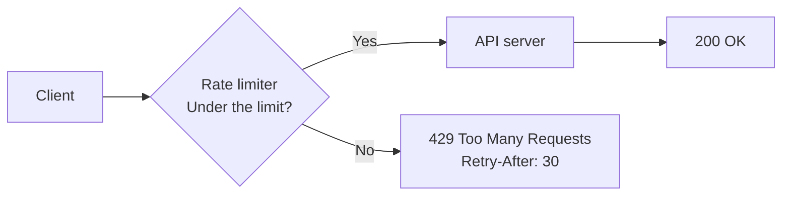
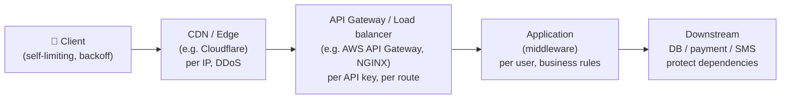
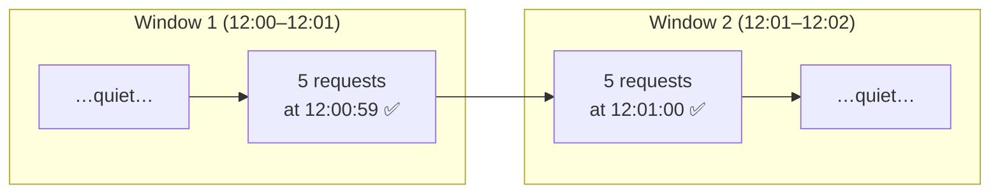
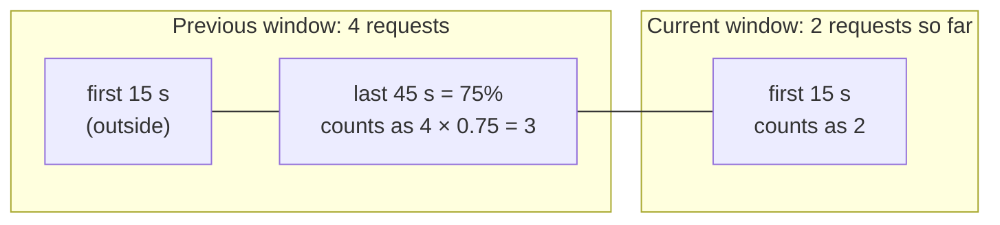
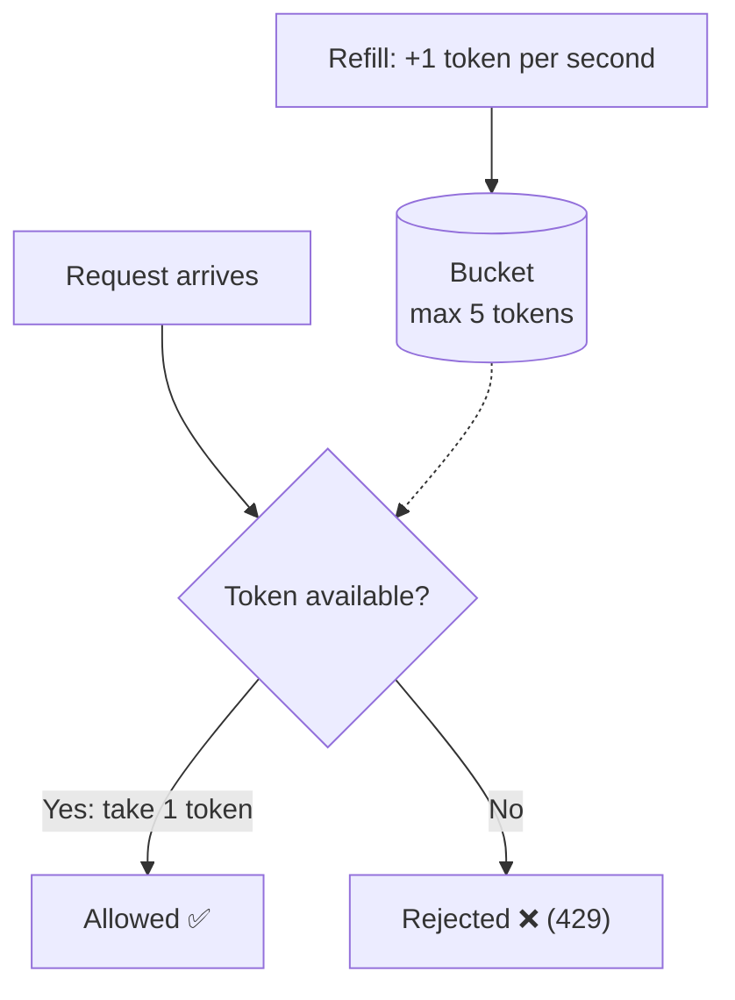
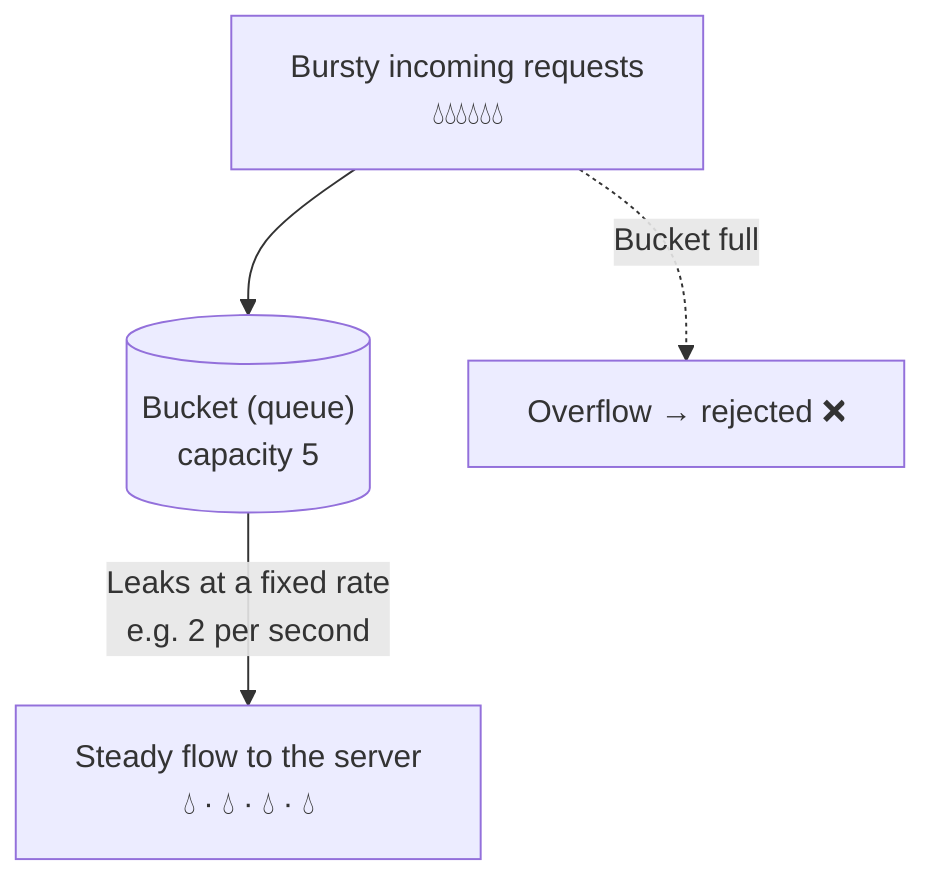

# Rate Limiting — System Design Notes

## 1. What Is Rate Limiting?

### 1.1 Definition in one line

> **Rate limiting = controlling how many requests someone can make in a given amount of time.**

When someone goes over the limit, their extra requests are **rejected** (or made to wait) until they are allowed again.

### 1.2 Everyday examples you already know

| Everyday situation                                                      | The rate limit           |
| ----------------------------------------------------------------------- | ------------------------ |
| "Resend OTP" button greyed out: _"Try again in 30 seconds"_             | 1 OTP per 30 seconds     |
| Entering a wrong ATM PIN 3 times blocks the card for the day            | 3 attempts per day       |
| A restaurant takes at most 50 online orders per hour on a busy night    | 50 orders per hour       |
| A "You're doing that too much, try again later" message on social media | A posting limit per hour |

Software rate limiting is the same idea applied to API requests, logins, messages, uploads, and so on.

### 1.3 What it looks like in an API



The rate limiter sits **in front of** the real work. It answers one question for every request: **"Has this caller used up their allowance?"**

## 2. Why We Need It

### 2.1 Protection against abuse and attacks

| Threat                    | How rate limiting helps                                                     |
| ------------------------- | --------------------------------------------------------------------------- |
| **DDoS / traffic floods** | Caps how much any single source can send                                    |
| **Brute-force login**     | An attacker trying 1 million passwords gets stopped after a few attempts    |
| **OTP / SMS bombing**     | Stops someone triggering thousands of SMS to a victim (and saves SMS costs) |
| **Scraping**              | Slows bots copying all your data                                            |
| **Credential stuffing**   | Limits login attempts per IP, per account and per device                    |

### 2.2 Fairness: the "noisy neighbour" problem

Imagine a shared API with 1,000 customers. One customer has a bug in a loop and sends 50,000 requests a second. Without limits, **everyone else's requests slow down or fail**.

Rate limiting gives each customer **their own fair share**, so one bad actor can't ruin the experience for others.

### 2.3 Protecting your own system

Every system has a breaking point: a database that can handle only so many queries, a payment provider with its own limits, a GPU cluster with fixed capacity. Rate limiting keeps traffic **below the breaking point** so the system degrades gracefully instead of crashing.

### 2.4 Cost control

Some operations cost real money per call: sending an SMS, calling a third-party API, running an AI model. Limits stop runaway bills.

### 2.5 Business plans

Many APIs sell tiers: **Free = 100 requests/day, Pro = 10,000/day, Enterprise = custom**. Rate limiting is how those tiers are enforced.

## 3. Key Terms

### 3.1 The vocabulary

| Term               | Meaning                                                                                  | Example                      |
| ------------------ | ---------------------------------------------------------------------------------------- | ---------------------------- |
| **Limit**          | Maximum allowed requests                                                                 | 100 requests                 |
| **Window**         | The time period the limit applies to                                                     | per minute                   |
| **Rate**           | Limit ÷ window                                                                           | 100/min ≈ 1.67/sec           |
| **Key (identity)** | _Who_ the limit applies to                                                               | IP address, user ID, API key |
| **Burst**          | Many requests arriving at once                                                           | 50 requests in 1 second      |
| **Throttling**     | Slowing down or rejecting excess requests (often used to mean the same as rate limiting) | —                            |
| **Quota**          | A long-term allowance, usually per day/month and often tied to billing                   | 10,000 calls/month           |
| **Hard limit**     | Never exceeded; extra requests are rejected                                              | Login attempts               |
| **Soft limit**     | Can be exceeded briefly, or only triggers a warning                                      | Burst allowance              |

### 3.2 Choosing the key: _who_ are we limiting?

The key decides **whose counter** a request increments.

| Key                 | Good for                                          | Watch out for                                                                                                                      |
| ------------------- | ------------------------------------------------- | ---------------------------------------------------------------------------------------------------------------------------------- |
| **IP address**      | Anonymous traffic, login pages                    | Many people share one IP (offices, colleges, mobile networks using carrier NAT). One heavy user can block everyone behind that IP. |
| **User ID**         | Logged-in users                                   | Doesn't help before login                                                                                                          |
| **API key / token** | Public APIs and paid plans                        | Keys can leak                                                                                                                      |
| **Device ID**       | Mobile apps                                       | Can be faked                                                                                                                       |
| **Endpoint**        | Expensive operations (search, export, login)      | —                                                                                                                                  |
| **Combination**     | e.g. _user + endpoint_, _IP + username_ for login | More counters to store                                                                                                             |

Real systems usually apply **several limits at once**, for example:

- 1,000 requests/min **per API key** (fairness)
- 5 login attempts/min **per username** (security)
- 50,000 requests/sec **for the whole service** (self-protection)

### 3.3 How servers say "slow down": HTTP 429

The standard response is **`429 Too Many Requests`**, usually with headers that help the client:

```http
HTTP/1.1 429 Too Many Requests
Retry-After: 30
X-RateLimit-Limit: 100
X-RateLimit-Remaining: 0
X-RateLimit-Reset: 1761638400

{ "error": "Too many requests. Try again in 30 seconds." }
```

| Header                  | Meaning                                                                 |
| ----------------------- | ----------------------------------------------------------------------- |
| `Retry-After`           | Seconds to wait (or a date) before retrying. This one is standard HTTP. |
| `X-RateLimit-Limit`     | Your total allowance in this window                                     |
| `X-RateLimit-Remaining` | How many you have left                                                  |
| `X-RateLimit-Reset`     | When the allowance resets (often a Unix timestamp)                      |

The `X-RateLimit-*` headers are a widely used **convention**, not an official standard. The IETF is working on standard `RateLimit` headers. Good APIs send these headers on **every** response, not only on 429, so clients can slow down _before_ they hit the limit.

> When the _whole system_ is overloaded (load shedding) rather than one client going over its limit, `503 Service Unavailable` is often the more honest response.

## 4. Where Rate Limiting Happens

Rate limiting can live at many layers. Big systems use **several layers at once**: cheap, coarse checks at the edge, and precise per-user checks deeper in.



| Layer                       | Strengths                                              | Weaknesses                                  |
| --------------------------- | ------------------------------------------------------ | ------------------------------------------- |
| **Client**                  | Avoids sending wasteful requests                       | Can't be trusted; attackers ignore it       |
| **CDN / edge**              | Blocks floods before they reach you; global scale      | Knows little about users and business logic |
| **API gateway**             | Central place, no app code changes, per-key limits     | Usually generic rules only                  |
| **Application**             | Knows the user, plan, endpoint cost and business rules | Traffic has already reached your servers    |
| **Before downstream calls** | Protects fragile or expensive dependencies             | Only protects that one dependency           |

> **Rule of thumb:** never rely on client-side limiting for protection. It's a courtesy, not a defence.

## 5. The Five Classic Algorithms

All five answer the same question, _"allow or reject?"_, but they differ in **accuracy, memory use and how they handle bursts**.

For every algorithm below:

- **Running rule:** _5 requests per minute per user_
- **Code:** each limiter has one method, `allow(key, now)`, which returns `true` (allow) or `false` (reject). `now` is the current time in milliseconds; it defaults to `Date.now()` and is passed in only so the examples can fake time.

### 5.1 Fixed Window Counter

#### The idea

Split time into **fixed blocks** (12:00–12:01, 12:01–12:02…). Keep **one counter per block**. Each request adds 1. If the counter reaches the limit, reject until the next block starts, when the counter resets to 0.

#### Analogy

A canteen gives each employee **5 coupons every hour, on the hour**. At 1:00 you get 5 fresh coupons, whether or not you used the old ones.

```
Window 12:00–12:01        Window 12:01–12:02
[ ✅ ✅ ✅ ✅ ✅ ❌ ❌ ]   [ ✅ ✅ ✅ ... ]
  count: 1 2 3 4 5 → full   count resets to 0
```

#### The big flaw: the boundary burst

A user can send **5 requests at 12:00:59** (end of window 1) and **5 more at 12:01:00** (start of window 2). Both windows say "only 5", but **10 requests went through in about 1 second**, double the intended rate.



In the worst case, fixed windows allow **up to 2× the limit** in a short span around the boundary.

#### Code

```js
class FixedWindowLimiter {
  constructor(limit, windowMs) {
    this.limit = limit; // e.g. 5 requests
    this.windowMs = windowMs; // e.g. 60000 ms = 1 minute
    this.counters = new Map(); // key -> { windowStart, count }
  }
  // limit is the maximum number of requests allowed per window.
  // windowMs is the window length in milliseconds.
  // counters is a Map that keeps one small record per user, such as:
  // "rahul" → { windowStart: 1761638400000, count: 3 }
  // "priya" → { windowStart: 1761638400000, count: 1 }

  allow(key, now = Date.now()) {
    // key identifies the caller, such as a user ID, an API key or an IP address. now is the current time in milliseconds. It defaults to Date.now(), but you can pass your own time when testing.
    const windowStart = Math.floor(now / this.windowMs) * this.windowMs; // This line rounds the current time down to the start of its window. With a 1-minute window (60,000 ms), suppose now is 125,000 (2 min 5 s after time zero).
    const entry = this.counters.get(key);

    // New window (or first request ever) → start counting from 1
    if (!entry || entry.windowStart !== windowStart) {
      this.counters.set(key, { windowStart, count: 1 });
      return true;
    }

    // If we're still in the same window, check the count, if we haven't hit the limit, increment and allow; otherwise reject
    if (entry.count < this.limit) {
      entry.count++;
      return true;
    }
    return false;
  }
}
```

#### Pros and cons

| ✅ Pros                                      | ❌ Cons                                                                                    |
| -------------------------------------------- | ------------------------------------------------------------------------------------------ |
| Simplest to understand and build             | Boundary burst: up to 2× the limit                                                         |
| Tiny memory: one counter per user            | Everyone's limit resets at the same moment, which can cause a "stampede" right after reset |
| Very fast; easy in Redis (`INCR` + `EXPIRE`) | —                                                                                          |

**Good for:** simple quotas ("1,000 calls per day"), where a burst at the boundary doesn't matter.

### 5.2 Sliding Window Log

#### The idea

Remember the **exact timestamp of every request**. For each new request:

1. Throw away timestamps older than one window (e.g. older than 60 seconds ago)
2. Count the remaining timestamps
3. If the count is below the limit, allow and save this timestamp; otherwise reject

The window **slides** with the current time. It always looks at "the last 60 seconds from right now", never at a fixed clock block.

#### Analogy

A security guard keeps a **notebook of entry times**. Before letting you in, he counts how many times you entered in the **last 60 minutes**. Old entries fall out of the count as time moves on.

```
Now = 12:01:30, window = 60 s → look at 12:00:30 – 12:01:30

Log:  12:00:10  12:00:40  12:00:55  12:01:05  12:01:20
      (too old)  ✓         ✓         ✓         ✓       → 4 in window → allow (5th)
```

#### Code

```js
class SlidingWindowLogLimiter {
  constructor(limit, windowMs) {
    this.limit = limit;
    this.windowMs = windowMs;
    this.logs = new Map(); // key -> [timestamps]
    // The only difference from the fixed window is what’s stored per user. Instead of one counter, each user gets a list of the times of their allowed requests:
    // "rahul" → [10000, 25000, 40000]   // requests at 0:10, 0:25 and 0:40
    // "priya" → [5000]
  }

  allow(key, now = Date.now()) {
    // Throw away timestamps older than the window
    const log = (this.logs.get(key) || []).filter(
      (t) => t > now - this.windowMs,
    );
    // Because filter created a new array, we store it back in the Map so the old timestamps are actually gone.
    this.logs.set(key, log);

    // log.length is the number of requests in the last 60 seconds
    if (log.length < this.limit) {
      log.push(now);
      return true;
    }
    return false;
  }
}
```

#### Pros and cons

| ✅ Pros                                                                 | ❌ Cons                                                                                                             |
| ----------------------------------------------------------------------- | ------------------------------------------------------------------------------------------------------------------- |
| **Perfectly accurate**: never more than the limit in any 60-second span | **Memory hungry**: stores one timestamp per request. A limit of 10,000/hour means up to 10,000 timestamps per user. |
| No boundary burst                                                       | Slower: must clean up and count on every request                                                                    |

**Good for:** low limits where precision matters (login attempts, OTP sends, payments). In Redis it's commonly built with a **sorted set** (`ZADD`, `ZREMRANGEBYSCORE`, `ZCARD`).

### 5.3 Sliding Window Counter

#### The idea

A clever **middle ground**: the accuracy of the sliding log with the low memory of fixed windows.

Keep just **two counters**: the **previous** window's count and the **current** window's count. Then **estimate** how many requests happened in the last 60 seconds by assuming the previous window's requests were spread evenly.

```
estimate = previous_count × (portion of previous window still inside the last 60 s)
         + current_count
```

#### Worked example

Rule: 5 per minute. The time is **12:01:15**, which is 15 seconds into the current window.

- Previous window (12:00–12:01) had **4** requests
- Current window (12:01–12:02) has **2** so far
- The "last 60 seconds" covers 12:00:15 → 12:01:15, which includes **45 of the previous window's 60 seconds** (75%)

```
estimate = 4 × 0.75 + 2 = 3 + 2 = 5
5 is not below 5 → reject
```



#### Analogy

You know a shop had 40 customers yesterday and 10 so far today by mid-morning. You **estimate** "the last 24 hours" by taking the fraction of yesterday that still overlaps, instead of keeping every receipt.

#### Code

```js
class SlidingWindowCounterLimiter {
  constructor(limit, windowMs) {
    this.limit = limit;
    this.windowMs = windowMs;
    this.state = new Map(); // key -> { windowStart, current, previous }
  }

  allow(key, now = Date.now()) {
    const w = this.windowMs;
    const windowStart = Math.floor(now / w) * w;
    const s = this.state.get(key) || { windowStart, current: 0, previous: 0 };

    // Moved into a new window? Current becomes previous (or 0 if we skipped a whole window)
    if (s.windowStart !== windowStart) {
      s.previous = windowStart - s.windowStart === w ? s.current : 0;
      s.current = 0;
      s.windowStart = windowStart;
    }
    this.state.set(key, s);

    const elapsed = now - windowStart;
    const previousWeight = (w - elapsed) / w; // how much of the previous window still "overlaps"
    const estimate = s.previous * previousWeight + s.current;

    if (estimate < this.limit) {
      s.current++;
      return true;
    }
    return false;
  }
}
```

#### Pros and cons

| ✅ Pros                                                                                                                  | ❌ Cons                                                   |
| ------------------------------------------------------------------------------------------------------------------------ | --------------------------------------------------------- |
| Smooths out the boundary burst                                                                                           | An **approximation**: assumes requests were evenly spread |
| Tiny memory: two counters per user                                                                                       | Slightly more maths than a fixed window                   |
| Accurate enough for real use: Cloudflare measured only **~0.003%** of requests wrongly allowed or blocked (section 10.3) | —                                                         |

**Good for:** most general API rate limiting at large scale.

### 5.4 Token Bucket

The **most widely used** algorithm in practice (Stripe and AWS API Gateway both use it).

#### The idea

- Each user has a **bucket** that holds up to **`capacity`** tokens.
- Tokens are **added at a steady rate** (`refillRate`, e.g. 1 per second), but the bucket **never overflows** beyond capacity.
- Each request **takes one token**.
- **No token? Rejected.**

Two separate knobs:

- **Capacity** = how big a **burst** is allowed
- **Refill rate** = the **long-term average** rate



#### Analogy

A **mobile data pack** of "1.5 GB per day" that refills daily but doesn't roll over. Or a **cinema with 5 free passes**: you can use all 5 at once (a burst), but you only earn a new pass every hour.

#### Walkthrough (capacity 5, refill 1 per second)

| Time | Event               | Tokens before              | Result     | Tokens after |
| ---- | ------------------- | -------------------------- | ---------- | ------------ |
| 0 s  | Bucket starts full  | —                          | —          | 5            |
| 0 s  | Burst of 6 requests | 5                          | 5 ✅, 1 ❌ | 0            |
| 2 s  | 1 request           | 0 + 2 refilled = 2         | ✅         | 1            |
| 10 s | 1 request           | 1 + 8 = 9, capped at **5** | ✅         | 4            |

Notice:

- A **burst of 5** is allowed immediately (good for real users who open an app and fire several requests at once).
- After that, the user is held to **1 per second** on average.
- Tokens **don't pile up forever**; the cap keeps future bursts bounded.

#### Code

Notice there's **no timer**. Instead of adding tokens every second, we work out "how many tokens were earned since last time" when each request arrives. This **lazy refill** keeps it simple and cheap.

```js
class TokenBucketLimiter {
  constructor(capacity, refillPerSec) {
    this.capacity = capacity;
    this.refillPerSec = refillPerSec;
    this.buckets = new Map(); // key -> { tokens, lastRefill }
  }

  allow(key, now = Date.now(), cost = 1) {
    const b = this.buckets.get(key) || {
      tokens: this.capacity,
      lastRefill: now,
    };

    // Add the tokens earned since last time (never more than capacity)
    const secondsPassed = (now - b.lastRefill) / 1000;
    b.tokens = Math.min(
      this.capacity,
      b.tokens + secondsPassed * this.refillPerSec,
    );
    b.lastRefill = now;
    this.buckets.set(key, b);

    if (b.tokens >= cost) {
      b.tokens -= cost;
      return true;
    }
    return false;
  }
}
```

The optional `cost` parameter lets **expensive requests use more tokens**. For example, a search might cost 5 tokens and a simple read 1 (GitHub does something similar; see section 10.1).

#### Pros and cons

| ✅ Pros                                                                                      | ❌ Cons                                                 |
| -------------------------------------------------------------------------------------------- | ------------------------------------------------------- |
| **Allows short bursts** while enforcing an average rate, which matches how real users behave | Two parameters to tune (capacity and rate)              |
| Tiny memory: two numbers per user                                                            | A full bucket lets a burst hit your backend all at once |
| Supports **weighted costs** per request                                                      | —                                                       |
| Very popular; well understood                                                                | —                                                       |

**Good for:** public APIs, per-user limits, almost any general case.

### 5.5 Leaky Bucket

#### The idea

Picture a **bucket with a small hole at the bottom**:

- Requests **pour water in** (1 unit each).
- Water **leaks out at a constant rate**, no matter how fast it was poured in.
- If the bucket is **full**, new water **overflows**, so the request is rejected.

The output is **perfectly smooth**: requests leave at a steady pace, even if they arrived in a burst.



#### Analogy

A **funnel**: however fast you pour, liquid comes out of the narrow end at the same speed. Or a **doctor's waiting room** with 5 chairs: the doctor sees one patient every 10 minutes; if all chairs are full, new patients are turned away.

#### Two flavours

| Flavour        | How it works                                                                        | Effect                                                                     |
| -------------- | ----------------------------------------------------------------------------------- | -------------------------------------------------------------------------- |
| **As a queue** | Requests wait in line and are processed at a fixed pace                             | Smooth output, but requests are **delayed**                                |
| **As a meter** | Track a "water level" that drains over time; reject if a new request would overflow | Immediate allow/reject, no waiting (Shopify describes its limits this way) |

#### Code: leaky bucket as a meter

```js
class LeakyBucketLimiter {
  constructor(capacity, leakPerSec) {
    this.capacity = capacity;
    this.leakPerSec = leakPerSec;
    this.buckets = new Map(); // key -> { water, lastLeak }
  }

  allow(key, now = Date.now()) {
    const b = this.buckets.get(key) || { water: 0, lastLeak: now };

    // Let water leak out since last time
    const secondsPassed = (now - b.lastLeak) / 1000;
    b.water = Math.max(0, b.water - secondsPassed * this.leakPerSec);
    b.lastLeak = now;
    this.buckets.set(key, b);

    if (b.water + 1 <= this.capacity) {
      b.water += 1;
      return true;
    }
    return false;
  }
}
```

#### Code: leaky bucket as a queue

```js
class LeakyBucketQueue {
  constructor(capacity, leakPerSec) {
    this.capacity = capacity;
    this.queue = [];
    // Every 1/leakPerSec seconds, take ONE job from the front and run it
    this.timer = setInterval(() => {
      const job = this.queue.shift();
      if (job) job();
    }, 1000 / leakPerSec);
  }

  submit(job) {
    if (this.queue.length >= this.capacity) return false; // bucket full → reject
    this.queue.push(job);
    return true;
  }
}
```

With capacity 5 and 2 per second, 8 requests arriving at once give: requests 6–8 rejected, and requests 1–5 processed at 0.5 s, 1.0 s, 1.5 s, 2.0 s and 2.5 s, a perfectly even pace.

#### Token bucket vs leaky bucket

They look similar (the meter version is mathematically very close to a token bucket), but the **mindset** differs:

|             | Token bucket                                           | Leaky bucket (queue)                                   |
| ----------- | ------------------------------------------------------ | ------------------------------------------------------ |
| Bursts      | **Allowed** up to capacity, passed straight through    | **Absorbed** and smoothed into a steady flow           |
| Output rate | Can spike                                              | Always constant                                        |
| Good when   | You want to be friendly to bursty but legitimate users | The downstream system needs a steady, predictable load |

#### Pros and cons

| ✅ Pros                             | ❌ Cons                                                           |
| ----------------------------------- | ----------------------------------------------------------------- |
| Smooth, predictable output          | Bursts of legitimate traffic get delayed or rejected              |
| Protects fragile downstream systems | The queue version adds latency                                    |
| Small memory                        | Old requests in a full queue can block newer, more important ones |

**Good for:** protecting systems that need a steady rate (payment processors, email/SMS providers, legacy systems), and traffic shaping in NGINX (section 10.6).

## 6. Comparing the Algorithms

### 6.1 Same traffic, five algorithms

Rule: **5 requests per minute**. Results from running the code in these notes:

**Scenario A: 7 requests at once**

```
Fixed window            ✅ ✅ ✅ ✅ ✅ ❌ ❌
Sliding window log      ✅ ✅ ✅ ✅ ✅ ❌ ❌
Sliding window counter  ✅ ✅ ✅ ✅ ✅ ❌ ❌
Token bucket            ✅ ✅ ✅ ✅ ✅ ❌ ❌
Leaky bucket            ✅ ✅ ✅ ✅ ✅ ❌ ❌
```

All of them agree on a simple burst.

**Scenario B: the boundary burst (5 requests at 0:59, then 5 at 1:00)**

```
Fixed window            ✅ ✅ ✅ ✅ ✅ ✅ ✅ ✅ ✅ ✅   → 10 allowed in ~1 second  ⚠️
Sliding window log      ✅ ✅ ✅ ✅ ✅ ❌ ❌ ❌ ❌ ❌   → 5 allowed
Sliding window counter  ✅ ✅ ✅ ✅ ✅ ❌ ❌ ❌ ❌ ❌   → 5 allowed
Token bucket            ✅ ✅ ✅ ✅ ✅ ❌ ❌ ❌ ❌ ❌   → 5 allowed
Leaky bucket            ✅ ✅ ✅ ✅ ✅ ❌ ❌ ❌ ❌ ❌   → 5 allowed
```

Only the fixed window lets double the limit through.

### 6.2 Side-by-side table

| Algorithm                  | Memory per user         | Accuracy                  | Bursts                    | Complexity | Typical use                      |
| -------------------------- | ----------------------- | ------------------------- | ------------------------- | ---------- | -------------------------------- |
| **Fixed window**           | 1 counter               | ⚠️ Up to 2× at boundaries | Allowed (even double)     | ⭐ Easiest | Daily/monthly quotas             |
| **Sliding window log**     | 1 timestamp per request | ✅ Exact                  | Strictly limited          | ⭐⭐       | Low, strict limits (login, OTP)  |
| **Sliding window counter** | 2 counters              | ✅ Very close             | Smoothed                  | ⭐⭐       | General APIs at scale            |
| **Token bucket**           | 2 numbers               | ✅ Good                   | ✅ Allowed up to capacity | ⭐⭐       | Most public APIs                 |
| **Leaky bucket**           | 2 numbers (or a queue)  | ✅ Good                   | Smoothed / queued         | ⭐⭐       | Steady output to fragile systems |

> **In doubt? Use a token bucket.** It's the most common choice in industry, handles real-world bursty traffic well, and is cheap to store.

## 7. Common Mistakes

| ❌ Mistake                                              | ✅ Instead                                                                     |
| ------------------------------------------------------- | ------------------------------------------------------------------------------ | --- |
| Counters in each server's memory behind a load balancer | Use a shared store (Redis) or account for N servers                            |     |
| Limiting only by IP                                     | Combine with user ID / API key; remember shared IPs (offices, mobile networks) |
| One global limit for all endpoints                      | Stricter limits on expensive or sensitive endpoints (login, search, export)    |
| Returning 500 or a generic error                        | Return **429** with `Retry-After` and rate limit headers                       |
| No headers on successful responses                      | Send `Remaining` / `Reset` so clients can pace themselves                      |
| Clients retrying instantly in a loop                    | Exponential backoff with jitter                                                |

---
